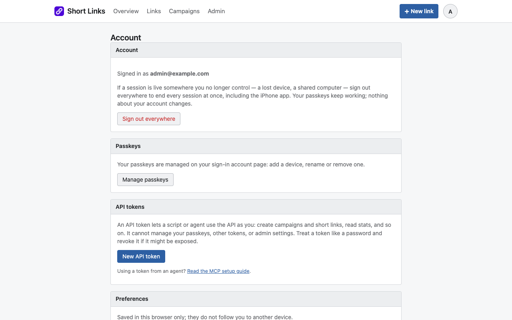
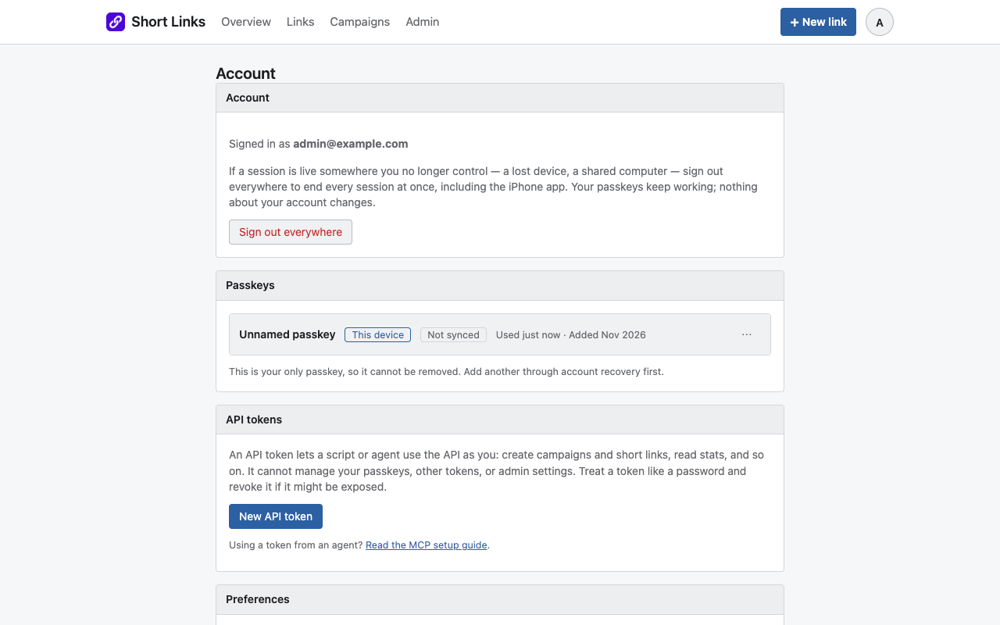
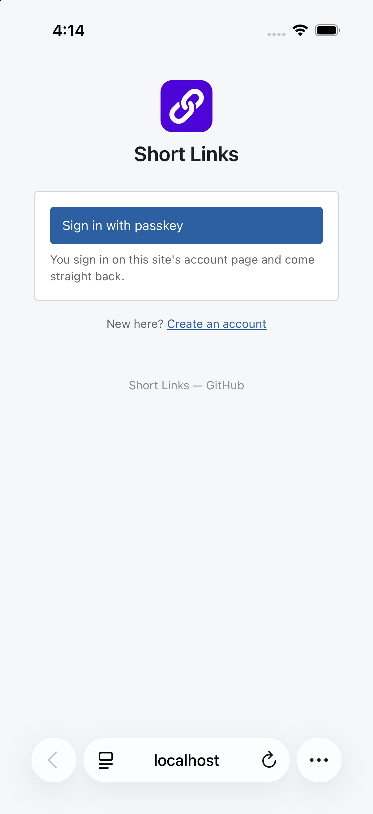

# 0133 — Move the SPA to Portiko's redirect-based sign-in and drop its passkey screens

| | |
|---|---|
| **Status** | in-progress |
| **Module** | web |
| **Platform** | All |
| **Phase** | 14 — Sign in through Portiko |
| **First seen** | 2026-11-12 |

## Description

With Portiko on, the SPA no longer runs passkey ceremonies itself. Signing in becomes a full-page redirect to `/auth/portiko/login?return=<hash route>`. `RegisterVerify.svelte` and `RecoverVerify.svelte`, and the WebAuthn helpers in `web/src/lib/webauthn.ts`, are no longer used. The Account page's passkey section links to Portiko's passkey management (#0137).

## Long Description

**Changes:**
- **`App.svelte` sign-in guard:** a signed-out deep link (e.g. `/#/campaigns/x`) sends the browser to the Portiko login with the hash route as its return target, and lands back on that route after sign-in. Confirm that the `rp` library's `returnTo` (`localPath` in `rp/client.go`) keeps a `#…` fragment, or carry the fragment through the server some other way.
- **`Login.svelte`** shrinks to a "Sign in with passkey" button, or a redirect. The sign-up option shows or hides on `registrations_enabled` as #0125 does today, and sends people to Portiko's registration.
- **#0125 home page:** its small **Sign in** link points at the Portiko login.
- **Account page:** passkey list, rename and revoke are replaced by "Manage passkeys" → Portiko's account page. API tokens stay as they are.
- **Sign out** posts to `/auth/logout`, which now ends the session at Portiko too.
- The runtime decides between old and new flows from `/api/public/home` (add a `portiko: true` field) or a build-free equivalent, so one SPA build works with the switch either on or off until #0136 removes the old flows.

## Notes

- Vitest coverage for the guard's return-target encoding and for the sign-up visibility rule.
- Delete the unused views and `webauthn.ts` in #0136, not here. They're still needed while some instances have Portiko off.
- **Passkey management link (from #0137):** "Manage passkeys" links to `BASE_URL + "/id/passkeys"`, which redirects to the default account's page (`/id/u/{n}/passkeys`) or to sign-in first.
- Portiko's last-passkey error code is `cannot_revoke_last_passkey` (ShortLinks used `cannot_revoke_last_credential`). Its rename and revoke POSTs require an explicit `account`. Neither matters while the SPA only links to the page.
- Renaming a passkey in Portiko sends no WebAuthn signal, because WebAuthn has none per credential. The name shown in the password manager won't change; only Portiko's label does.
- **Passkey restyle (from #0170):** #0170 did NOT restyle the Account passkey list (one line per passkey, "This device", synced/backed-up in words, drop "Sign count"), because this issue replaces those screens. The current API also exposes no backup flag or current-session credential, so that restyle needs Portiko data or a backend change. #0170 only did the token and preference parts.

## Relation

- Parent: [#0126](0126.md)
- Blocked by: [#0132](0132.md), [#0137](0137.md)
- Related: [#0125](0125.md), [#0086](0086.md)

## Root cause

The SPA only knew the passkey flows. With `PORTIKO_ENABLED` (#0132) the old `/auth/login/*` routes answer 404 and `POST /auth/logout` answers 302, so every sign-in and sign-out path in the SPA broke, and nothing told the SPA which mode the server was in.

## Fix

One SPA build serves both modes. `GET /api/public/home` gained a `portiko` boolean (`HomeHandler.WithPortiko`, set from `PORTIKO_ENABLED`, and from `DEV_PORTIKO` in dev mode; OpenAPI schema updated).

- `lib/portiko.ts` (new, tested): `returnToFromHash` / `portikoLoginURL` encode the hash route as `return_to=/#/route?query` (rp's `localPath` keeps the fragment; confirmed end to end), `prompt=create` for sign-up, a sessionStorage loop guard, and `portikoSignOut` (a real form POST so the browser follows the 302).
- `lib/authMode.ts`: `portikoMode` store, filled from the home info App already fetched (now on every signed-out cold load, not only at the root) or memoised on demand for signed-in views.
- `App.svelte`: a signed-out deep link in Portiko mode does `location.replace` to `/auth/portiko/login?return_to=...` and stays on the loading screen. The root and `/login` show the card instead (so sign-out does not bounce straight back), as does a redirect repeated within 15 s.
- `views/Login.svelte` is now a gate: `PortikoLogin.svelte` (button, and "Create an account" when `registrations_enabled`, via `prompt=create`) or `PasskeyLogin.svelte` (the old screen, moved unchanged with `git mv`).
- Home page and public home "Sign in"/"Register" link straight to the Portiko login. AppShell sign-out uses `portikoSignOut`. Account replaces the passkey list with "Manage passkeys" -> `/id/passkeys`; API tokens and "Sign out everywhere" are unchanged.
- Not deleted (#0136): `RegisterVerify`, `RecoverVerify`, `webauthn.ts`, the passkey screens.

## Verification

`cd web && npm ci && npm run check && npm test && npm run build`: 0 errors, 44 files / 865 tests pass (new `portiko.test.ts`: return-target encoding incl. query, `/login?redirect=`, open-redirect refusal, sign-up rule vs `registerOptionVisible`, loop guard). `go build ./... && go vet ./...` clean; `go test ./internal/handlers ./cmd/...` pass, including the pinned key set of `/api/public/home` (now with `portiko`) and `TestHomeHandler_PortikoFlag`.

End to end on a fresh Postgres DB `shortlinks_0133` (migrated to 28, dropped after), binary built with the SPA embedded, Playwright with a CDP virtual authenticator:

- Portiko off: registered the admin through the real ceremony (link from the NoOp mailer log); `portiko:false`; deep link `/#/campaigns` -> `/#/login?redirect=%2Fcampaigns`, passkey sign-in works, Account still lists the passkey with its rename/remove menu (`off-*.png`).
- Portiko on (`PORTIKO_ENABLED`, test crypto key): `portiko-import` -> 1 account, 1 credential imported, subject recorded. Signed-out `/` shows the card with Create an account. Deep link `/#/campaigns` -> `/id/signin?...` -> "Use a passkey" -> back on `/#/campaigns`, `/api/me` 200. Same with `/#/campaigns?range=7` (query kept). Account shows Manage passkeys -> `/id/u/0/passkeys`. Sign out -> `/` -> card, `/api/me` 401.
- Screenshots at 1280 and 390, light and dark: `on-login-*`, `on-account-*`, `on-signed-out-*`, `off-login-*`, `off-account-*`, plus `on-provider-signin-1280.png`, `on-landed-1280.png`, `on-manage-passkeys-1280.png`; no horizontal scroll reported. Simulator: `sim-login.png`.

   

Not exercised: `DEV_PORTIKO` dev mode in a browser (same `/auth/portiko/login?return_to=` URL; the flag is reported there too) and a brand-new registration through Portiko's UI.

## Files changed

- `internal/handlers/home.go`, `home_test.go`; `internal/openapi/openapi.yaml`; `cmd/shortlinks/main.go`
- `web/src/lib/portiko.ts`, `portiko.test.ts`, `authMode.ts`, `home.ts`, `AppShell.svelte`, `PublicHome.svelte`
- `web/src/App.svelte`, `views/Login.svelte` (gate), `views/PasskeyLogin.svelte` (moved), `views/PortikoLogin.svelte`, `views/Home.svelte`, `views/Account.svelte`
- `issues/0133.md`, `issues/0133/*.png`

## Review round 1

Review asked for changes; done in new commits on this branch.

- **Login gate:** `Login.svelte` now calls `loadPortikoMode()` on mount and shows "Loading…" while the mode is null, so a mid-session 401 can never show the passkey screen on a Portiko instance (a failed fetch falls back to the passkey screen). `loginGate.test.ts` covers loading -> Portiko card, passkey mode, fetch failure, known mode with no refetch, and the loop-guard clear. Playwright repro (`on-401-loading-1280.png`, `on-401-resolved-1280.png`): signed in, cold reload with `/api/public/home` held back, cookies cleared, SPA navigation to `/#/campaigns` -> screens seen were Loading then the Portiko card, never the passkey form (`#login-email` count 0). AppShell now also asks for the mode on mount, so signed-in pages know it early.
- **Dev stand-in logout:** with `DEV_PORTIKO`, `POST /auth/logout` deletes the dev session, clears the cookie and answers 302 to `/`; a GET passes through. `TestDevPortikoLogout` covers it.
- **Home info reused:** `authMode.lastHomeInfo` holds the answer App fetched; `PortikoLogin` and `PasskeyLogin` use it and fetch only when it is absent.
- **Parallel work:** Account runs the mode fetch and the passkey list together (the list result is ignored in Portiko mode). AppShell warms the mode on mount so Sign out does not wait.
- **Loop guard** is cleared after a successful `getMe` (checked: key is null after landing back).
- **Guard fallback keeps the query:** when the guard declines the redirect, the card's return target is the full route with its query (`/login?redirect=%2Fcampaigns%3Frange%3D7`).

Re-verified: `npm run check` 0 errors, `npm test` 45 files / 871 tests, `npm run build`, `go vet`, `go test ./cmd/... ./internal/handlers`. Playwright on a fresh DB (dropped after): Portiko off (register, deep link to `/#/login?redirect=`, passkey sign-in, Account passkey list unchanged), Portiko on (import, sign-in through `/id`, query kept, Manage passkeys, sign-out, 401 repro above).
