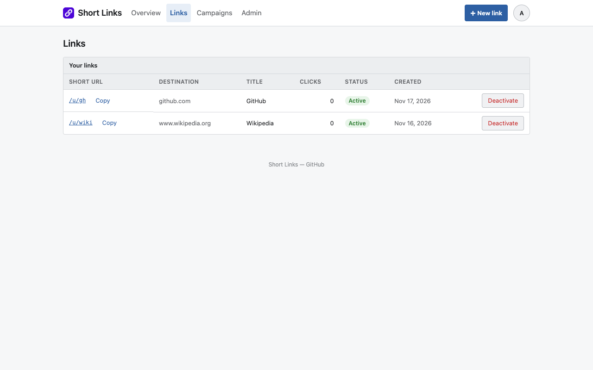
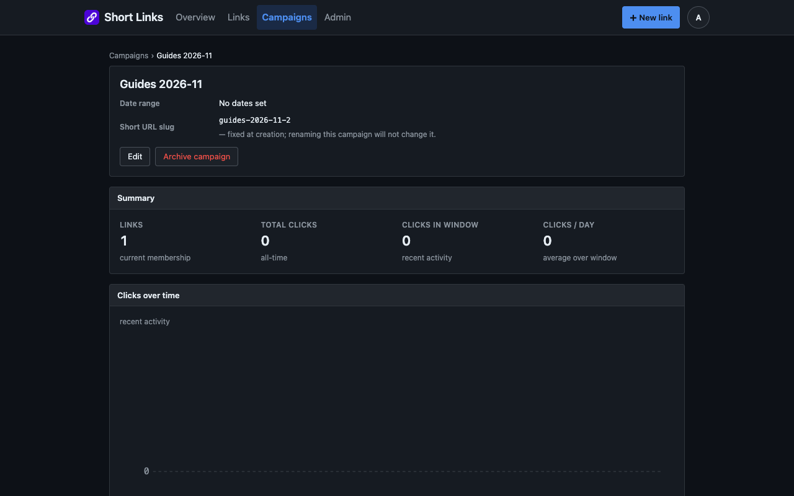
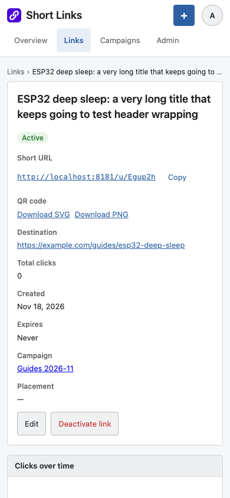
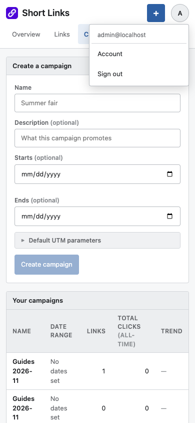
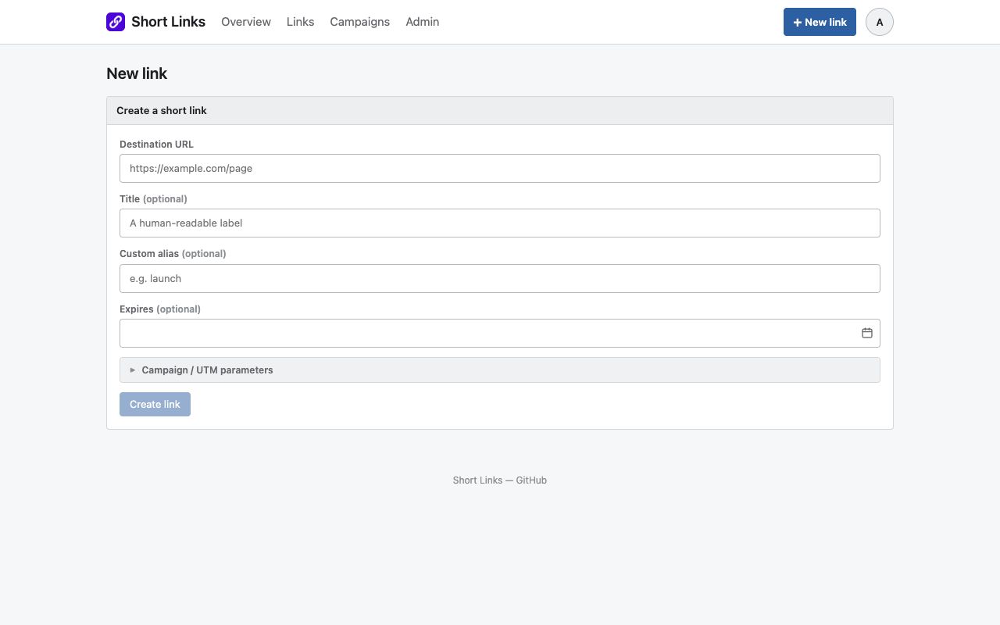
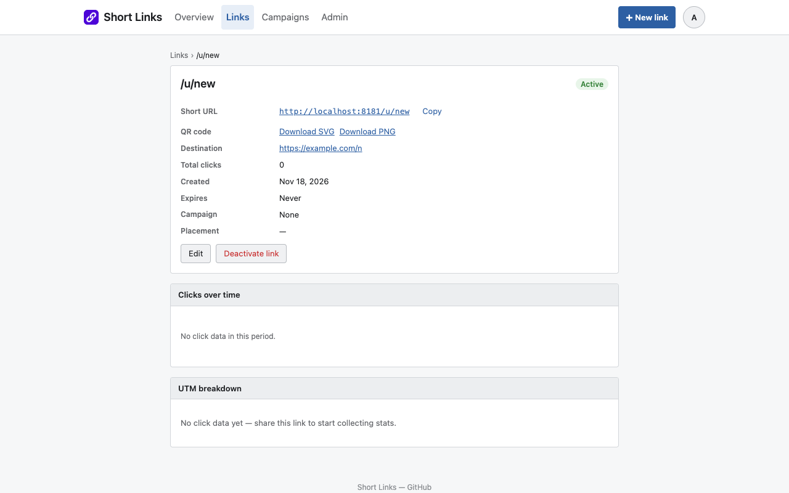
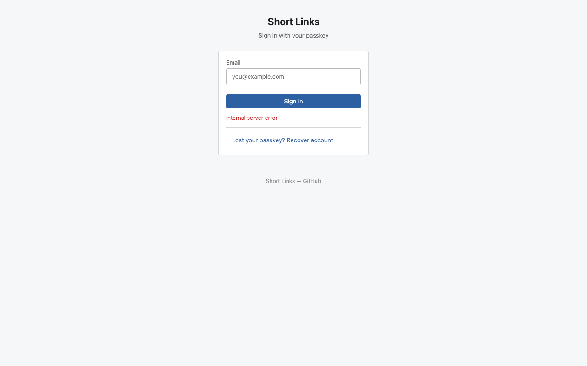
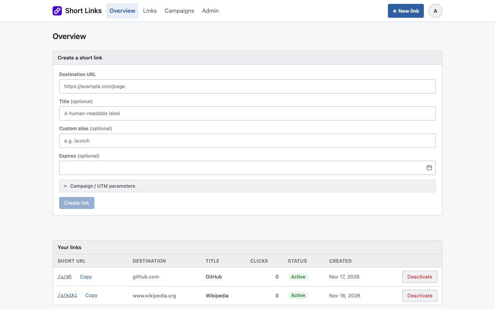
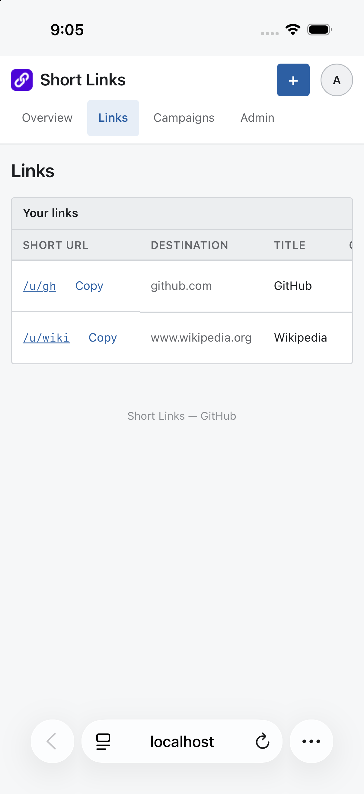

# 0153 — The header and nav are copy-pasted into four views, detail pages have no nav, and there is no Links page or New link button

| | |
|---|---|
| **Status** | resolved |
| **Module** | web |
| **Platform** | All |
| **Phase** | 17 — UI redesign foundations |
| **First seen** | 2026-11-18 |
| **Closed** | 2026-11-18 |
| **Commit** | 7446963 |

## Description

Header and nav tabs are duplicated in `Dashboard.svelte:357-362`, `CampaignsList.svelte:156-163`, `Account.svelte:194-199` and `Admin.svelte:469-473`, each with its own `handleSignOut`. LinkDetail and CampaignDetail drop the nav and show a generic "Link detail" heading. Add one `AppShell` and the new routes.

## Long Description

See [docs/ui-redesign.md](../docs/ui-redesign.md) §3.1.

- `lib/AppShell.svelte`, rendered by `App.svelte` around `<Router />` for signed-in routes. It holds the brand, tabs (Overview, Links, Campaigns, Admin for admins), a **+ New link** button and an avatar menu (Account, Sign out).
- Routes: `#/` (temporarily the existing Dashboard until #0162), `#/links` (the link list moved out of Dashboard), `#/links/:key`, `#/new` (the create form, until #0158 turns it into a dialog), `#/campaigns`, `#/campaigns/:slug`, `#/account`. Use `/new`, not `/links/new`, because `new` is a legal custom key.
- Detail pages keep the nav, show a breadcrumb (`Campaigns › Guides 2026-11`) and use the item's own name as `<h1>`.
- Keyboard: `n` opens New link when focus isn't in a text field.
- Phone width: row 1 is brand, + and menu; row 2 is a horizontally scrolling tab strip.
- Remove the per-view headers and sign-out handlers.

## Acceptance criteria

- Routing tests in `lib/routing.test.ts` cover the new routes, including a link whose key is `new`.
- Checked in the running app via `scripts/dev.sh` (:5173) and `scripts/sim.sh` (iOS Simulator), in light and dark, at desktop width and about 400px, with screenshots attached to the issue folder.
- `cd web && npm test && npm run build` passes.

## Relation

- Part of: [#0152](0152.md)
- Blocks: [#0154](0154.md), [#0156](0156.md), [#0158](0158.md), [#0162](0162.md)

## Root cause

Each top-level view rendered its own `<header class="app-header">` with a hand-copied tab list and `handleSignOut`; the two detail views rendered a different bare header ("Link detail" / "Campaign detail"). There was no shared layout component, no `/links` or `/new` route (the list and the create form were two halves of `Dashboard.svelte`), and nothing to hang a global "New link" action or shortcut on.

## Fix

- `lib/AppShell.svelte` (new), rendered by `App.svelte` around `<Router />` for every signed-in route except `/login`: brand, tabs (Overview, Links, Campaigns, Admin for admins), a **+ New link** button, an avatar menu (Account, Sign out; closes on outside click and Escape) and the single sign-out handler. Below 600px, row 1 is brand, + and avatar, and row 2 is a horizontally scrolling tab strip. The `n` key goes to `#/new` unless focus is in an input, textarea, select or contenteditable (`lib/shell.ts`, unit-tested).
- Routes: `#/` (still the old Dashboard, now a thin view that stacks the two new views until #0162), `#/links` (`views/LinksList.svelte`, the list and SSE moved out of Dashboard), `#/new` (`views/NewLink.svelte`, the create form), `#/links/:key`, `#/campaigns`, `#/campaigns/:slug`, `#/account`, `#/admin`. `#/links/new` stays the detail page of a link keyed `new`.
- Detail pages keep the nav and show `lib/Breadcrumb.svelte` (`Campaigns › Guides 2026-11`, `Links › <title>`), with the item's own name as `<h1>`. The link detail's campaign is now a link to the campaign.
- Removed the per-view headers, the `Dashboard`/`Campaigns`/`Account`/`Admin` nav copies, their `handleSignOut` functions and the now-unused imports.

## Verification

- `cd web && npm run check`: `COMPLETED 211 FILES 0 ERRORS 0 WARNINGS`.
- `cd web && npm test`: `Test Files 14 passed (14)`, `Tests 457 passed (457)`. New cases: the `app route table (#0153)` block in `lib/routing.test.ts` (`/links`, `/links/:key`, `/new`, `/links/new` resolving to the detail with `key: 'new'`, campaigns, account) and `lib/shell.test.ts` (tabs, avatar initial, `n` shortcut guard).
- `cd web && npm run build`: `built in 2.80s`. `web/dist/index.html` restored to the placeholder afterwards.
- No Go files changed.
- Ran the app (Go on :8181 with `STORAGE=json`, Vite on :5181 with a temporary config because `dev.sh` hardcodes 5173/8080; both stopped) and drove it with Playwright at 1280px and 390px, light and dark. Console checks: press `n` on `#/links` goes to `#/new`; typing `nnn` into the destination field stays on `#/new`; avatar menu then Account goes to `#/account`; the Links tab becomes `.active`; Sign out goes to `#/login`. No horizontal page overflow on any route at 390px except `#/` and `#/links`, which is the existing 7-column table (replaced in #0154).
- The iOS Simulator (`scripts/sim.sh`) was not run; 390px Chromium stands in for it.

Desktop links list, light:

Campaign detail with breadcrumb and own-name h1, 1280px dark:

Link detail at phone width, with the scrolling tab strip and + button on row 1:

Avatar menu, phone width:

New link route and a link keyed `new`:

## Files changed

- `web/src/lib/AppShell.svelte`, `web/src/lib/Breadcrumb.svelte`, `web/src/lib/shell.ts`, `web/src/lib/shell.test.ts` (new)
- `web/src/views/LinksList.svelte`, `web/src/views/NewLink.svelte` (new, split from Dashboard)
- `web/src/views/Dashboard.svelte` (reduced to a temporary composition of the two)
- `web/src/App.svelte` (routes, shell wrapper), `web/src/lib/routing.test.ts`, `web/src/app.css` (`.text-link`)
- `web/src/views/Account.svelte`, `Admin.svelte`, `CampaignsList.svelte`, `NotFound.svelte` (header and sign-out removed)
- `web/src/views/LinkDetail.svelte`, `CampaignDetail.svelte` (breadcrumb, `<h1>`)
- `issues/0153/*.png`

## Review round 1

Changes after review, all on this branch:

- Renamed the shell's global `.brand` class to `.shell-brand`; it had leaked onto the signed-out `<header class="brand">` titles in Login, Home, RegisterVerify and RecoverVerify. Signed-out Login and Home now render as before (computed header style `display: block`, `white-space: normal`):  
- Every page has an `<h1 class="page-title">` (20px, `app.css`): Overview, Links, New link, Campaigns, Account, Admin, Page not found. `NewLink` and `LinksList` take a `showTitle` prop so the temporary Dashboard shows only one `<h1>`. Checked in the running app: each route reports exactly one `h1`. 
- The avatar menu is now a disclosure: no `role=menu`/`menuitem`, `aria-expanded` plus `aria-controls`, and Escape closes it and returns focus to the avatar button (checked: `aria-expanded` goes `true` then `false`, focus is on the avatar).
- Removed dead CSS from `app.css` (`.app-header`, `.app-title`, `.nav-tabs`, the 480px `.nav-tabs` block and the 480px header block) and rewrote the stale `.nav-tab` comment; removed the stale comment in `Account.svelte`.
- `n` shortcut ignores key auto-repeat and does nothing while a `dialog[open]` or `aria-modal` element exists.
- The 600px breakpoint choice is recorded in `docs/ui-redesign.md` section 3.1.
- `.text-link` now matches the Destination link (accent colour, underlined).
- Ran `scripts/sim.sh "http://localhost:5181/#/links" "iPhone 17" issues/0153/sim-links.png` (Vite and Go as before, both stopped afterwards). It booted and captured the iPhone 17 Safari screenshot: two-row header with + and avatar on row 1 and the tab strip on row 2. 
- Re-ran `npm run check` (0 errors, 0 warnings), `npm test` (457 passed) and `npm run build` (built in 3.20s); `web/dist/index.html` restored to the placeholder.

## Work log

| Date | Model | Input | Output | Cache read | Cache write | Cost |
|---|---|---|---|---|---|---|
| 2026-11-18 | claude-sonnet-5-5 | 130 | 55,686 | 7,845,064 | 178,428 | $1.79 |
| 2026-11-18 | claude-opus-5-5 | 40 | 8,351 | 1,110,323 | 67,797 | $0.73 |

**Total: $2.52**
