# 0154 — Admin sections are component state, so "Admin › Audit log" can't be linked to or reloaded

| | |
|---|---|
| **Status** | closed |
| **Module** | web |
| **Platform** | All |
| **Phase** | 17 — UI redesign foundations |
| **First seen** | 2026-11-18 |
| **Closed** | 2026-11-18 |
| **Commit** | b0aa7d5 |

## Description

`views/Admin.svelte:482-513` switches sections with local state. Give each section a route (`#/admin/settings`, `#/admin/filters`, `#/admin/users`, `#/admin/audit`) with a side nav on desktop and a select on phones.

## Long Description

See [docs/ui-redesign.md](../docs/ui-redesign.md) §3.9. `#/admin` redirects to `#/admin/settings`. Non-admins hitting any admin route see the existing not-permitted state.

## Acceptance criteria

- Routing tests cover each section and the redirect.
- Checked in the running app via `scripts/dev.sh` (:5173) and `scripts/sim.sh` (iOS Simulator), in light and dark, at desktop width and about 400px, with screenshots attached to the issue folder.
- `cd web && npm test && npm run build` passes.

## Relation

- Part of: [#0152](0152.md)
- Blocked by: [#0153](0153.md)
- Blocks: [#0171](0171.md)

## Root cause

`Admin.svelte` kept the active section in a local `$state` and drew the sub-tabs as buttons, so the URL was always `#/admin` and a section could be neither linked nor reloaded.

## Fix

- `App.svelte`: added `/admin/:section` beside `/admin`.
- `lib/admin.ts`: `ADMIN_SECTIONS`, `adminSectionPath`, `parseAdminSection`, `adminRouteAction` (redirect, show or not-found).
- `views/Admin.svelte`: takes a `section` prop. A bare `#/admin` does `replace('/admin/settings')`. An unknown section renders the NotFound view. Section nav is a left rail of `Link`s on desktop and a `<select>` at 720px and below. The non-admin "no access" panel is unchanged and applies to every admin route.
- Routing tests in `lib/admin.test.ts` for each section, the redirect, an unknown section and a too-deep path.

## Verification

- `cd web && npm run check`: `COMPLETED 211 FILES 0 ERRORS 0 WARNINGS`
- `npm test`: `Test Files 14 passed (14)`, `Tests 465 passed (465)` (8 new)
- `npm run build`: built OK. `web/dist/index.html` restored to the placeholder.
- Ran Go (`STORAGE=json`, :8184) and Vite (:5184, a temporary config because `dev.sh` hardcodes 5173 and kills it), both stopped afterwards. Playwright at 1280 and 390 px, light and dark: `#/admin` goes to `#/admin/settings`; a reload on each of the four section URLs stays on it; there is no horizontal overflow; clicking "Users" in the rail goes to `#/admin/users`; the select at 390 px goes to `#/admin/filters`; `#/admin/bogus` shows "Page not found".
- Not checked: a non-admin session, since dev auto-login is always admin. That branch is unchanged code.
- iOS Simulator (`scripts/sim.sh`): its first capture came out blank and a later one showed another implementer's app on the shared Safari. I re-opened the URL with `simctl openurl` and captured again.

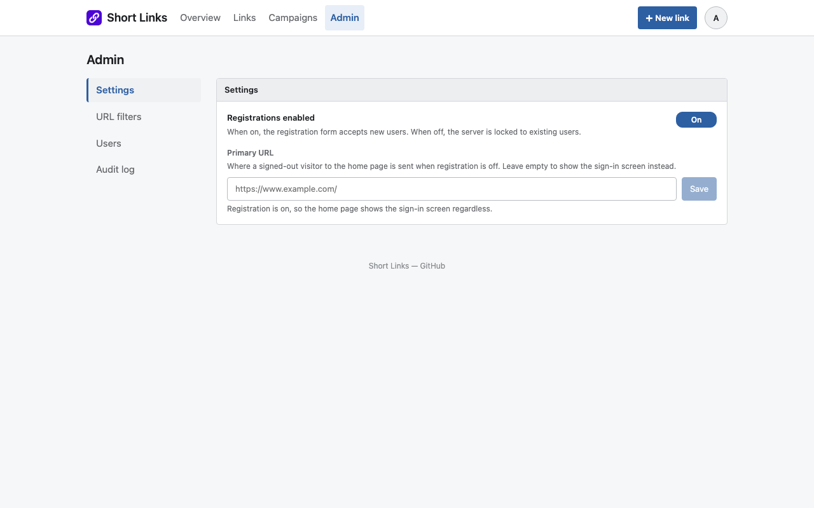
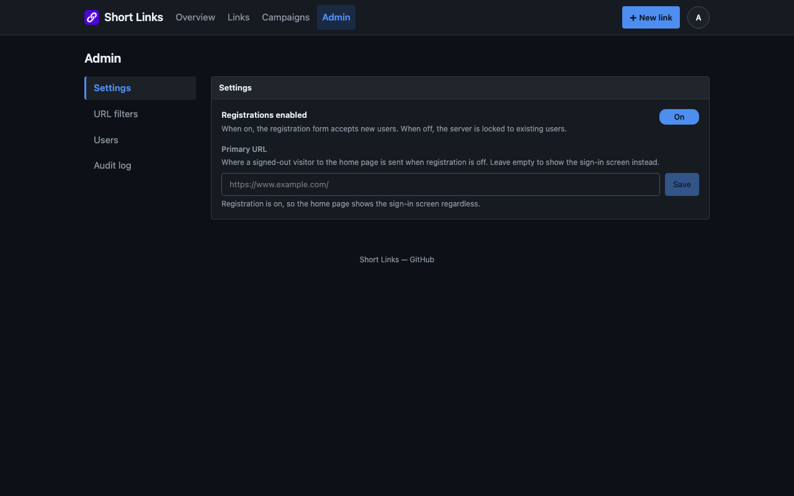
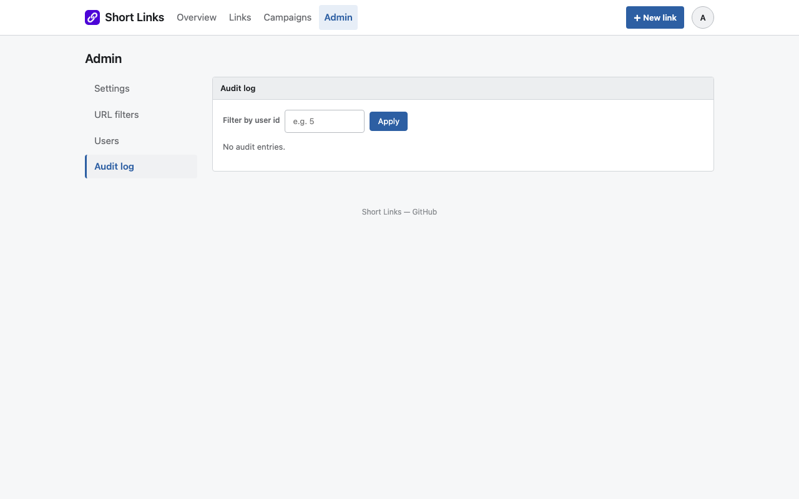
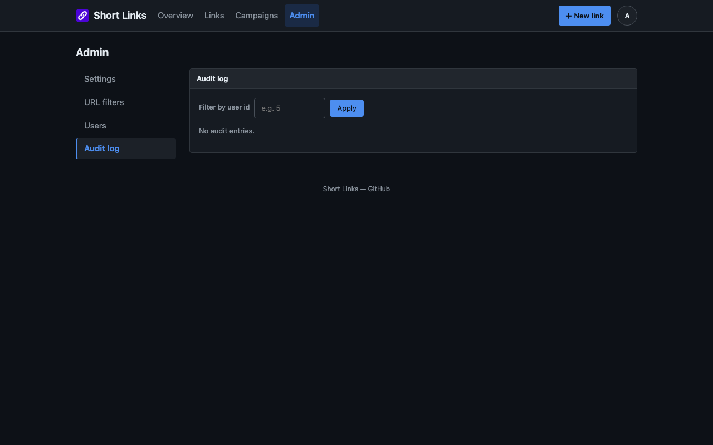
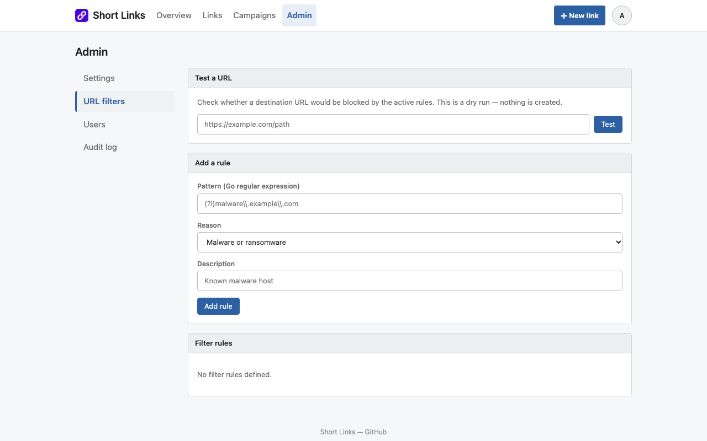
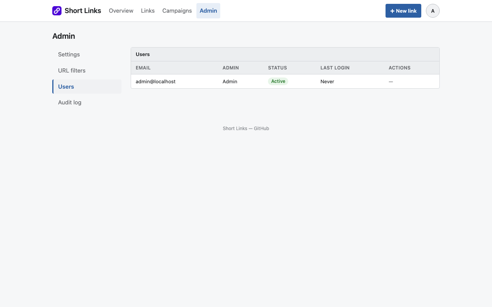
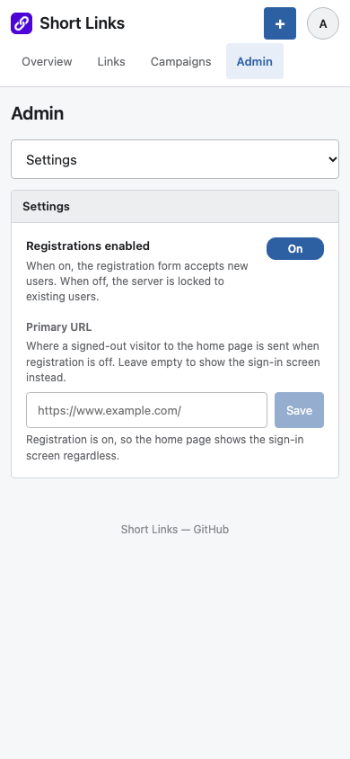
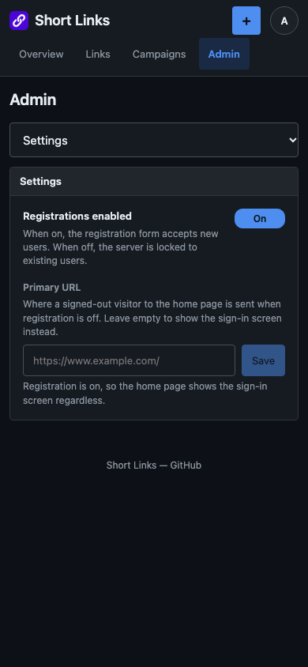
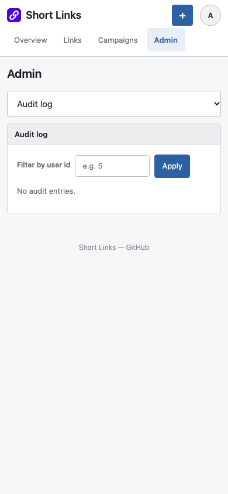
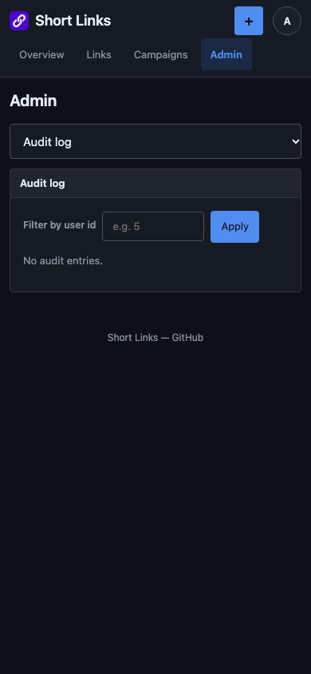
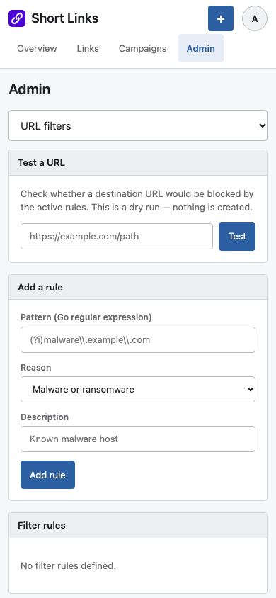
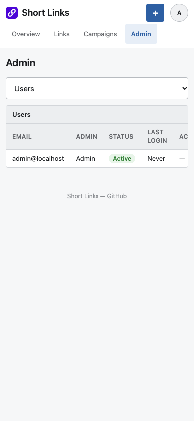
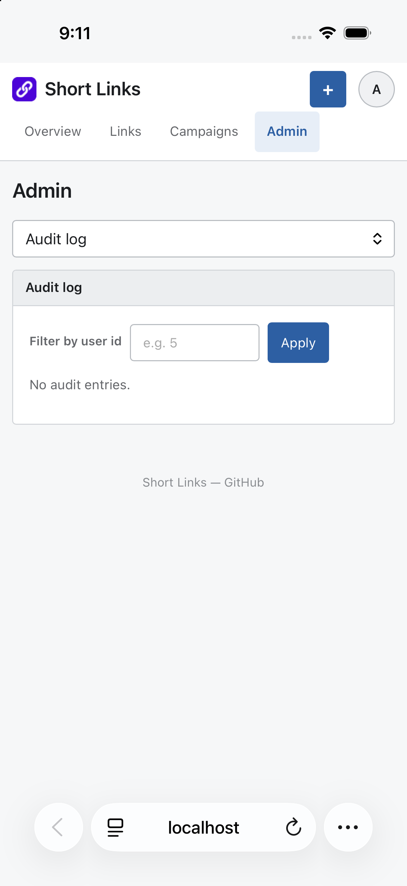

## Files changed

- `web/src/App.svelte`
- `web/src/lib/admin.ts`
- `web/src/lib/admin.test.ts`
- `web/src/views/Admin.svelte`
- `issues/0154.md`, `issues/0154/*.png`

## Work log

| Date | Model | Input | Output | Cache read | Cache write | Cost |
|---|---|---|---|---|---|---|
| 2026-11-18 | claude-sonnet-5-5 | 86 | 21,569 | 2,978,824 | 85,609 | $0.73 |
| 2026-11-18 | claude-opus-5-5 | 22 | 4,768 | 474,672 | 43,484 | $0.41 |

**Total: $1.14**
