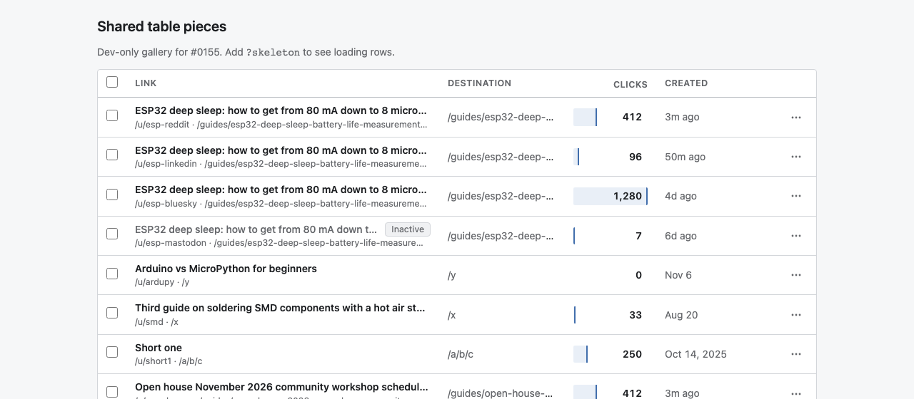
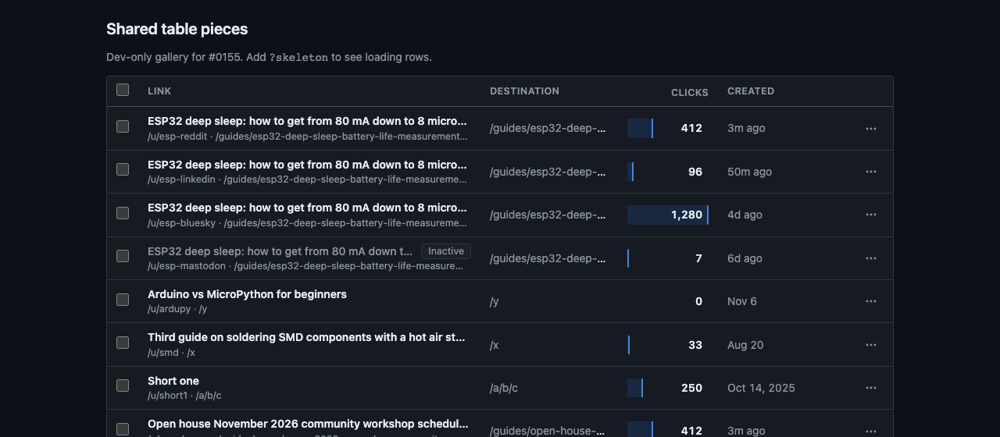
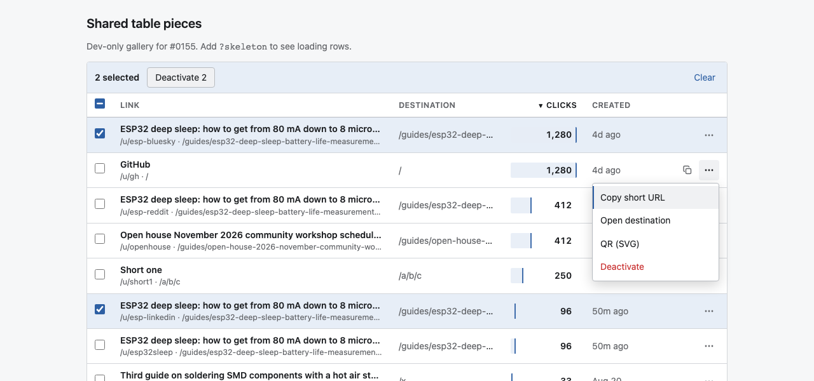
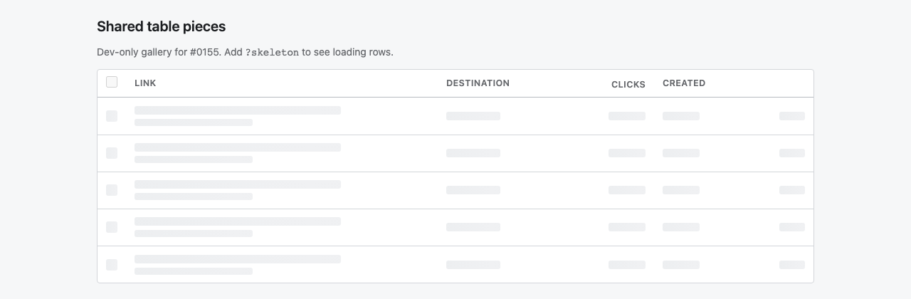
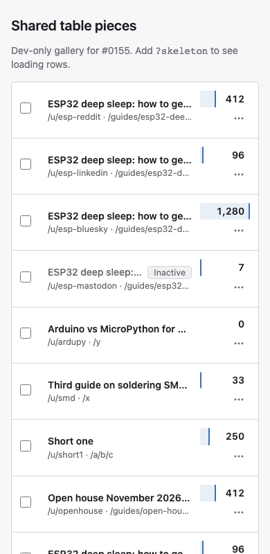
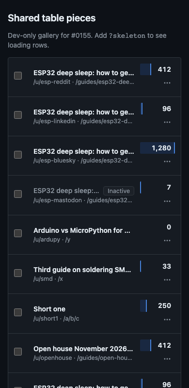
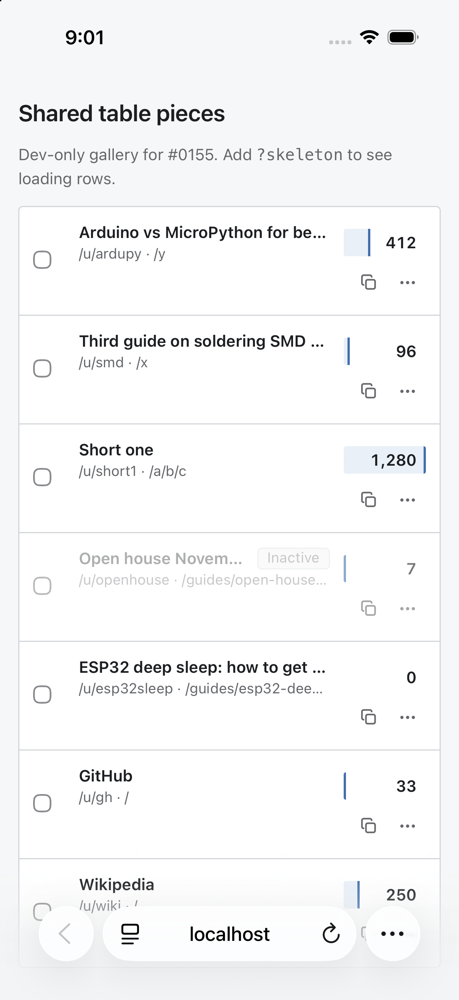
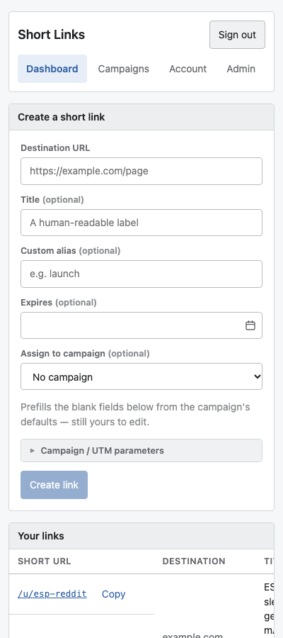
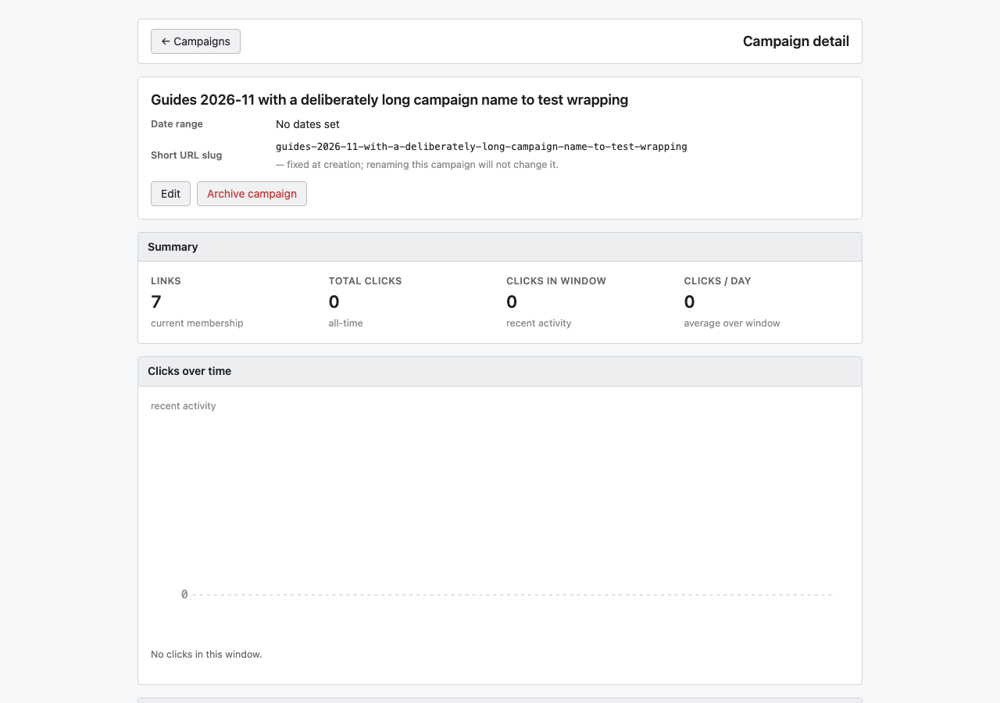
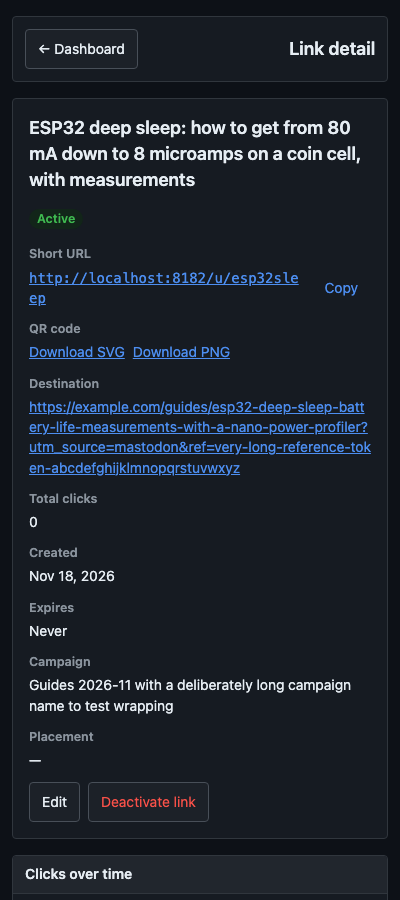

# 0155 — Every table invents its own layout and truncation, with base text at 13px and dates that wrap

| | |
|---|---|
| **Status** | in-progress |
| **Module** | web |
| **Platform** | All |
| **Phase** | 17 — UI redesign foundations |
| **First seen** | 2026-11-18 |

## Description

Tables are styled by global element selectors (`app.css:316-342`) with no column priority or truncation rules, so each view fights overflow with its own CSS (about 250 lines of it in CampaignDetail). Build the shared table pieces and type scale the rest of the redesign uses.

## Long Description

See [docs/ui-redesign.md](../docs/ui-redesign.md) §2 (principles 2–6, 8, 9, 11, 12, 15).

- `lib/DataTable.svelte`: `table-layout: fixed` with a `<colgroup>`, sortable headers, optional row selection with a bulk-action bar slot, and skeleton rows while loading.
- `lib/TwoLineCell.svelte`: line 1 is the title (600 weight, one line, ellipsis, full text in `title`); line 2 is muted metadata.
- `lib/RowMenu.svelte`: the ⋯ menu, keyboard accessible (arrow keys, Escape), and a hover copy icon.
- `lib/InlineBar.svelte`: a right-aligned tabular number with a bar scaled to the column maximum.
- `lib/RelativeDate.svelte`: shows "3d ago" for dates under 7 days old and an absolute date otherwise, never wraps, with the absolute timestamp in `title`.
- `app.css`: base text 14px, small 12.5px, page title 20px; table headers lose the grey fill and get a bottom border. Status pills show only for abnormal states.
- Phone width (under 900px): DataTable renders rows as cards (title, meta line, metric, ⋯). The full card treatment for every view is #0173.

## Acceptance criteria

- Component tests (Vitest) cover sort, selection, the menu's keyboard behaviour and relative-date thresholds.
- Checked in the running app via `scripts/dev.sh` (:5173) and `scripts/sim.sh` (iOS Simulator), in light and dark, at desktop width and about 400px, with screenshots attached to the issue folder.
- `cd web && npm test && npm run build` passes.

## Relation

- Part of: [#0152](0152.md)
- Blocks: [#0156](0156.md), [#0157](0157.md), [#0166](0166.md), [#0167](0167.md)

## Root cause

Tables were styled by global element selectors with no column-priority or truncation rules, base text was 13px, and there were no shared components, so every view hand-rolled overflow handling.

## Fix

Added shared pieces under `web/src/lib/`:

- `DataTable.svelte`: `table-layout: fixed` plus `<colgroup>`, sortable headers (`aria-sort`), optional selection with a bulk-action bar slot, skeleton rows, empty slot, and card rows under 900px (column `mobile` roles: title, meta, metric, actions).
- `TwoLineCell.svelte` (600-weight one-line ellipsis title with the full text in `title`, muted line 2, optional abnormal-state tag), `RowMenu.svelte` (arrow keys, Home/End, Escape, Tab; hover copy icon, always visible on touch), `InlineBar.svelte`, `RelativeDate.svelte`.
- Pure logic in `dataTable.ts`, `rowMenu.ts` and `relativeDate.ts`.
- `app.css`: base 14px, small 12.5px, `--fs-title` 20px and `.page-title`, header fill removed (bottom border), `.tag` / `.tag-denied` for abnormal states only.
- `vite.config.ts`: `SHORTLINKS_API` env overrides the proxy target; jsdom component tests (devDependencies `jsdom`, `@testing-library/svelte`).
- Dev-only gallery `web/table-demo.html` + `src/demo/` (not in the production build) so the components can be seen before any view uses them. `?fake` spreads clicks and dates; `?skeleton` shows loading rows.

## Verification

- `cd web && npm run check`: 0 errors, 0 warnings.
- `npm test`: 16 files, 473 tests pass (31 new: sort, selection, menu keyboard, relative-date thresholds, component behaviour).
- `npm run build`: succeeds (`dist/index.html` placeholder restored, not committed).
- No Go changes.
- Ran Go on :8182 (STORAGE=json) and Vite on :5182 against it, seeded links with long titles and URLs, and viewed the demo page in Playwright (1280px and 390px, light and dark) and in the iOS Simulator (`scripts/sim.sh`). All servers stopped afterwards.

Not done here: no existing view uses the components yet (#0156, #0157, #0166, #0167 adopt them), the full per-view card treatment is #0173, and the global type-scale change was not re-checked view by view.

### Review round 1

- Dimming is now by text colour only (`TwoLineCell`, muted token, no opacity); `DataTable` no longer dims rows or the actions cell.
- `RowMenu` closes on any scroll (capture-phase listener) as well as resize.
- `DataTable` has a `rowLabel` prop ("Select Short one"), prunes `selected` keys for rows no longer present, no longer clips the sort button's focus ring (`th` is not `overflow: hidden`), and in phone cards with no meta column the title spans the actions row.
- 14px check of existing views (Dashboard, Campaigns, CampaignDetail, LinkDetail) at 900, 1280 and 400px, light and dark: `view-<view>-<width>-<scheme>.png`. Probed `documentElement.scrollWidth` vs `clientWidth` for all 24 combinations. Two regressions found and fixed:
  - Dashboard at 400px had root horizontal scroll (scrollWidth 727 vs 400, also 702 at the old 13px). Cause: the `.sr-only` "Actions" header label is absolutely positioned and escaped `.table-scroll`. Fix: `position: relative` on `.table-scroll` and on DataTable's scroller. All 24 combinations now report no horizontal scroll.
  - LinkDetail's Copy button wrapped to "Cop / y" at 400px. Fix: `white-space: nowrap; flex: none` on `Button`.
- Tests: 476 pass (added rowLabel, selection pruning, close-on-scroll).
- Added the demo cleanup note to `issues/0156.md`.

## Files changed

`web/src/app.css`, `web/src/lib/Button.svelte`, `issues/0156.md`, `web/vite.config.ts`, `web/package.json`, `web/package-lock.json`, `web/src/lib/{DataTable,TwoLineCell,RowMenu,InlineBar,RelativeDate}.svelte`, `web/src/lib/{dataTable,rowMenu,relativeDate}.ts`, `web/src/lib/{components,dataTable,relativeDate}.test.ts`, `web/table-demo.html`, `web/src/demo/*`, `issues/0155.md`, `issues/0155/*.png`.
