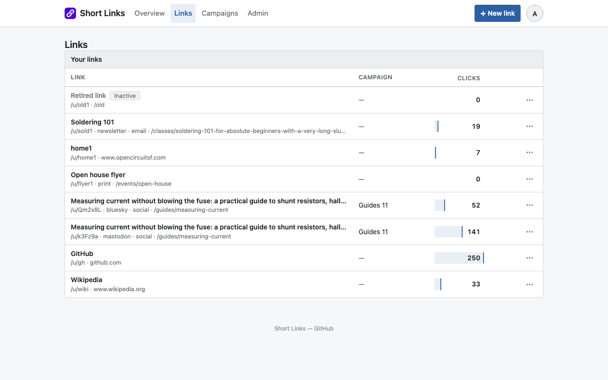
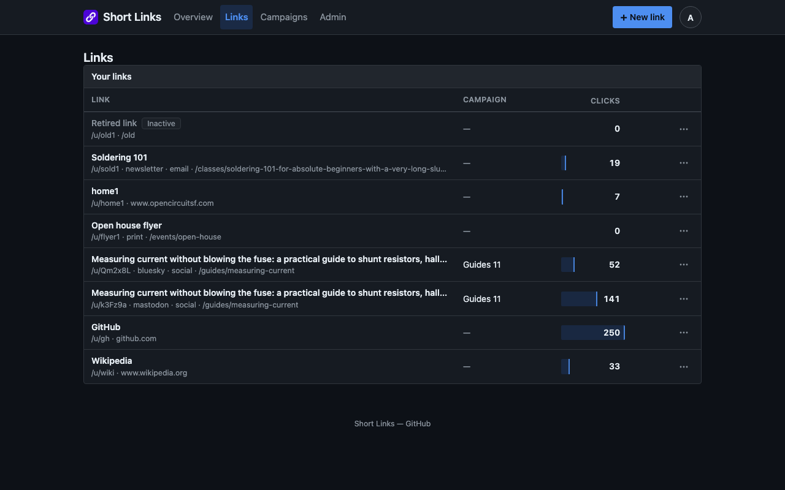
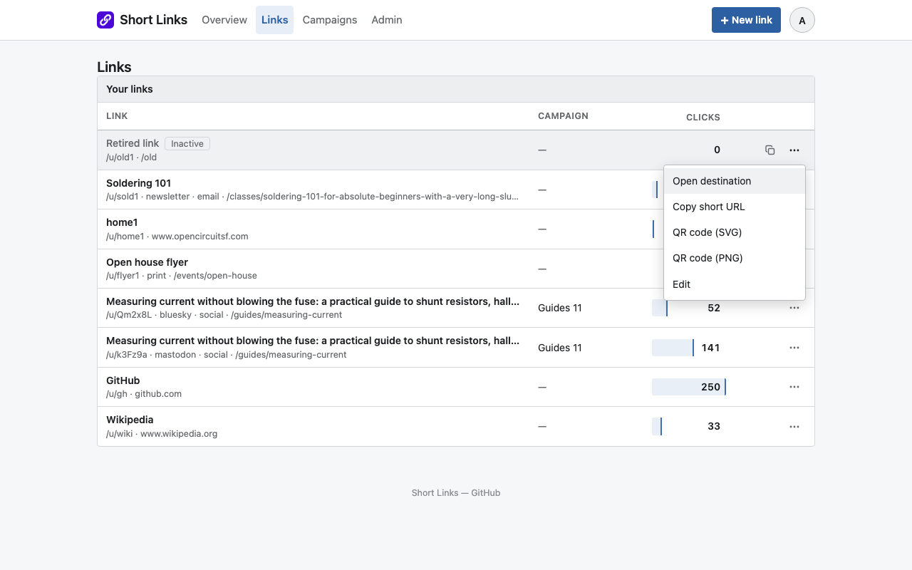
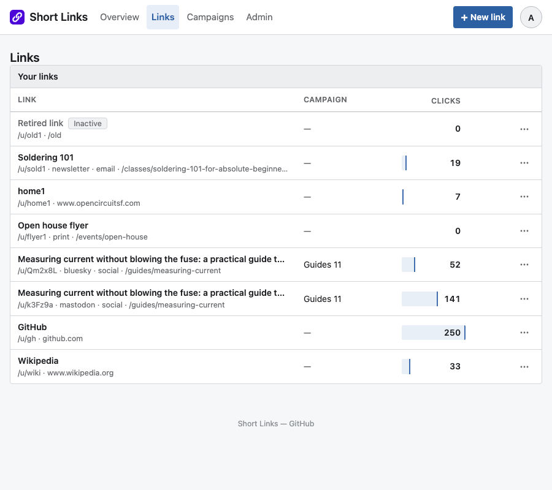
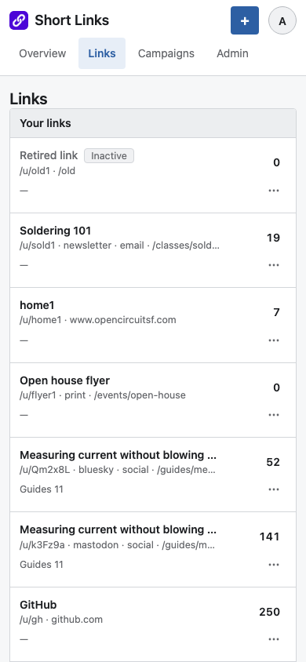
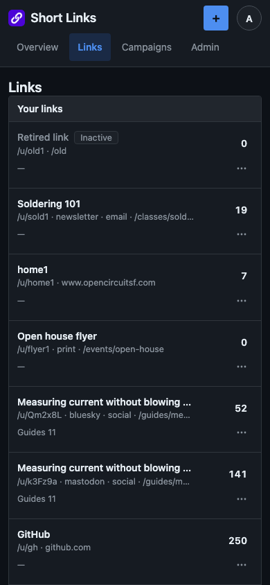
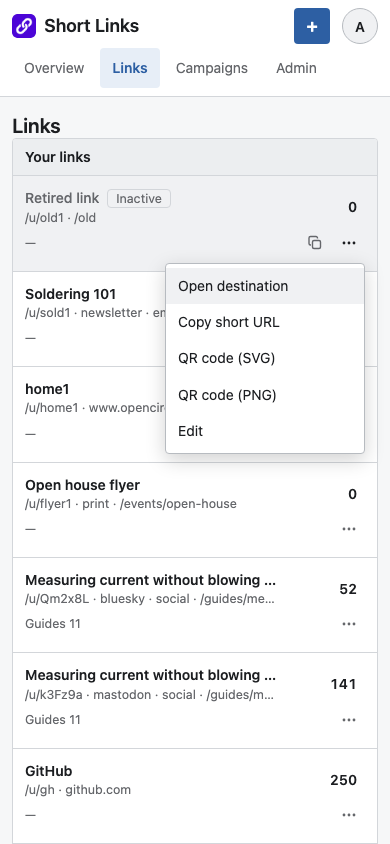
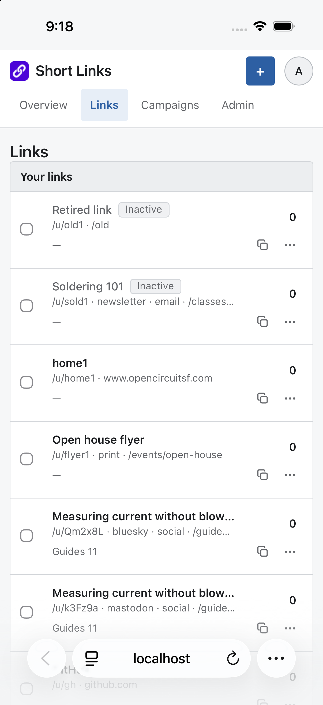

# 0156 — The links list shows the same hostname on every row and wraps titles, with a red Deactivate button on each row

| | |
|---|---|
| **Status** | resolved |
| **Module** | web |
| **Platform** | All |
| **Phase** | 17 — UI redesign foundations |
| **First seen** | 2026-11-18 |
| **Closed** | 2026-11-18 |
| **Commit** | 42d57e5 |

## Description

In Brennan's screenshot of "Your links", Destination is `www.opencircuitsf.com` on every row, Title wraps onto two lines, Status is always a green "Active" pill, Created wraps, and every row has a red **Deactivate** button that fires with no confirmation. Rebuild the list on `#/links` with the shared table pieces.

## Long Description

See [docs/ui-redesign.md](../docs/ui-redesign.md) §3.3.

- Columns: select, Link (two-line: title, then `/u/key` · source chip · channel label · destination *path*), Campaign, Clicks (all time, with InlineBar; the 30-day column arrives with #0167), ⋯.
- Drop the Destination-hostname, Status and Created columns. Inactive links are dimmed with an "Inactive" tag.
- Only the title links to the detail page; the row is no longer one big click target.
- The ⋯ menu has Open destination, Copy short URL, QR SVG, QR PNG, Edit and Deactivate. Deactivate asks through ConfirmDialog (#0160) until undo lands (#0165).
- Use `label` and `content_key` from #0144 when available; otherwise show the raw title.
- Keep the SSE prepend of newly created links.
- The no-horizontal-scroll invariant from [#0103](0103.md) still holds, down to 900px.

## Acceptance criteria

- Uses only fields the list endpoint already returns, so it doesn't wait on #0144.
- Checked in the running app via `scripts/dev.sh` (:5173) and `scripts/sim.sh` (iOS Simulator), in light and dark, at desktop width and about 400px, with screenshots attached to the issue folder.
- `cd web && npm test && npm run build` passes.

- Delete web/table-demo.html and web/src/demo/ once views adopt DataTable.

## Relation

- Part of: [#0152](0152.md)
- Blocked by: [#0153](0153.md), [#0155](0155.md)
- Supersedes: [#0113](0113.md), [#0114](0114.md) (verify that both symptoms are gone and note it on them; only Brennan closes them)

## Root cause

`LinksList.svelte` was a hand-rolled seven-column table: Destination showed the hostname (identical on every row), Title wrapped, Status was a pill on every row, Created wrapped, and each row had a red Deactivate button that fired immediately. The whole row was a click target.

## Fix

- Rebuilt on #0155's `DataTable`, `TwoLineCell`, `RowMenu` and `InlineBar`. Columns: select, Link (title; second line `/u/key · source · channel · destination path`), Campaign (name looked up through `listCampaigns`, best effort), Clicks (all time, with bar), and a copy + ⋯ menu.
- Destination, Status and Created columns are gone. Inactive and denied links are dimmed and carry a tag; active rows carry none.
- Only the title links to the detail page.
- ⋯ menu: Open destination, Copy short URL, QR code (SVG), QR code (PNG), Edit (opens the detail page), Deactivate (active links only, behind a confirmation).
- Kept pagination and the SSE prepend of new links. Uses only fields the list endpoint already returns.
- New helpers `destinationPath` and `linkMeta` in `lib/links.ts`, with tests in `lib/linkMeta.test.ts`.
- Deleted `web/table-demo.html` and `web/src/demo/`.
- Deactivate uses `window.confirm` for now, because `ConfirmDialog` (#0160) is not on main. Swap it in when #0160 lands.
- #0113 and #0114 symptoms (wrapping titles and dates, constant hostname column, no-scroll) are gone in this view; only Brennan closes them.

## Verification

- `cd web && npm run check` reports 0 errors and 0 warnings. `npm test` reports 18 files and 515 tests passed. `npm run build` succeeded.
- Ran Go in dev mode on :8190 and Vite on :5190, seeded long-title, inactive, campaign and source links, and drove it with Playwright. Root `scrollWidth == clientWidth` at 1280, 900 and 390 (no horizontal scroll).
- Deactivate flow: the confirm dialog showed `Deactivate "Soldering 101"? ...`, and after accepting the row gained an Inactive tag.
- Click counts are faked through a Playwright route, since the dev store records no clicks, so the bars could be seen.
- `scripts/sim.sh` ran in the iOS Simulator.

## Files changed

`web/src/views/LinksList.svelte`, `web/src/lib/links.ts`, `web/src/lib/linkMeta.test.ts`, removed `web/table-demo.html` and `web/src/demo/*`, `issues/0156.md`, `issues/0156/*.png`.

## Follow-up after review

- Follow-up: #0160 swaps window.confirm for ConfirmDialog.
- Merged main (#0158, #0170, #0154, #0159). Pasting a URL opens New link on `#/links` and does nothing on `#/` (checked in Playwright).
- `destinationPath` drops `utm_*` params so line 2 does not repeat source and channel.
- The Clicks header is inset to sit over its numbers (`Column.inset`). On phone cards the InlineBar fill is hidden so the number no longer overlaps it.
- The select column is off until bulk actions exist (#0167).

## Work log

| Date | Model | Input | Output | Cache read | Cache write | Cost |
|---|---|---|---|---|---|---|
| 2026-11-18 | claude-sonnet-5-5 | 112 | 30,867 | 5,150,974 | 114,036 | $1.11 |
| 2026-11-18 | claude-opus-5-5 | 22 | 4,646 | 553,471 | 46,363 | $0.44 |

**Total: $1.55**
