# 0157 — The campaign Links table squeezes 11 columns into 960px, truncating titles to "ESP32-C…" and URLs to "http…"

| | |
|---|---|
| **Status** | resolved |
| **Module** | web |
| **Platform** | All |
| **Phase** | 17 — UI redesign foundations |
| **First seen** | 2026-11-18 |
| **Closed** | 2026-11-18 |
| **Commit** | 64715a6 |

## Description

Brennan's screenshot of `#/campaigns/guides-2026-11`: Title and URL are truncated to about 8 characters, source shows "… stodon", and Created, QR and a red Remove on all 42 rows get the space instead. `CampaignDetail.svelte:774-797` caps title at 95px and URL at 60px (`:1249-1256`) with a right-to-left front ellipsis on source (`:1384-1389`). Cut the table to five columns and group it by content.

## Long Description

See [docs/ui-redesign.md](../docs/ui-redesign.md) §3.6 (Links tab) and the before/after in the artifact.

- Columns: select, Link (two-line: title, then `/u/key` · channel label · path), Channel (`source · medium` in one column), Clicks (InlineBar with the share under it), ⋯. Placement shows as a column only if a link in the campaign has one.
- **Group by content** is on by default (a toggle switches it off). Groups come from `top-content` (#0140) filtered by `campaign=<slug>` over the same window; expanding a group shows its links.
- QR SVG/PNG, Remove from campaign, Open, Copy and Edit move to the ⋯ menu. The bulk bar has Copy URLs, Remove from campaign and Export. Copy all, QR zip and CSV merge into one **Export ▾** button.
- Delete the max-width and RTL workarounds in `CampaignDetail.svelte:1131-1407`.
- A seven-digit click count must not overflow ([#0115](0115.md)).

## Acceptance criteria

- The screenshot's 42-link campaign (or a seeded copy of it) shows full titles at 960px with no horizontal scroll.
- Checked in the running app via `scripts/dev.sh` (:5173) and `scripts/sim.sh` (iOS Simulator), in light and dark, at desktop width and about 400px, with screenshots attached to the issue folder.
- `cd web && npm test && npm run build` passes.

## Relation

- Part of: [#0152](0152.md)
- Blocked by: [#0140](0140.md), [#0155](0155.md)
- Supersedes: [#0115](0115.md) (verify and note; only Brennan closes it)
- Followed by: [#0164](0164.md) (tabs and matrix)

## Root cause

`CampaignDetail.svelte` rendered an 11-column auto-layout table inside a 960px shell. To stop horizontal scroll (#0103) it capped Title at 95px and URL at 60px and truncated Source from the front with `direction: rtl`, so titles read "ESP32-C…" while Created, QR and a red Remove button on every row kept their width. Nothing related links to the content they point at, so one guide shared as three links was three unrelated rows.

## Fix

- The Links panel now uses #0155's `DataTable`, `TwoLineCell`, `RowMenu`, `InlineBar`: select, Link (title, then `/u/key · channel label · /path`), Channel (`source · medium`), Clicks (bar, share under it), ⋯. Placement is a column only if some link has one. Line 1 wraps to two lines at every width via a new `TwoLineCell` `wrapAlways` prop (main's phone-only `wrap` is unchanged).
- Group by content is on by default (`?group=0` in the hash turns it off). Groups come from `GET /api/reports/top-content?campaign=<slug>&from&to&tz=UTC&compare=none&sort=newest&limit=500` over the same window as the stats (`sort=newest` keeps zero-click links in their group; members from other campaigns are dropped). A multi-link group is one expandable row, a lone link is a plain row. Without the report (dev mode) the toggle is hidden and the flat list is shown.
- ⋯ menu: Edit link, Copy short URL, Open destination, QR SVG, QR PNG, Remove from campaign. Bulk bar: Copy URLs, Export (CSV of the selection), Remove from campaign. Toolbar **Export ▾** (new `text` prop on `RowMenu`) merges Copy all, QR zip and CSV. Row and bulk Remove act at once and show #0165's Undo toast (one toast per bulk remove; Undo re-assigns all of them).
- `DataTable` gained `rowSelectable` (group rows have no checkbox) and a phone min-width for the empty selection cell.
- Deleted the max-width / RTL / 10-column stacked-card CSS and the history comments in `CampaignDetail.svelte`. New pure helpers and tests in `lib/campaignLinks.ts`.
- #0115 (seven-figure counts): the Clicks cell measured 120/120 (no overflow) with a 1,234,567-click link. Only Brennan closes #0115.

## Verification

Real Postgres DB `shortlinks_0157` (migrated, then dropped), seeded with a 42-link campaign (14 pieces x 3 channels, 12-char alias, a placement, a 97-character title) plus a campaign with a 1,234,567-click link; session cookie injected in Playwright; Go on :8191, Vite on :5191.

```
cd web && npm run check   -> 0 ERRORS 0 WARNINGS
npm test                  -> Test Files 18 passed, Tests 537 passed
npm run build             -> built
desktop light docScroll=1280/1280 tableScroll=926/926
desktop dark  docScroll=1280/1280 tableScroll=926/926
phone light   docScroll=390/390  tableScroll=364/364
phone dark    docScroll=390/390  tableScroll=364/364
seven-figure Clicks cell: 120/120
```

No Go code changed, so Go tests were not run.

Screenshots: 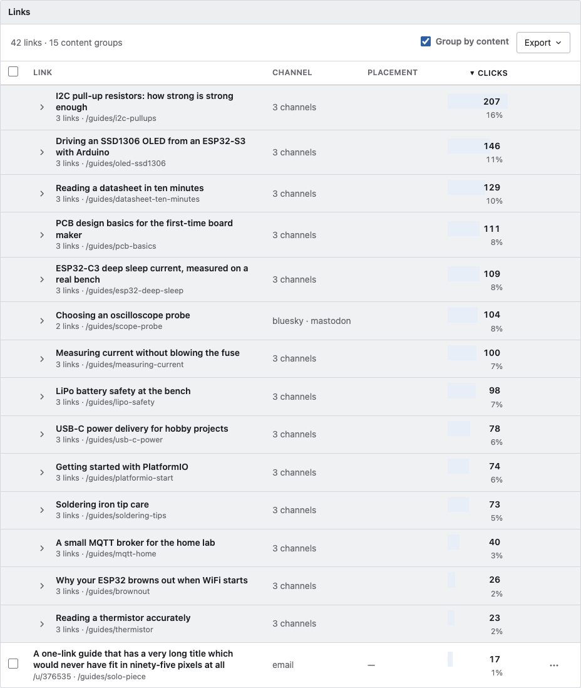 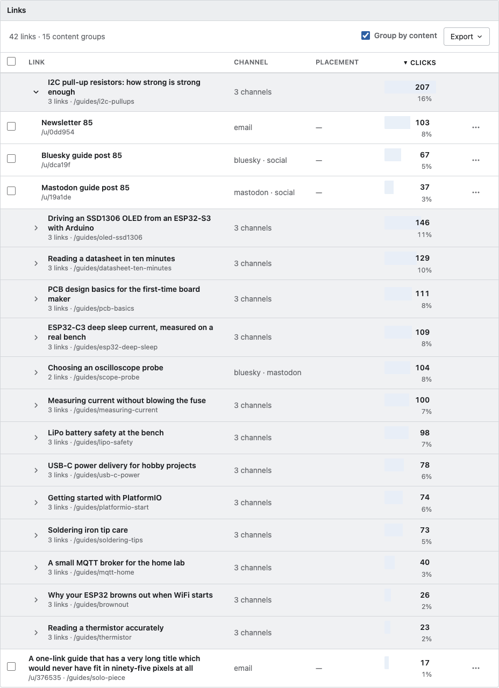 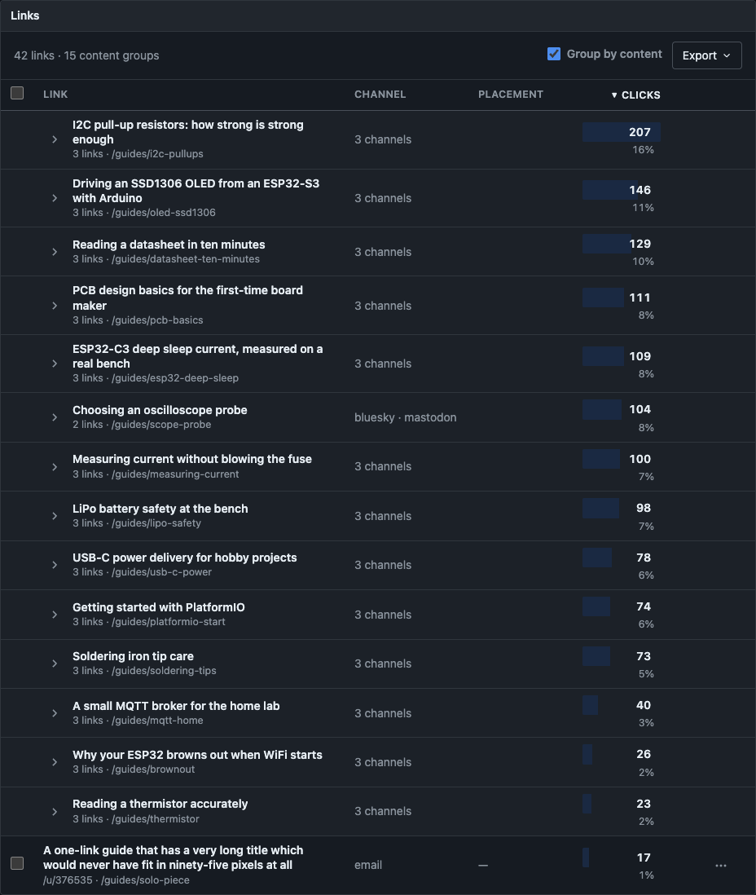 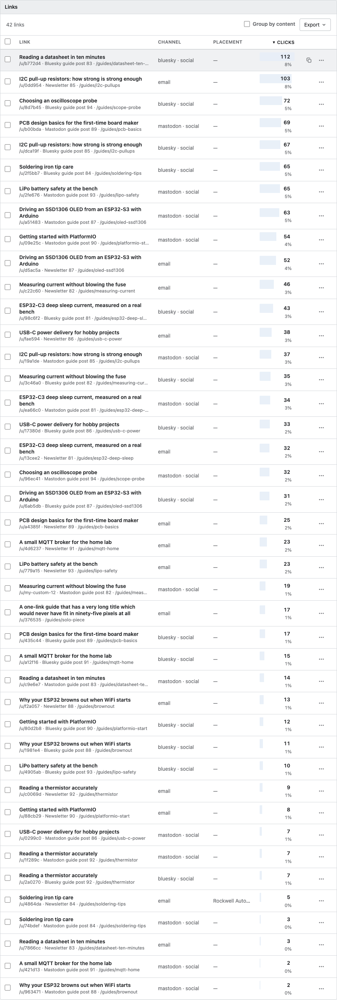 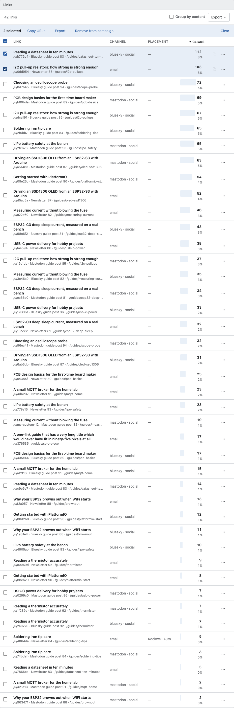  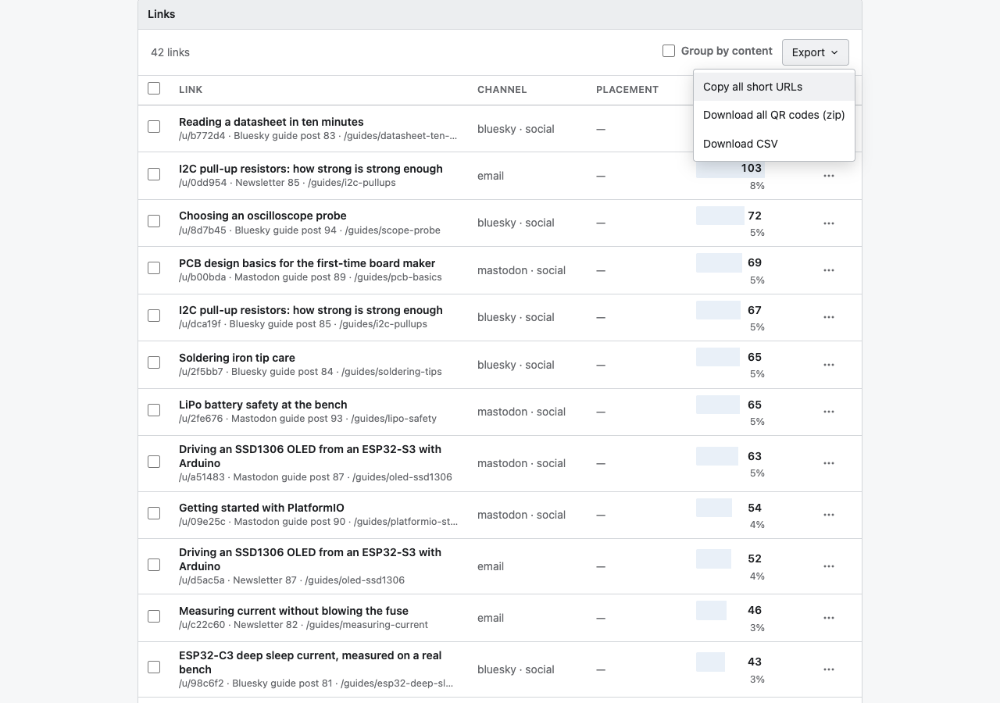 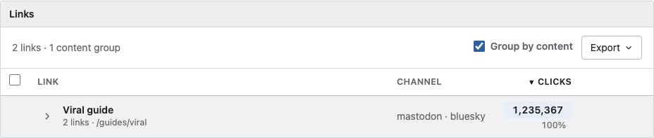 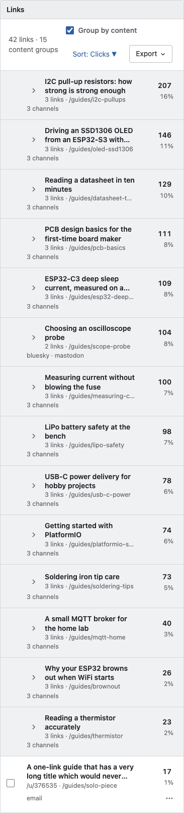 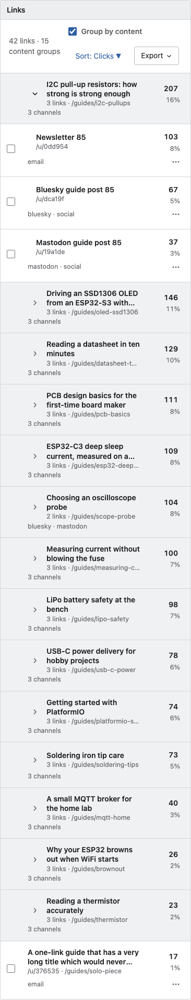 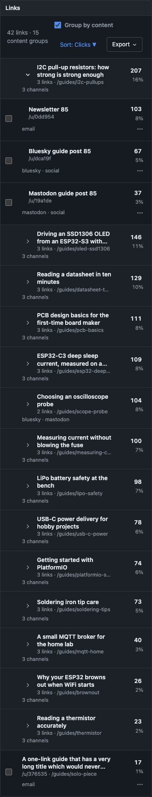 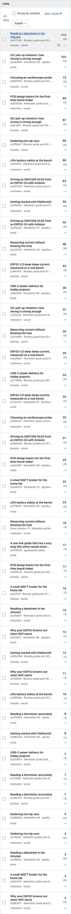

iOS: against a STORAGE=json dev server on :8192 (auto-login) with a campaign of long-titled links, `xcrun simctl openurl booted http://localhost:5192/#/campaigns/guides-2026-11` loads the page (`0157/sim-iphone.png`, top of the page only; the simulator cannot be scrolled from here). The table itself is shown by Playwright WebKit with the iPhone 15 profile (`0157/webkit-iphone-flat.png`, 393/393 no horizontal scroll). That is emulation, not the simulator.

## Review round 1

- Merged main (#0155-#0171, then #0165) with `git merge`; conflicts in CampaignDetail, TwoLineCell and api.ts resolved in the merge commits.
- `TwoLineCell`: main's `wrap` semantics kept; desktop wrapping is a separate `wrapAlways` prop. Overview TopContent, Links and Campaigns screenshots (`regress-*.png`) show them unchanged.
- Remove: both row-menu and bulk Remove go through #0165's `pushToast` Undo (no ConfirmDialog, no local notice). Checked: bulk remove of 2 -> "40 links" and one toast "2 links removed from Guides 2026-11."; Undo -> "42 links" (`desktop-light-remove-toast.png`).
- `api.ts`: comment explaining `tz=UTC` (stats window is resolved in UTC).
- Nits: "Grouping is partial" note when the report sets `truncated`; InlineBar end marker already fixed on main (re-checked, no overlap); unused `shareOf` import removed from the view; `selectedRows` replaced by plain `rowsForKeys(keys)`; select-all covers links in collapsed groups (new `DataTable` `selectAllKeys`; grouped table select-all showed "42 selected").
- Re-verified after the merges: `npm run check` 0 errors, `npm test` 628 passed, `npm run build` ok; screenshots retaken on the merged UI.

## Files changed

- web/src/views/CampaignDetail.svelte
- web/src/lib/campaignLinks.ts, campaignLinks.test.ts (new)
- web/src/lib/api.ts (`getCampaignContentGroups`)
- web/src/lib/DataTable.svelte (`rowSelectable`, phone selection cell)
- web/src/lib/RowMenu.svelte (`text` trigger), web/src/lib/TwoLineCell.svelte (`wrap`)
- issues/0157.md, issues/0157/*.png

## Work log

| Date | Model | Input | Output | Cache read | Cache write | Cost |
|---|---|---|---|---|---|---|
| 2026-11-18 | claude-sonnet-5-5 | 230 | 83,209 | 18,440,203 | 241,454 | $3.28 |
| 2026-11-18 | claude-opus-5-5 | 44 | 9,196 | 1,402,699 | 74,069 | $0.83 |

**Total: $4.11**
