# 0158 — Creating a link is a seven-field form at the top of the home page instead of a quick action from anywhere

| | |
|---|---|
| **Status** | in-progress |
| **Module** | web |
| **Platform** | All |
| **Phase** | 17 — UI redesign foundations |
| **First seen** | 2026-11-18 |

## Description

The create form (`Dashboard.svelte:368-606`) is the first thing on the home page, though it's the least frequent task. Make it a dialog opened by **+ New link** on any page (a full page at `#/new` on phones), with a success step that makes the next platform's link one click away.

## Long Description

See [docs/ui-redesign.md](../docs/ui-redesign.md) §3.7.

- Fields: Destination URL, Title (hint: "Use the content's title. The channel goes in Channel."), Campaign, Channel (fills `utm_source`/`utm_medium` from the campaign's conventions). A **More** disclosure holds custom alias, expiry, the UTM fields and placement. A live preview shows the final redirect URL.
- On success the dialog shows the short URL with Copy and QR, plus **Create another for this page** (keeps URL, title and campaign; pick the next channel) and **Done**.
- Pasting a URL on the Links page while no input is focused opens the dialog prefilled.
- Duplicate responses (`"duplicate": true`) say "You already have a link for this" and show it.

## Acceptance criteria

- Vitest covers the channel-to-UTM mapping and the "create another" carry-over.
- Checked in the running app via `scripts/dev.sh` (:5173) and `scripts/sim.sh` (iOS Simulator), in light and dark, at desktop width and about 400px, with screenshots attached to the issue folder.
- `cd web && npm test && npm run build` passes.

## Relation

- Part of: [#0152](0152.md)
- Blocked by: [#0153](0153.md)

## Root cause

The create form was a seven-field panel embedded at the top of the old Dashboard (moved to `NewLink.svelte` by #0153 but still rendered above the table on `#/`), with no Channel shortcut, no success step beyond an inline banner, and no way to repeat it for the next platform.

## Fix

- `lib/newLink.ts` (pure): `CHANNELS`, `applyChannel` (channel fills `utm_source`/`utm_medium`; falls back to the campaign's default medium), `nextChannel`, `carryOver` (keeps URL, title, campaign, `utm_campaign`, `utm_term`; clears alias, expiry, placement, source, medium, content), `pastedUrl`.
- `lib/NewLinkForm.svelte`: Destination URL, Title (hint "Use the content's title. The channel goes in Channel."), Campaign, Channel, a **More** disclosure (alias, expiry, UTM fields, placement), a live "Will redirect to" preview. Success step: short URL, Copy, QR (image plus PNG download), "Create another for this page" with a next-channel picker, Done. Duplicate responses say "You already have a link for this" and show the link.
- `lib/NewLinkDialog.svelte` + `lib/newLinkDialog.ts`: native `<dialog>` mounted once in `AppShell`. **+ New link** and the `n` shortcut open it on desktop and navigate to `#/new` at 600px and under. `views/NewLink.svelte` is the full-page form (supports `?url=`).
- `LinksList.svelte`: pasting a bare http(s) URL with no input focused opens the dialog prefilled.
- `Dashboard.svelte` no longer renders the form.

## Verification

`cd web && npm run check`: 216 files, 0 errors, 0 warnings. `npm test`: `Test Files 15 passed (15)`, `Tests 470 passed (470)` (includes `src/lib/newLink.test.ts`: channel-to-UTM mapping, carry-over, next channel, paste detection). `npm run build` succeeded. No Go files changed.

`scripts/dev.sh` hardcodes Vite on :5173 and kills whatever holds it (other implementers' servers), so I ran the same env (`STORAGE=json`, auto-login) as a built binary with the freshly built SPA on `PORT=8185` instead. Playwright at 1280px and 390px, light and dark created real links through the flow:

```
desktop light url after click #/links dialog open true
desktop light preview https://www.example.com/guides/measuring-current-desktop-light?utm_source=mastodon&utm_medium=social&utm_campaign=guides-2026-11
desktop light created http://localhost:8185/u/QKkchx
desktop light carry <same url> | Measuring current without blowing the fuse | 1 | bluesky
desktop light dup heading You already have a link for this
paste prefilled https://pasted.example.com/article
escape closed true / n opens dialog
phone light url after click #/new dialog open false
```
No page errors in any run. The 243px horizontal scroll on the phone Links page is the existing table (#0155).

`scripts/sim.sh http://localhost:8185/#/new` in the iOS Simulator: 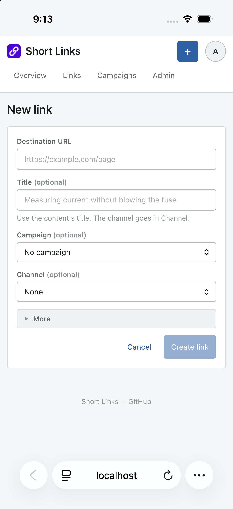

Desktop dialog, light: 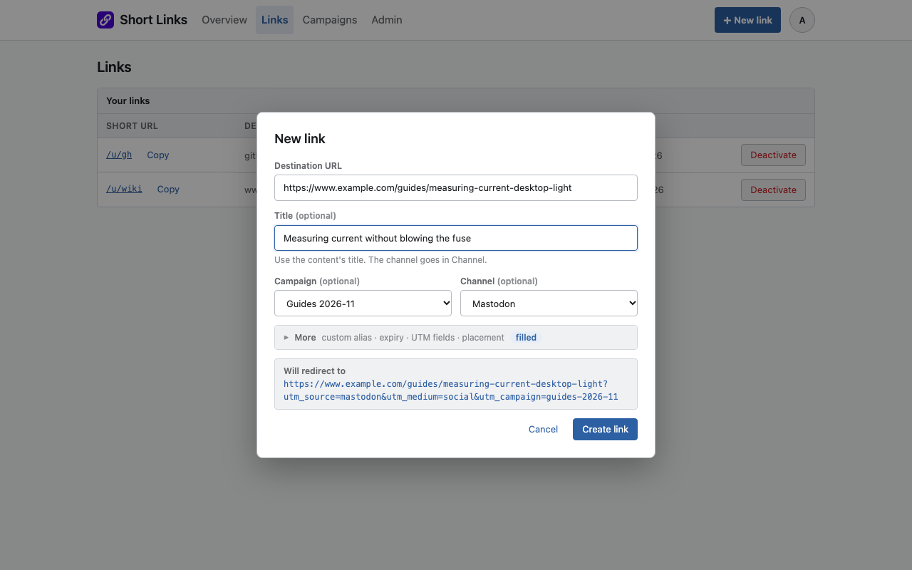 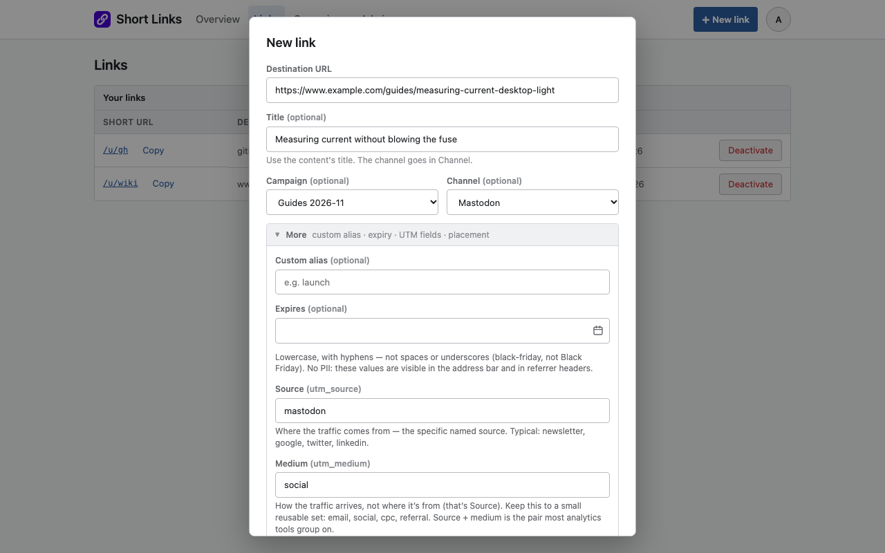 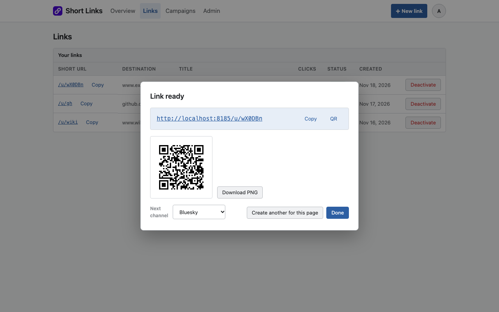 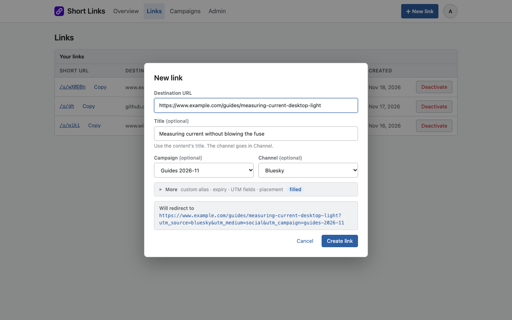 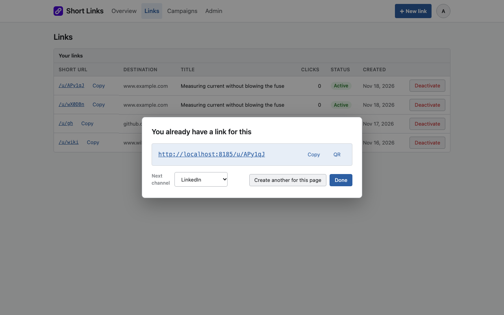
Desktop dark: 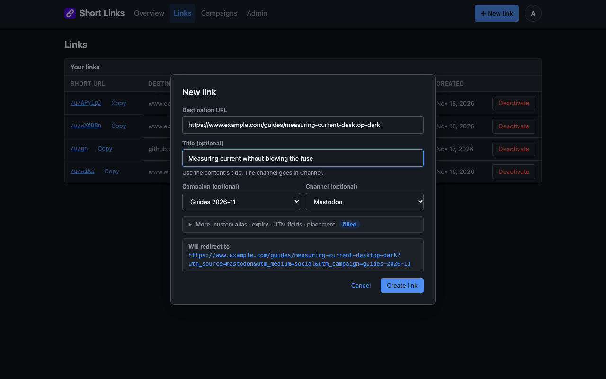 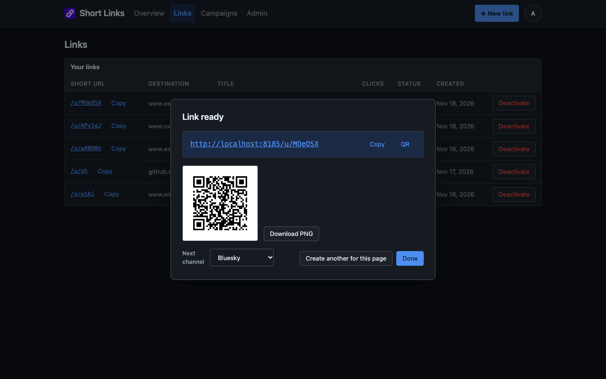 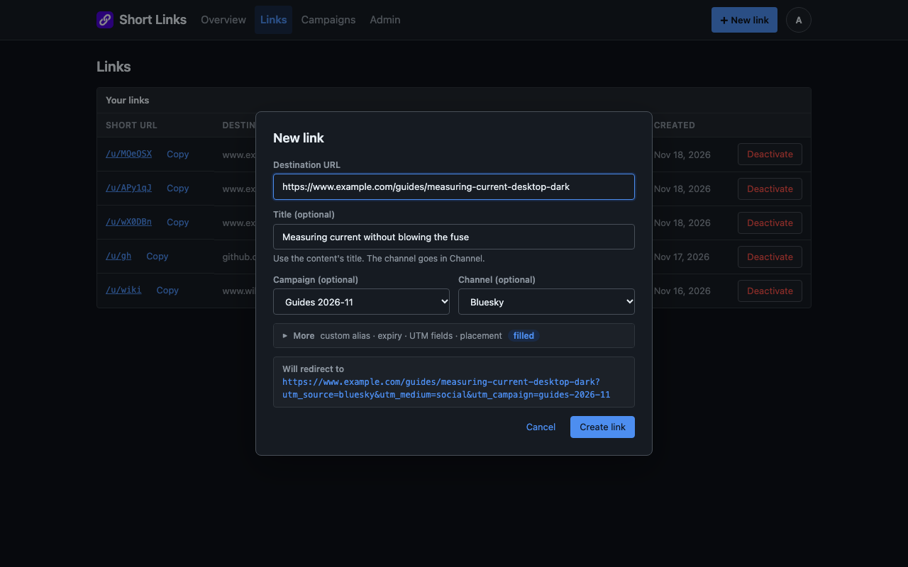
Phone page, light: 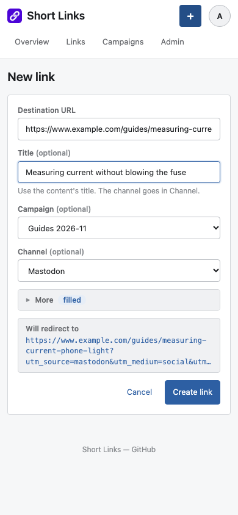 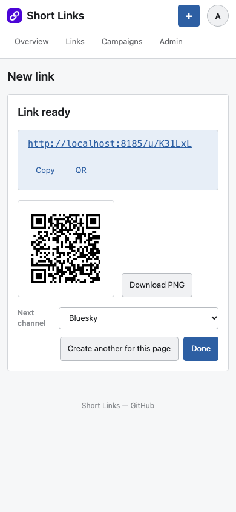 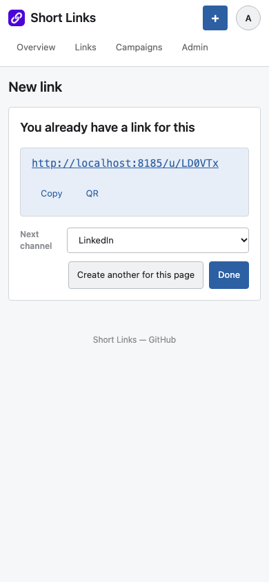
Phone page, dark: 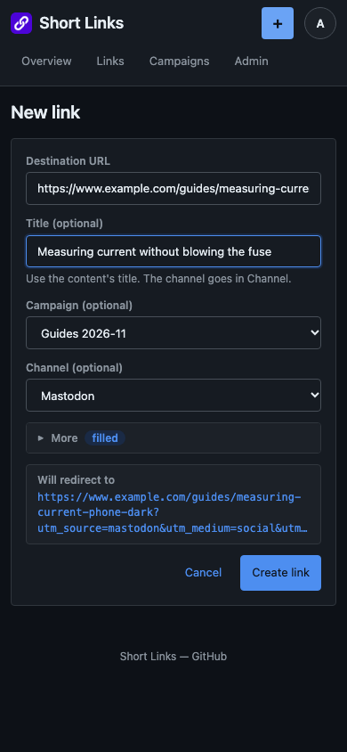 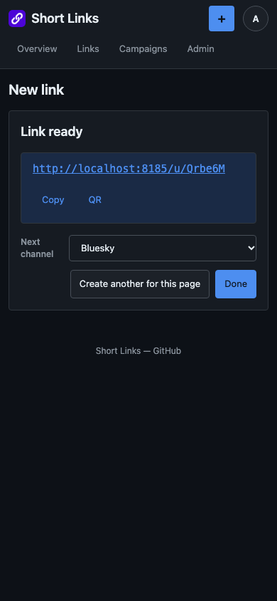 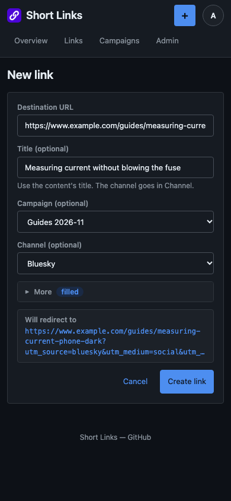

## Files changed

- `web/src/lib/newLink.ts`, `newLink.test.ts`, `newLinkDialog.ts` (new)
- `web/src/lib/NewLinkForm.svelte`, `NewLinkDialog.svelte` (new)
- `web/src/lib/AppShell.svelte`, `web/src/views/NewLink.svelte`, `Dashboard.svelte`, `LinksList.svelte`
- `issues/0158.md`, `issues/0158/*.png`

## Review round 1

- Fixed: a click in the dialog padding closed it (`e.target === dlg`) and lost typed input. Padding moved to an inner `.nl-body` wrapper; the dialog has `padding: 0`. Playwright: a click 6px inside the dialog edge keeps it open with the typed URL intact; a click on the real backdrop closes it.
- Channel medium now yields to the campaign `default_utm_medium`; tests added (472 passed).
- Removed unused imports (`shortUrl`, `isUtmEmpty`) from `NewLinkForm.svelte`.
- "Create another" re-applies campaign defaults with `fillBlankUtmParams` before the channel.
- The success step focuses Copy (Playwright: focused element is "Copy").
- `CarryOver` and `CreatedForm` merged into one interface.
- The paste handler only acts on `#/links`; a paste on `#/` opens nothing.
- `npm run check`: 0 errors; `npm test`: 472 passed; `npm run build` OK.
