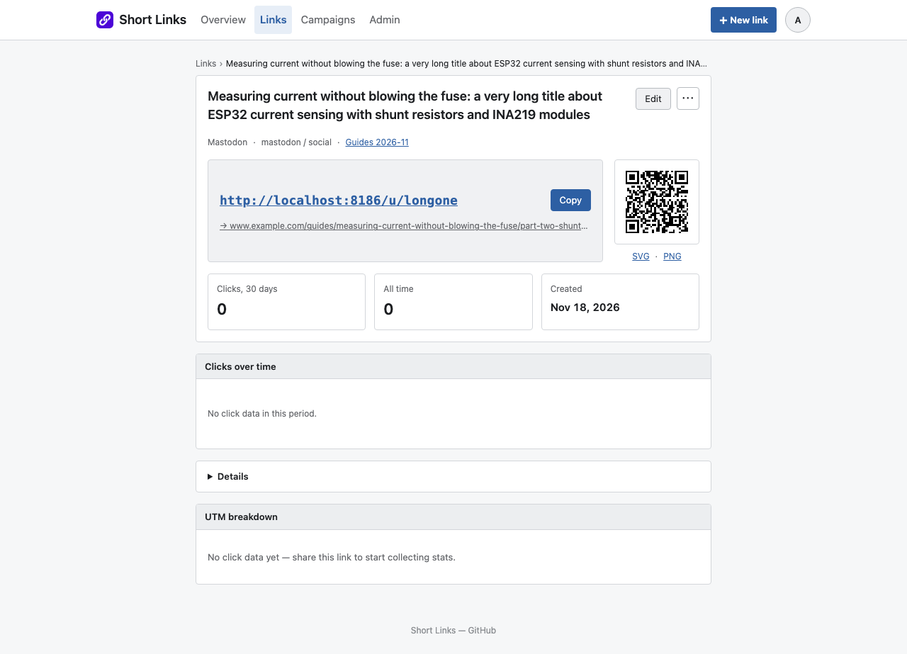
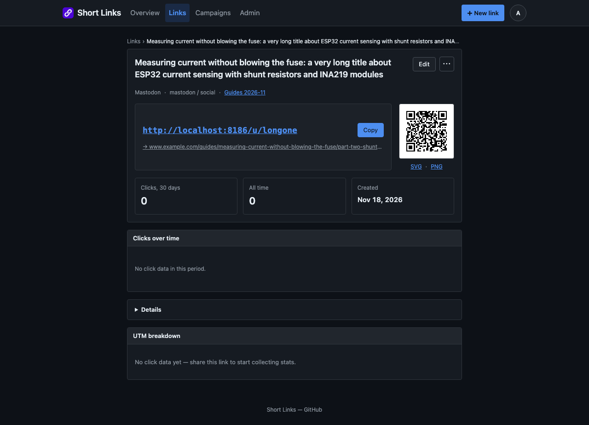
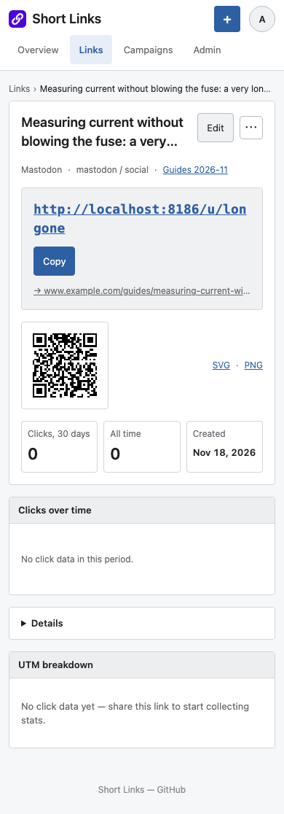
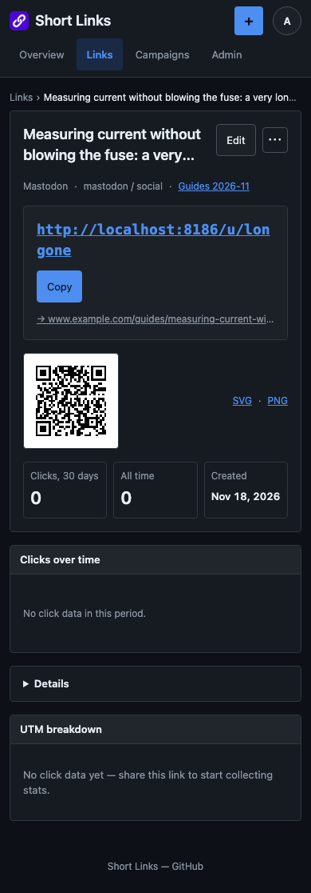
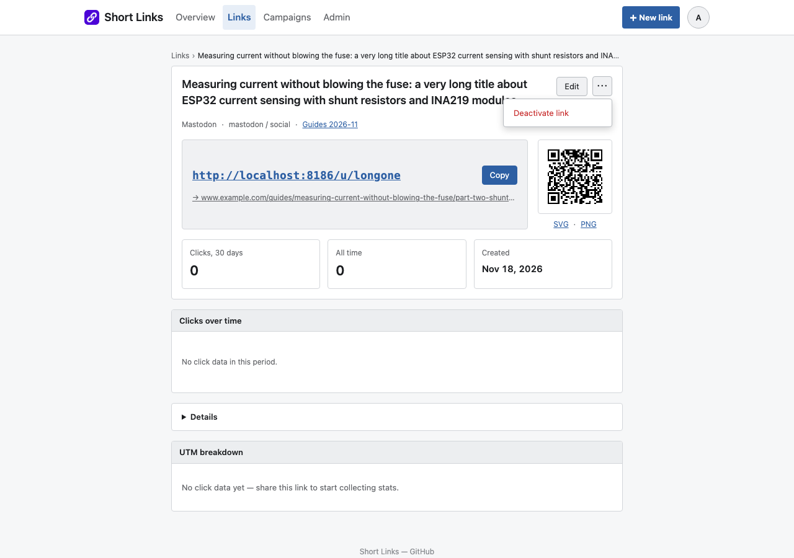
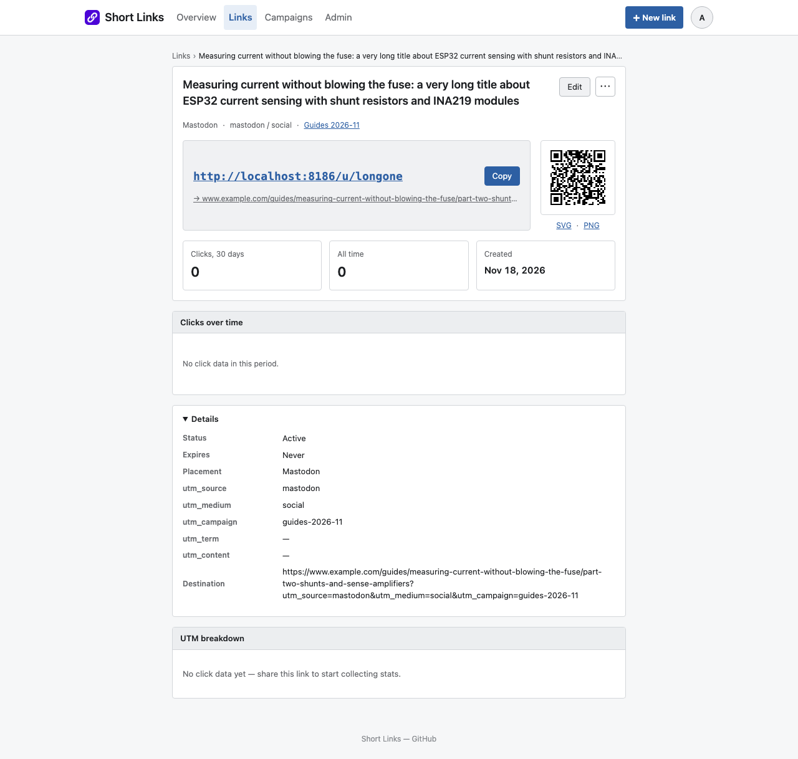
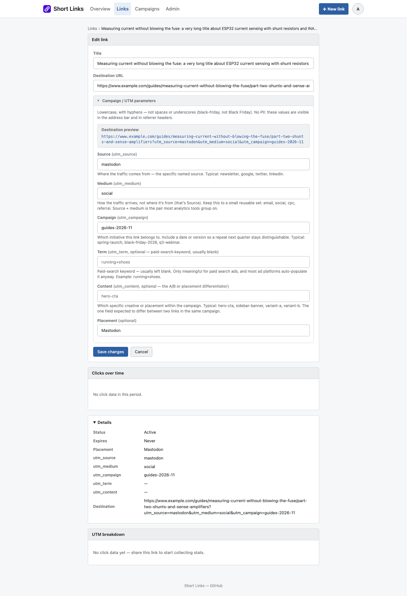
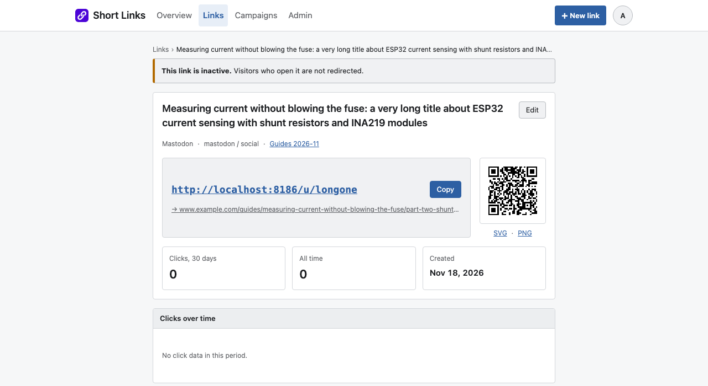
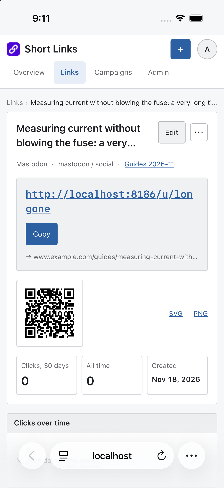

# 0159 — Link detail leads with a nine-row metadata list, and its campaign is plain text instead of a link

| | |
|---|---|
| **Status** | in-progress |
| **Module** | web |
| **Platform** | All |
| **Phase** | 17 — UI redesign foundations |
| **First seen** | 2026-11-18 |

## Description

`LinkDetail.svelte:246-286` shows metadata before the chart (`:385-387`), the campaign is plain text (`:281-282`) though the API returns `campaign_slug`, and the link's UTM values are only visible in the edit form. Lead with the short URL, a QR preview and stat tiles.

## Long Description

See [docs/ui-redesign.md](../docs/ui-redesign.md) §3.4. Siblings and referrers come later (#0169).

- Header: title, then channel label · `source / medium` · campaign as a link.
- Short URL box as the main element, with Copy, the full destination underneath, and a QR preview from `GET /api/links/{key}/qr.svg` with SVG and PNG downloads.
- Stat tiles: clicks in the window, all time, created. The chart comes next. The metadata and UTM values go in a **Details** disclosure.
- Edit replaces the header card in place instead of opening a panel below. Deactivate goes in ⋯. An inactive link shows a banner (Reactivate arrives with #0165).

## Acceptance criteria

- Checked in the running app via `scripts/dev.sh` (:5173) and `scripts/sim.sh` (iOS Simulator), in light and dark, at desktop width and about 400px, with screenshots attached to the issue folder.
- `cd web && npm test && npm run build` passes.

## Relation

- Part of: [#0152](0152.md)
- Followed by: [#0169](0169.md)

## Root cause

`LinkDetail.svelte` was built metadata-first: a nine-row `<dl>` came before the chart, the campaign was rendered as plain text although `campaign_slug` is returned, UTM values were visible only inside the edit form, Edit opened a second panel below the page, and Deactivate was a red button.

## Fix

- Header: title (two-line clamp, full text in `title`), then `placement · source / medium · campaign` with the campaign as a real link to `/campaigns/:slug`.
- Short URL hero box with a primary Copy button and the destination (scheme stripped, ellipsised, full URL in `title`/`href`) underneath; QR preview from `qr.svg` with SVG and PNG downloads.
- Stat tiles: clicks in the 30-day window, all time, created. The chart follows (ClicksChart untouched, #0161 owns it).
- A **Details** disclosure holds status, expiry, placement, all five UTM values and the full destination.
- Edit replaces the header card in place; Deactivate moved to a ⋯ menu; inactive and denied links show a banner (Reactivate arrives with #0165).
- New pure helpers `windowClicks`, `headerMetaParts`, `destinationDisplay` in `lib/linkDetail.ts` with tests.

## Verification

```
cd web && npm ci && npm run check && npm test && npm run build
svelte-check: COMPLETED 211 FILES 0 ERRORS 0 WARNINGS
Test Files  14 passed (14)   Tests  460 passed (460)
✓ built in 1.71s
```

No Go changes. App run with the Go dev server on :8186 and Vite on :5186 (a temporary config proxied to :8186; `dev.sh` hardcodes :5173/:8080), link `longone` with a long title and URL assigned to campaign "Guides 2026-11". Playwright reported no horizontal scroll at 1280px or 390px.

Desktop light, dark; phone light, dark:






Menu, Details, in-place edit, inactive banner, and iOS Simulator (`scripts/sim.sh`):







## Files changed

- `web/src/views/LinkDetail.svelte`
- `web/src/lib/linkDetail.ts`
- `web/src/lib/linkDetail.test.ts`
- `issues/0159.md`, `issues/0159/*.png`
