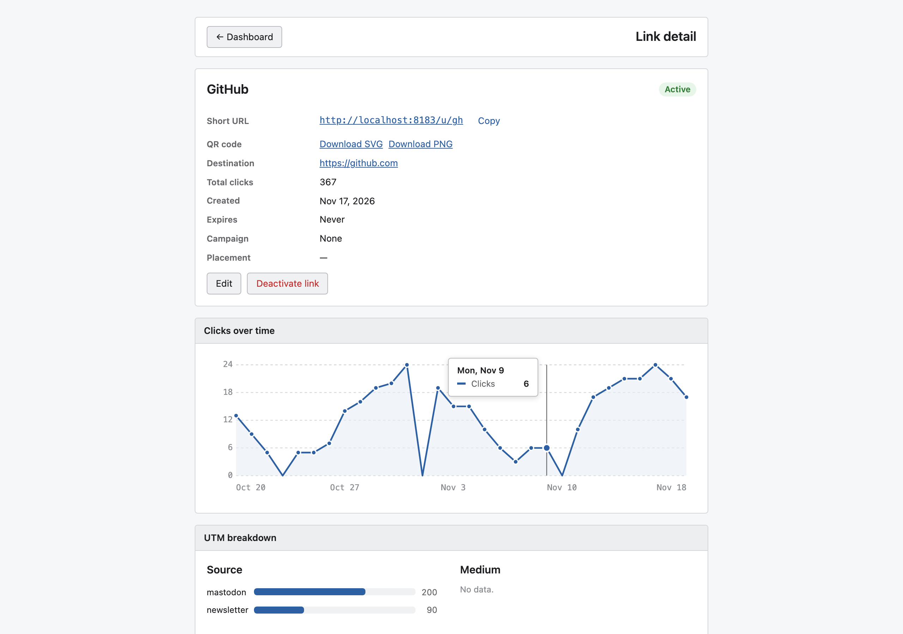
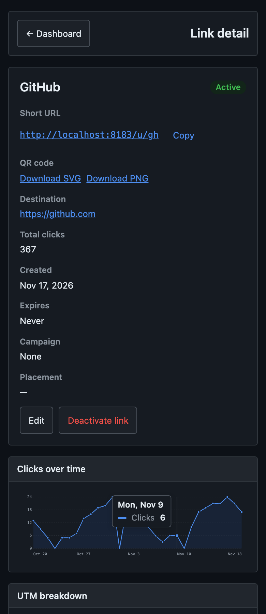
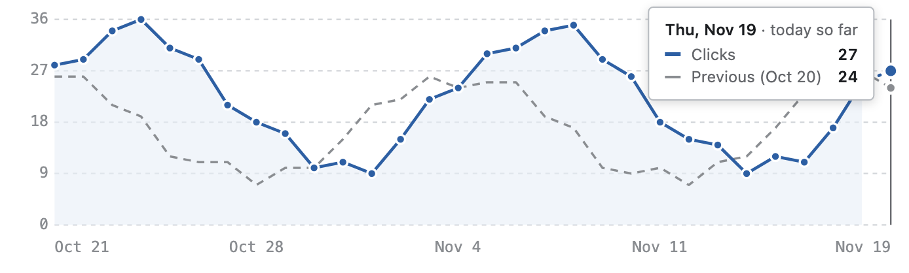
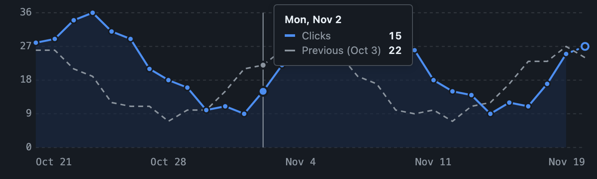
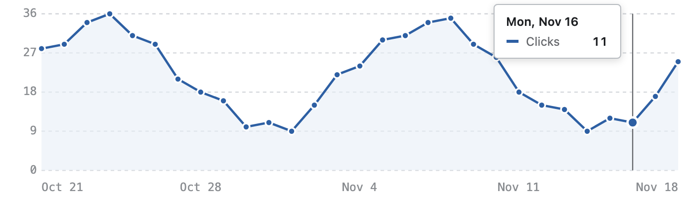
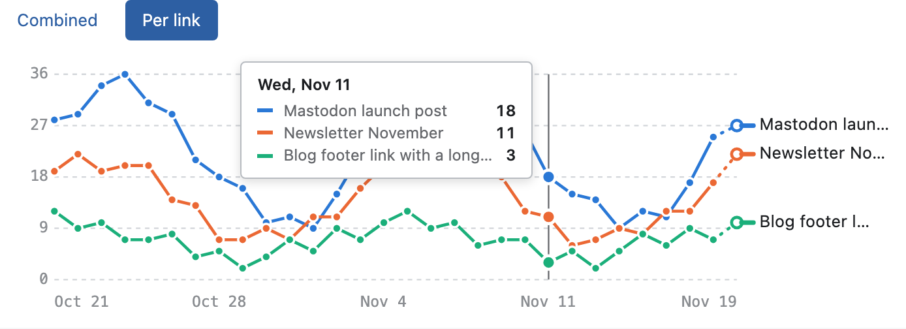
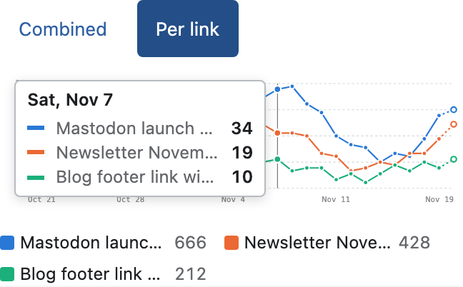
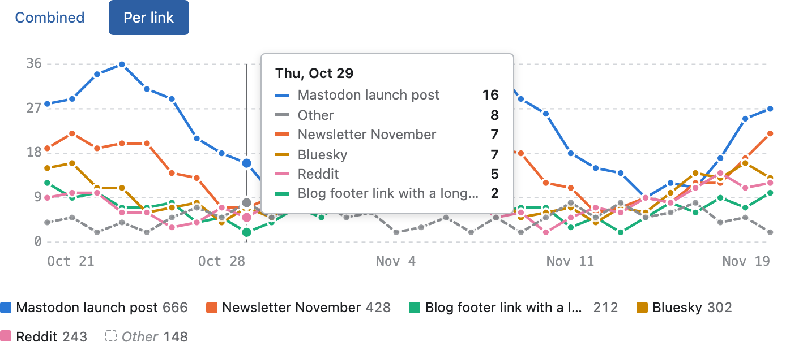

# 0161 — No chart has a hover or tap read-out, so the only way to read a day's value is the screen-reader table

| | |
|---|---|
| **Status** | in-progress |
| **Module** | web |
| **Platform** | All |
| **Phase** | 17 — UI redesign foundations |
| **First seen** | 2026-11-18 |

## Description

`ClicksChart`, `CampaignClicksChart` and `UTMBarChart` draw values but don't let you read them. Add a crosshair read-out and the chart features the Overview needs: a comparison series, a partial last day, explicit windows and a sparkline component.

## Long Description

See [docs/ui-redesign.md](../docs/ui-redesign.md) §4.

- Hover, tap or arrow keys move a crosshair. The read-out shows the date, value, previous-period value when present, and the series name.
- `comparison` prop: a grey dashed series aligned day for day.
- `partialLast` prop: the last point is hollow with a dotted final segment, labelled "today so far".
- `from`/`to` props, so the component stops deriving its own window (`lib/charts.ts:100`).
- Direct end-of-line labels instead of a legend in the campaign chart when there are four or fewer series.
- `lib/Sparkline.svelte`: 110×22, no axes, `aria-label` with the total.
- Bars in `UTMBarChart` emit a `select` event so later views can turn a bar into a filter.

## Acceptance criteria

- Vitest covers the nearest-point lookup and keyboard stepping.
- Checked in the running app via `scripts/dev.sh` (:5173) and `scripts/sim.sh` (iOS Simulator), in light and dark, at desktop width and about 400px, with screenshots attached to the issue folder.
- `cd web && npm test && npm run build` passes.

## Relation

- Part of: [#0152](0152.md)
- Blocks: [#0162](0162.md), [#0166](0166.md)

## Root cause

The three chart components were purely visual SVG/CSS: no pointer or keyboard handling, so a day's value was only available through the screen-reader table. `ClicksChart` also derived its own 30-day window (`defaultDateRange`) instead of taking one, and there was no comparison series, partial-day treatment, sparkline, or way for a bar to report a selection.

## Fix

- `lib/charts.ts`: pure helpers `nearestIndex`, `clientToSvgX`, `stepIndex` (arrows, PageUp/Down = 7 days, Home/End, Escape), `pointsForWindow`, `alignComparison`, `shiftDate`, `longDateLabel`, `spreadLabels`, `truncateLabel`, `geoWithPadRight`.
- New `ChartReadout.svelte`: floating read-out (date, series value, previous-period value, "today so far"), flips at the midpoint, compact at phone widths.
- `ClicksChart`: crosshair via hover, tap or arrow keys (focusable, polite live region), `from`/`to` props (falls back to `days` when omitted), `comparison`/`comparisonFrom` (grey dashed, day for day), `partialLast` (hollow last point, dotted final segment). `LinkDetail` now passes `from`/`to` explicitly.
- `CampaignClicksChart`: same crosshair/comparison/partialLast; with four or fewer series in Per-link mode the legend is replaced by direct, de-collided end-of-line labels (falls back to the legend below 480px rendered width, where SVG text would scale to unreadable).
- `UTMBarChart`: optional `onselect({dimension, value})`; label becomes a button and the bar a click target. No call site passes it yet (later views).
- New `Sparkline.svelte` (110x22, no axes, `aria-label` with total, optional `partialLast`). Not yet used by any view.

## Verification

- `cd web && npm run check`: `207 FILES 0 ERRORS 0 WARNINGS`
- `npm test`: `Test Files 13 passed (13)`, `Tests 462 passed (462)` (new tests cover nearest-point lookup, keyboard stepping, comparison alignment, label spreading)
- `npm run build`: `built in 2.79s`. `go` untouched.
- Ran the real server (`STORAGE=json`, :8183, built SPA) and a Vite harness on :5183, driven with Playwright at 1280px and 390px, light and dark. The dev store records no clicks, so the Link detail page was checked with `/api/links/gh` intercepted to inject a timeseries; comparison, partial day, per-link and sparkline cases came from a throwaway harness page (not committed). Read-outs seen: `Mon, Nov 2 | Clicks 15 | Previous (Oct 3) 22`; `Thu, Nov 19 · today so far | Clicks 27 | Previous (Oct 20) 24`; keyboard `Mon, Nov 16: 11 clicks` after three ArrowLeft, Escape hides it; bar button emitted `source=newsletter`; sparkline `aria-label` "Last 30 days: 666 clicks". No console errors. All servers stopped.
- scripts/sim.sh (iOS Simulator) was not run; 390px desktop Chromium with touch emulation was used instead.

Link detail, desktop and phone (hover/tap read-out):

Comparison and today so far:

Keyboard:

Campaign direct labels, legend fallback, sparkline:

More variants (dark, 390px) are in `issues/0161/`.

## Files changed

- `web/src/lib/charts.ts`, `charts.test.ts`
- `web/src/lib/ChartReadout.svelte` (new), `Sparkline.svelte` (new)
- `web/src/lib/ClicksChart.svelte`, `CampaignClicksChart.svelte`, `UTMBarChart.svelte`
- `web/src/views/LinkDetail.svelte`
- `issues/0161.md`, `issues/0161/*.png`

## Review round 1

Changes:
- Live region now announces only keyboard stepping (`viaKeyboard`); hover/tap are silent.
- iOS Safari does not focus or blur a tapped non-focusable element, so `onblur` never dismissed a tapped read-out. Both charts now also listen on `<svelte:window onpointerdown>` and clear the crosshair for any pointerdown outside the plot.
- `ClicksChart` shows the chart, not "No click data", when the comparison series has data.
- `LinkDetail` derives the window with `$derived.by` keyed on `detail`, so each reload recomputes it (no stale window after midnight).
- `docs/ui-redesign.md` section 4: Sparkline is 110×22.
- "Today so far" labelling already existed behind `partialLast` (read-out title note and live-region text, seen in the 1280px screenshots). `LinkDetail` does not pass `partialLast` because its window ends yesterday.

iOS Simulator (`scripts/sim.sh`, iPhone 17, iOS Safari) against a throwaway harness page served by Vite on :5183:
- Tested for real: the page loads and lays out in iOS Safari, and the pointer handlers run there. Because Simulator.app (the GUI) is not installed here, and neither `simctl` nor any other available tool can inject touches, I could NOT produce genuine finger taps or drags. Instead the page dispatched synthetic `PointerEvent`s (`pointerType: 'touch'`) on `#step=N` URL changes sent via `xcrun simctl openurl`, screenshots via `simctl io screenshot`.
  - step0: initial, no read-out. step1: touch pointerdown on the chart shows the read-out "Mon, Nov 2 / Clicks 15 / Previous (Oct 3) 22". step3: pointerdown on text outside the chart dismisses it. step2: a series of pointermove events (scrub).
  - Screenshots: `0161/sim-ios-step0-initial.png`, `0161/sim-ios-step1.png`, `0161/sim-ios-step2.png`, `0161/sim-ios-step3.png`.
- Not verified on a real iOS touch stack: that `touch-action: pan-y` lets a horizontal drag scrub while a vertical drag still scrolls. Only the computed style (`pan-y`) was confirmed.
- Supplementary, Playwright WebKit with iPhone 13 emulation and real `touchscreen.tap` (not iOS Safari itself): tap shows the read-out (live region empty), a second tap moves it ("Fri, Nov 13 | Clicks 14 | Previous (Oct 14) 11"), a tap outside dismisses it (0 read-outs), computed `touch-action: pan-y`.
- Re-ran `npm run check` (0 errors, 0 warnings), `npm test` (462 passed), `npm run build`.

Files changed this round: `web/src/lib/ClicksChart.svelte`, `CampaignClicksChart.svelte`, `web/src/views/LinkDetail.svelte`, `docs/ui-redesign.md`, `issues/0161.md`, `issues/0161/sim-ios-*.png`.
