# 0162 — The signed-in home page shows a create form and a link list instead of a 30-day overview of click activity

| | |
|---|---|
| **Status** | in-progress |
| **Module** | web |
| **Platform** | All |
| **Phase** | 18 — Overview and campaign analytics UI |
| **First seen** | 2026-11-18 |

## Description

Replace the signed-in home page with the Overview Brennan asked for: stat tiles, a 30-day click chart with the previous period, campaign focus chips, and the top content list. Data comes from `GET /api/reports/overview` (#0139) and `/top-content` (#0140).

## Long Description

See [docs/ui-redesign.md](../docs/ui-redesign.md) §3.2 and the interactive mockup in the artifact.

- **Tiles:** Clicks, Visitors (daily unique, with a tooltip explaining the daily count), Best day, Top content. Each shows its change against the previous period, or "new" when the previous period was zero.
- **Chart:** daily clicks in the browser's time zone (`tz` from `Intl.DateTimeFormat().resolvedOptions().timeZone`), including today as a partial point, with the previous 30 days dashed. Range control: 7d, 30d, 90d, custom. Footnote: "N bot clicks excluded".
- **Campaign chips:** "All" first, then each campaign with clicks in the window by count, then "No campaign" if present. Single select. After five chips the rest go in a More menu, and the row scrolls on phones. Selecting a chip re-scopes tiles, chart and top content, and shows "Open campaign →".
- **Top content:** rank, title, path and link count, a stacked by-source bar with a legend, clicks, change. Expand to see member links with copy and ⋯. A group-by switch (Content, Link, Source) and Show more / View all links →.
- **State in the hash:** `#/?range=30d&campaign=guides-2026-11` (serialisation in #0163). Defaults are omitted.
- **Empty state:** a new account sees "Create your first link" instead of an empty chart.

## Acceptance criteria

- Verified against seeded dev data with at least three campaigns, and against Brennan's ocsf-like data shape (two links per guide).
- Checked in the running app via `scripts/dev.sh` (:5173) and `scripts/sim.sh` (iOS Simulator), in light and dark, at desktop width and about 400px, with screenshots attached to the issue folder.
- `cd web && npm test && npm run build` passes.

## Relation

- Part of: [#0152](0152.md)
- Blocked by: [#0139](0139.md), [#0140](0140.md), [#0153](0153.md), [#0161](0161.md)
- Blocks: [#0163](0163.md)

## Root cause

`#/` rendered `Dashboard.svelte`, a temporary stack of the create form and the links table (left by #0153). Nothing on the signed-in home page answered "what is getting attention", and the SPA did not call the reports API (#0139, #0140) at all.

## Fix

`views/Overview.svelte` replaces the Dashboard (deleted) at `#/`. Data comes only from `GET /api/reports/{overview,top-content,top-links,breakdown}` using the cookie session, with `tz` from `getChartTimeZone()` (#0170).

- Tiles (`StatTile`): Clicks, Visitors (daily unique, with an (i) toggle explaining the daily count), Best day, Top content. Change vs the previous period, or "new" when it was zero (`changeOf`).
- Chart: `ClicksChart` with the previous period dashed, today as a partial point, range 7d / 30d / 90d / Custom (from-to form), and the "N bot clicks excluded" footnote. Axis labels are enlarged under 600px so they stay legible on phones.
- Campaign chips (`CampaignChips`): All, campaigns by clicks, No campaign last; five chips then a More menu (the selected chip is promoted into the row); the row scrolls on phones; "Open campaign" link when one is focused. Focus re-scopes tiles, chart and list.
- Top content (`TopContent`, `SourceBar`): rank, title, path and link count, stacked by-source bar with legend, clicks, change; expandable member links with copy and a menu; Group by Content, Link or Source; Show more and View all links. TODO(#0156, #0157): adopt DataTable from #0155; this is a minimal list on purpose.
- State in the hash (`lib/overviewQuery.ts`: range, from, to, campaign, group; defaults omitted). #0163 widens it. Controls are hash links, so Back works.
- A new account (no links) sees "Create your first link". `#/links` is unchanged.
- `scripts/dev-seed.sql` seeds a user, 7 campaigns, 33 links (8 guides x 3 channels like ocsf, plus events) and about 2,500 clicks over 60 days, with a usage comment. Dev mode (STORAGE=json) has no `/api/reports`, so run the Go server against Postgres.

## Verification

```
$ cd web && npm ci && npm run check && npm test && npm run build
COMPLETED 270 FILES 0 ERRORS 0 WARNINGS 0 FILES_WITH_PROBLEMS
Test Files  21 passed (21)   Tests  557 passed (557)
built
```

No Go code was touched. Real data: a scratch database `shortlinks_0162` (dropped afterwards), migrated to 000019, seeded with `scripts/dev-seed.sql`, Go server on :8188 serving the embedded build, a session row inserted for the cookie, Playwright (tz America/Los_Angeles). Observed: 1,530 clicks in 30 days, up 88% on the prior 30 days; 7 campaigns giving 4 chips plus More (4); picking "No campaign" in More gave `#/?campaign=none`; Custom range gave `#/?from=2026-11-01&campaign=none`; group=link and group=source render; Back restores the previous hash; a second user with no links shows the empty state; `#/links` still loads. No console errors.

iOS Simulator (sim.sh through a header-injecting proxy, because Safari has no session cookie): `0162/overview-ios-simulator.png`.

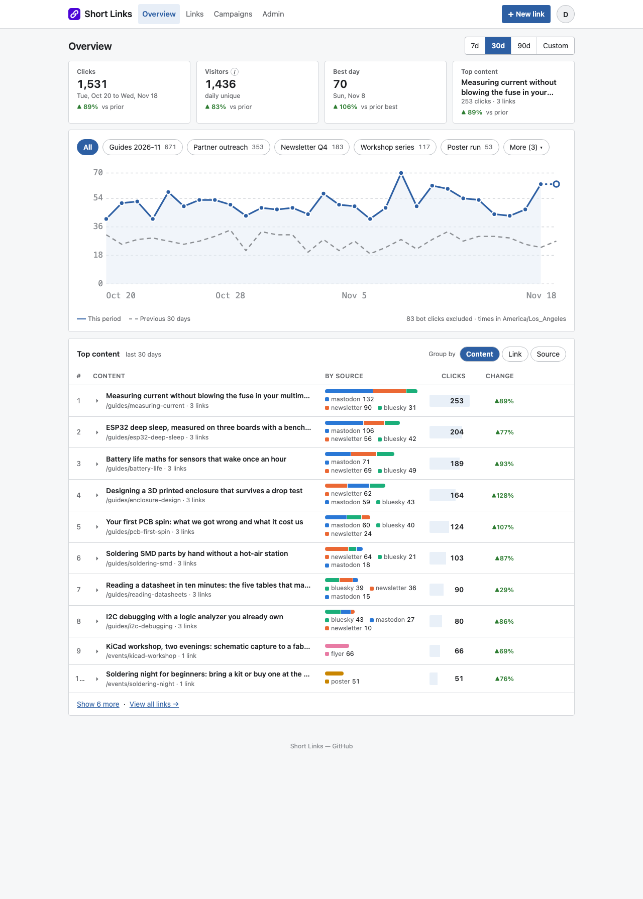
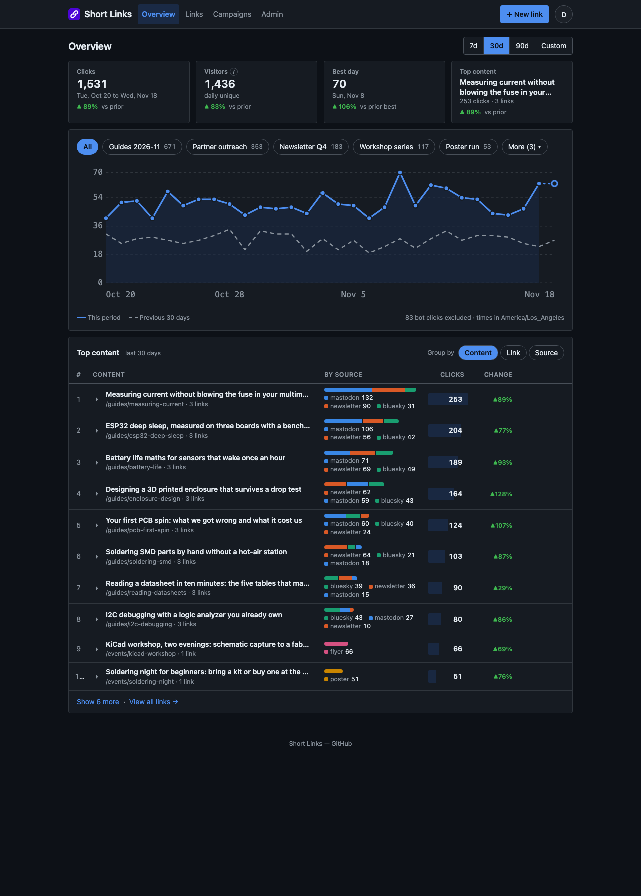
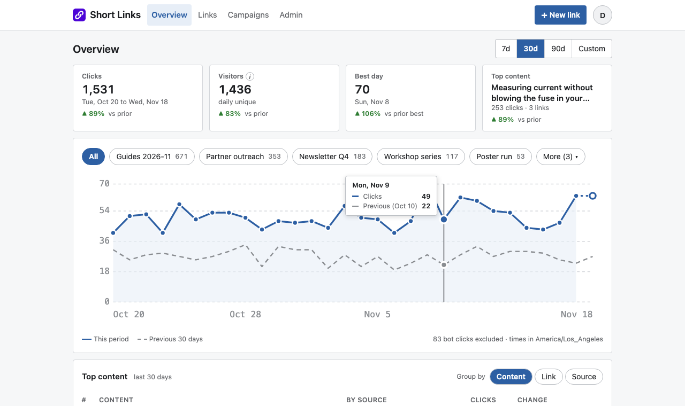
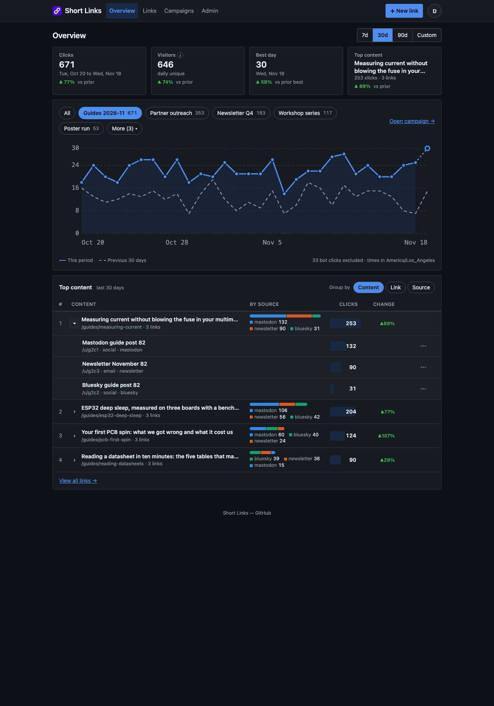
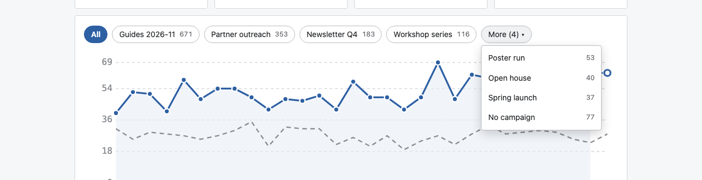
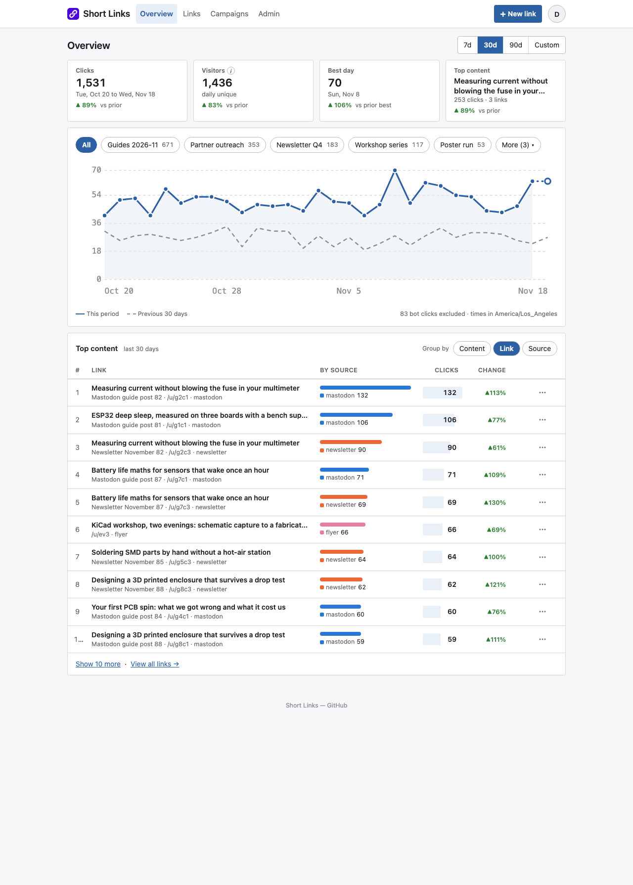
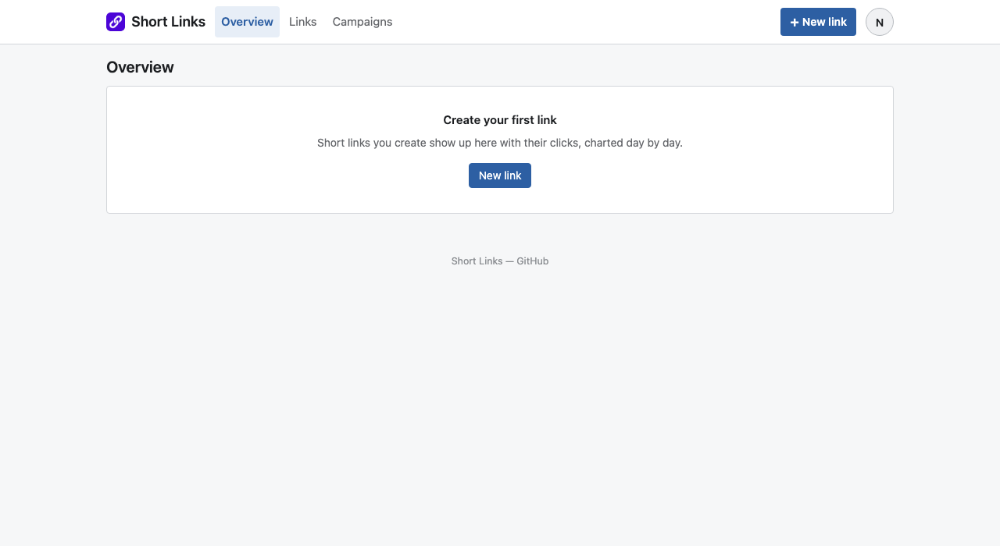
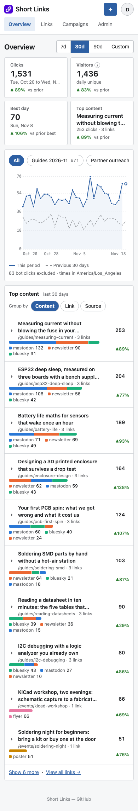
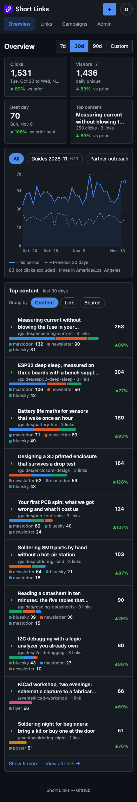
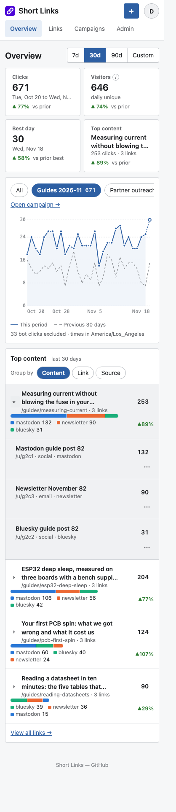
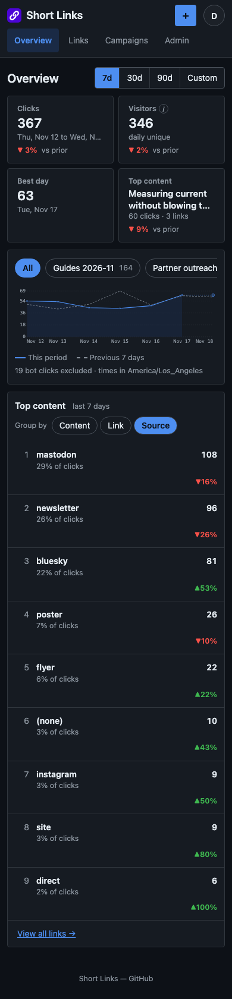
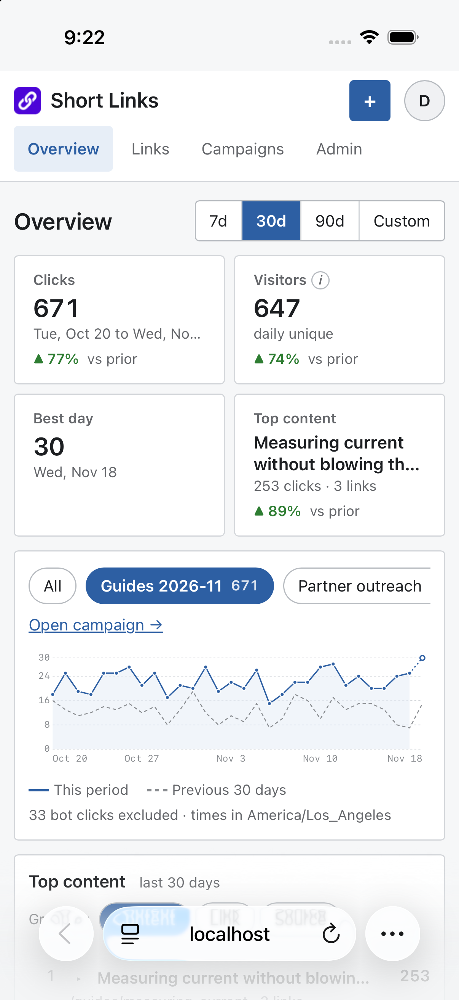

## Files changed

- `web/src/views/Overview.svelte` (new); `web/src/views/Dashboard.svelte` (deleted); `web/src/App.svelte`
- `web/src/lib/overview.ts`, `overviewQuery.ts`, `reports.ts` and tests `overview.test.ts`, `overviewQuery.test.ts` (new)
- `web/src/lib/StatTile.svelte`, `CampaignChips.svelte`, `TopContent.svelte`, `SourceBar.svelte` (new)
- `web/src/lib/ClicksChart.svelte` (phone axis label size)
- `scripts/dev-seed.sql` (new); `issues/0162/*.png`

## Review round 1

Changes requested by review, all done on `issue/0162` with new commits:

- Group by Link titles by `content_title`; line two is `label · /u/key · source`.
- One stable colour per source across the whole list (`sourceColors`: ranked by total clicks, top six get `--series-1..6`), also used by Group by Link and Source bars.
- `TopContent` now uses `DataTable` (real column headers), `TwoLineCell`, `InlineBar` and `RowMenu`. The identity column is the flexible one; By source has a fixed 13rem. Titles wrap to two lines on phones (`TwoLineCell wrap`). Member links are extra table rows.
- `ClicksChart` uses a taller near-1:1 geometry in containers narrower than 520px (360 x 260 viewBox, 12-unit labels render at about 11px), and x labels are chosen from the drawable width (`xLabelIndices`, tested) so 7d and 30d labels do not collide. LinkDetail and CampaignDetail were re-shot on a phone (`linkdetail-phone-light.png`, `campaigndetail-phone-light.png`, `linkdetail-desktop-light.png`).
- The empty state calls `openNewLink()`; the Overview subscribes to `link.created` over SSE and refetches.
- Removed LinksList's `showTitle`; docs/frontend.md, architecture.md and events.md describe the Overview.
- Top five campaigns plus All before More.
- Changing the grouping fetches only that group's report (observed: a single `top-links` request); the old rows stay dimmed until it lands, with no "Loading…" text.
- Nits: Best day shows its change vs the prior best day; StatTile shows a note only next to a real change (`unavailable` otherwise); a custom range ending in the past is labelled by its dates; a stale campaign slug shows a dismissible notice and falls back to All (the reports return 200 with no clicks for an unknown slug, so this checks `/api/campaigns`); the More menu focuses its first item, supports arrow keys, and Escape returns focus to the button (observed in Playwright).

Verification (fresh seeded `shortlinks_0162`, dropped afterwards): check 0 errors, 572 tests pass, build ok. Screenshots at 1280 and 390, light and dark, in `0162/`: `overview-*-{light,dark}.png`, `-link`, `-campaign`, `-7d` (phone), `-hover` (desktop). The iOS Simulator, More menu, empty state and phone group-by-source shots are from round 0 and show the earlier layout.


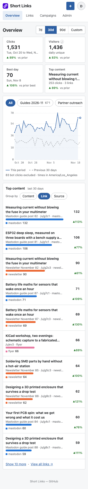
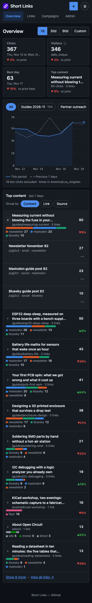

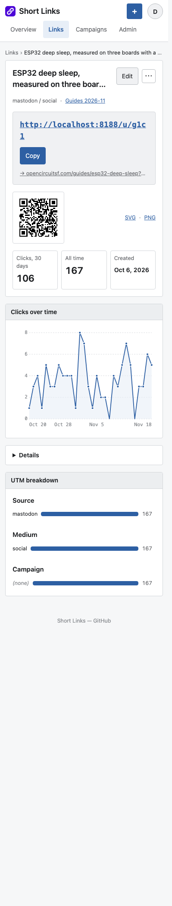
