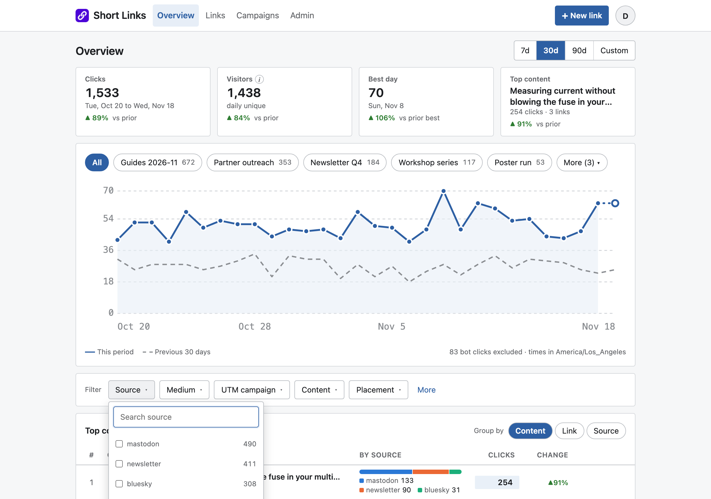
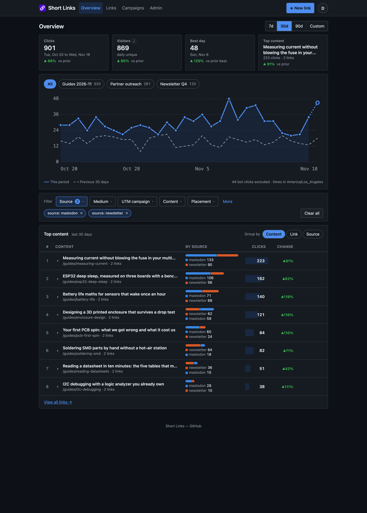
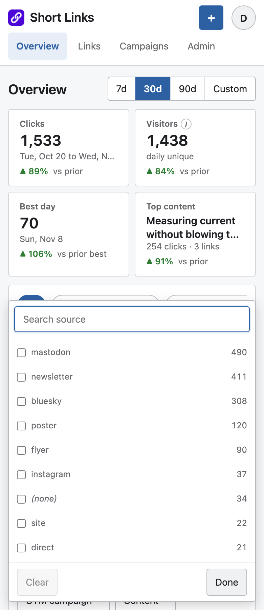
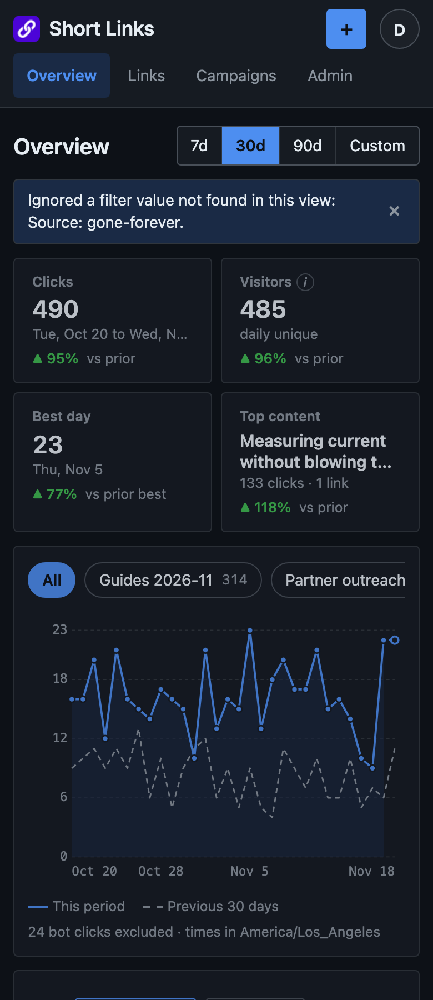

# 0163 — The Overview can't be filtered by UTM parameters, and a filtered view can't be bookmarked or shared

| | |
|---|---|
| **Status** | closed |
| **Module** | web |
| **Platform** | All |
| **Phase** | 18 — Overview and campaign analytics UI |
| **First seen** | 2026-11-18 |
| **Closed** | 2026-11-18 |
| **Commit** | a003a2a |

## Description

Add the UTM filter bar to the Overview and a shared hash-query module that the Overview, Links and Campaign detail all use for their state.

## Long Description

See [docs/ui-redesign.md](../docs/ui-redesign.md) §3.2 (UTM filter bar, URL state).

- Dropdowns: Source, Medium, UTM campaign, Content, Placement (Term under More). Each lists values from the report's `facets` with counts, is searchable above eight values, offers "(none)", and allows several values. Active filters show as removable chips with **Clear all**.
- Label the dropdown "UTM campaign" to tell it apart from the campaign chips. Hide it when every value maps one-to-one to a ShortLinks campaign.
- `lib/viewQuery.ts`: `parse(query) → state` and `serialize(state) → string` for `range`, `from`, `to`, `campaign`, the UTM keys (comma-joined, each value URI-encoded, `~none` for empty), `group`, `sort` and `tab`. Unit-tested next to `routing.test.ts`.
- Chip and dropdown changes use `navigate()` so Back undoes them; typing in a search box uses `replace()`.
- Unknown values (for example a deleted campaign slug) are dropped with a dismissible notice.

## Acceptance criteria

- `viewQuery` round-trip tests cover every key, encoding of `&` and `,` inside values, and defaults being omitted.
- Checked in the running app via `scripts/dev.sh` (:5173) and `scripts/sim.sh` (iOS Simulator), in light and dark, at desktop width and about 400px, with screenshots attached to the issue folder.
- `cd web && npm test && npm run build` passes.

## Relation

- Part of: [#0152](0152.md)
- Blocked by: [#0162](0162.md), [#0141](0141.md)

## Root cause

The Overview (#0162) kept only range, campaign and grouping in its hash query and had no UTM filters. The reports already accept them (`internal/reports` Predicate, #0141), and the overview report returns `facets`, but the SPA neither sent the filters nor typed or showed the facets. `overviewQuery.ts` also parsed through `URLSearchParams`, which decodes `%2C` and so cannot tell a comma inside a value from a separator.

## Fix

- `web/src/lib/viewQuery.ts` (renamed from `overviewQuery.ts`): `parse(rawQuery)` and `serialize(state)` for `range`, `from`, `to`, `campaign`, the six UTM keys (comma-joined, each `encodeURIComponent`-ed, `~none` for empty), `group`, `sort`, `tab`; defaults are omitted. It also holds `reportQuery` (filters sent as repeated parameters), `pruneFilters` (unknown values), and `utmCampaignRedundant` (hides the "UTM campaign" dropdown when every value is a ShortLinks campaign slug).
- `routing.ts` / `hashRouter.svelte.ts`: `parseHash` and `RouteState` also expose `rawQuery`, the query as written, so the comma can be told apart.
- `FacetFilter.svelte`: one dropdown of checkboxes with counts, "(none)", multi-select, a search box above eight values; on phones the panel is a fixed bottom sheet.
- `FilterBar.svelte`: Source, Medium, UTM campaign, Content, Placement, Term under "More", removable chips and Clear all.
- `Overview.svelte`: parses state from `route.rawQuery`; dropdown and chip changes call `navigate()` (Back undoes them); requests facets with `limit=200`; unknown filter values are dropped via `replace()` with a dismissible notice; a filtered empty result has its own message.
- `reports.ts`: types for `facets`.

Choices: the dropdown search text is local component state, not in the URL, so nothing there needs `replace()`. The reports split every value on commas, so a value that itself contains a comma round-trips through the URL but cannot be matched exactly by the report. Links and Campaign detail do not read the new module yet; it is ready for them.

## Verification

Run in the worktree:

```
cd web && npm run check   -> 277 FILES 0 ERRORS 0 WARNINGS
cd web && npm test        -> Test Files 25 passed (25), Tests 612 passed (612)
cd web && npm run build   -> built in 1.17s
```

Real Postgres DB `shortlinks_0163` (migrated, `scripts/dev-seed.sql`, signed in with the seed session cookie), Go on :8196, Vite on :5196 (`SHORTLINKS_API`, no temporary config). Playwright, light and dark at 1280px and 390px:

- Picking Source "mastodon" then "newsletter" gave `#/?source=mastodon,newsletter`; Back gave `#/?source=mastodon`.
- `#/?medium=social&placement=18th%20%26%20Texas%20board&range=90d` loaded as a shared link.
- `#/?source=gone-forever,mastodon` became `#/?source=mastodon` with the notice "Ignored a filter value not found in this view: Source: gone-forever."
- Root horizontal scroll was 0 in every state (#0103); no page errors.

Screenshots: `0163/overview-{desktop,phone}-{light,dark}-{dropdown,filtered,shared,stale}.png`, for example    .

`scripts/sim.sh` ran once (`0163/overview-simulator.png`) but shows the sign-in page: the simulator's Safari has no session cookie for the seeded DB, so the filtered Overview could not be seen there. The 390px Playwright shots are the phone evidence.

## Files changed

- `web/src/lib/viewQuery.ts`, `viewQuery.test.ts` (renamed from `overviewQuery*`)
- `web/src/lib/FacetFilter.svelte`, `FilterBar.svelte` (new)
- `web/src/lib/routing.ts`, `hashRouter.svelte.ts`, `reports.ts`
- `web/src/views/Overview.svelte`
- `issues/0163.md`, `issues/0163/*.png`

## Review round 1

- **Pruning (blocker):** the per-window prune effect is gone. A pasted or shared URL is now checked once, on arrival, against an unfiltered `range=all` overview (facets, limit 500), and only values the account has never had are dropped, with a dismissible notice. Changing range or campaign never touches a selection; `FacetFilter` keeps zero-count selections visible. Found while verifying: the reports lower-case facet values and match filters case-insensitively, so comparisons (`sameValue`) are now case-insensitive too (test added).
  Checked in WebKit: `#/?placement=Cafe%20window&range=7d` (no clicks in 7d) kept its value on arrival, through 90d and back to 7d, with no notice; `#/?placement=Cafe%20window,nowhere-at-all` became `#/?placement=Cafe%20window` with "Ignored a filter value that does not exist: Placement: nowhere-at-all."
- **Phone evidence:** Playwright WebKit (iPhone 13 emulation), light and dark, filtered and with a bottom sheet open: `0163/webkit-iphone-{light,dark}-{filtered,sheet}.png`; root overflow 0. Real Simulator against a dev-mode (`STORAGE=json`) server: `0163/overview-simulator-devmode.png` signs in and shows the Overview shell with its loading skeleton, because dev mode has no `/api/reports`.
- **Docs:** `viewQuery.ts` in `docs/frontend.md` and `docs/ui-redesign.md` (both places); `FilterBar` and `FacetFilter` described in the Overview row of `docs/frontend.md`.
- **Nits:** `FacetFilter` uses `aria-controls` (unique panel id) instead of `aria-haspopup`. "View all links" is unchanged because `LinksList` reads no filters yet. Collapsing the bar into one "Filters (N)" sheet is not modest (each dropdown panel is already its own sheet), so it is noted in `issues/0173.md`.
- Re-verified: `npm run check` 0 errors, `npm test` 629 passed, `npm run build` ok; `git merge main` done first (clean).

## Work log

| Date | Model | Input | Output | Cache read | Cache write | Cost |
|---|---|---|---|---|---|---|
| 2026-11-18 | claude-sonnet-5-5 | 168 | 57,336 | 10,295,258 | 170,347 | $2.03 |
| 2026-11-18 | claude-opus-5-5 | 18 | 5,580 | 431,557 | 60,465 | $0.50 |

**Total: $2.53**
