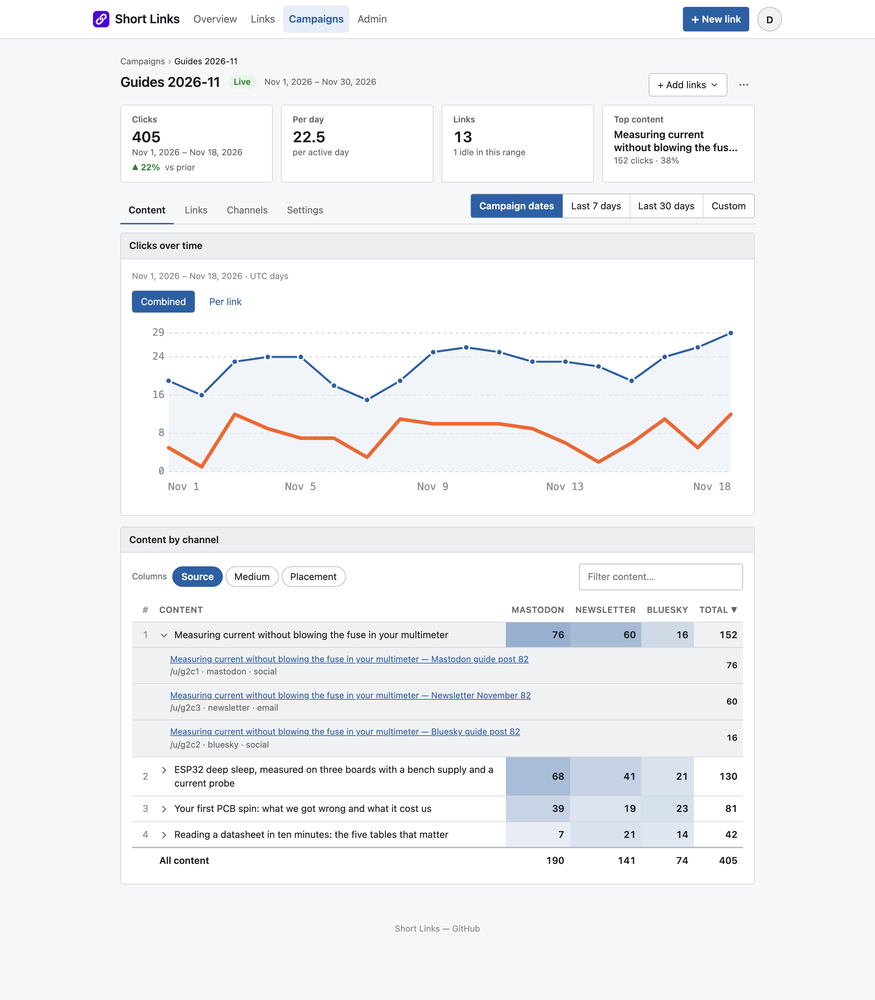
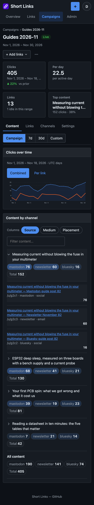
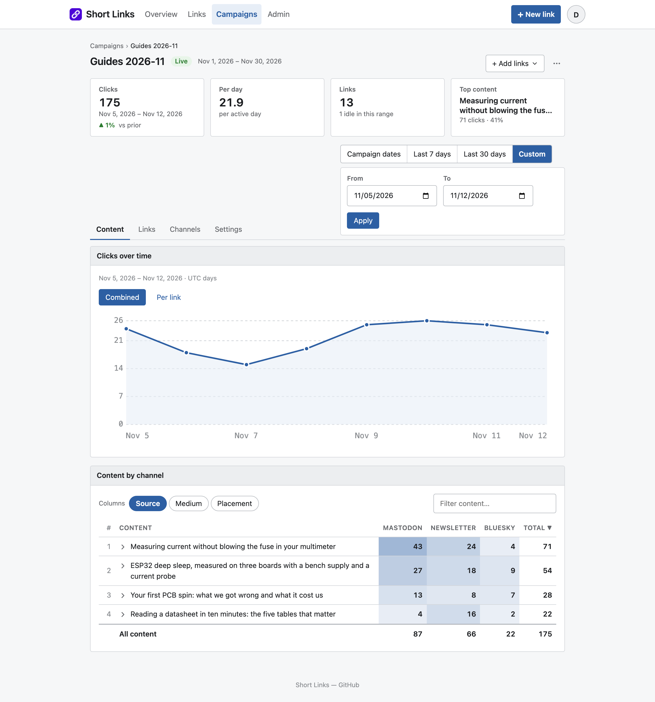
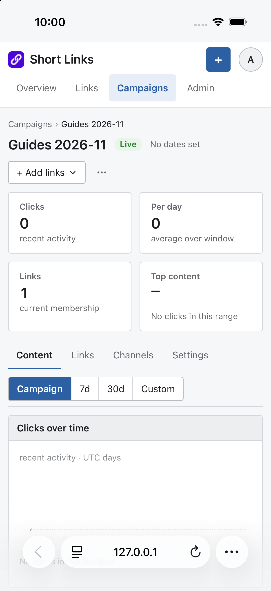

# 0164 — Campaign detail is one long six-panel page with no date range and no view of which content wins on which channel

| | |
|---|---|
| **Status** | closed |
| **Module** | web |
| **Platform** | All |
| **Phase** | 18 — Overview and campaign analytics UI |
| **First seen** | 2026-11-18 |
| **Closed** | 2026-11-18 |
| **Commit** | a31b3d7 |

## Description

Split CampaignDetail into tabs, make a content × channel matrix the default view, and add a date range control. This absorbs [#0124](0124.md) (the campaign range picker).

## Long Description

See [docs/ui-redesign.md](../docs/ui-redesign.md) §3.6.

- Header: breadcrumb, name, status tag, dates, **+ Add links ▾** (batch create and Assign existing, both as dialogs) and ⋯ (edit, archive, delete).
- Tiles: clicks, per day, links (with idle count), top content.
- Tabs in the hash (`?tab=`): **Content** (default), **Links** (#0157's table), **Channels** (the existing source, medium, content and referrer bars; the six-line caveat becomes one line with a "Why?" disclosure), **Placements** (only when placements exist), **Settings**.
- **Content tab:** the chart, then the matrix from `campaign-performance` (#0143). Columns switch between source, medium and placement; cell shade is proportional to clicks; a dash marks a missing pairing. Clicking a cell opens that link, and clicking a title expands its links. Hovering a row highlights its line in the chart.
- **Range control:** campaign dates (default), 7d, 30d, custom. It passes `from`/`to` to every request and is stored in the hash. This meets [#0124](0124.md)'s acceptance criteria; note that on #0124 (only Brennan closes it).

## Acceptance criteria

- Checked in the running app via `scripts/dev.sh` (:5173) and `scripts/sim.sh` (iOS Simulator), in light and dark, at desktop width and about 400px, with screenshots attached to the issue folder.
- `cd web && npm test && npm run build` passes.

## Relation

- Part of: [#0152](0152.md)
- Blocked by: [#0143](0143.md), [#0157](0157.md)
- Absorbs: [#0124](0124.md)
- Related: [#0123](0123.md) (placement CSV should honour the selected range)

## Root cause

CampaignDetail was one long page of six panels that called the campaign stats endpoint with no `from`/`to`, so the server's default window applied to everything (#0124), and nothing summed the links of one piece of content against the channels they were shared on.

## Fix

- `views/CampaignDetail.svelte` is now a header (breadcrumb, name, status tag, dates, **+ Add links** menu, ⋯ menu), four tiles (clicks with change vs prior, per day, links with idle count, top content) and tabs kept in the hash: Content (default), Links (#0157's DataTable, grouping, bulk bar, Export and #0165 undo, unchanged), Channels (the bars; the long caveat is one line with a "Why?" disclosure), Placements (only when a link has one) and Settings (name, dates, default UTMs, archive).
- Range control (`lib/CampaignRange.svelte`): Campaign dates (default), 7d, 30d, custom, stored as `?range=` / `?from=&to=`. It is passed as `from`/`to` to the campaign stats call and to the reports, so every panel moves together (meets #0124). 7d/30d end today exclusive, like the server's default; a custom `to` is inclusive in the control.
- Content tab: the chart, then `lib/CampaignMatrix.svelte` from `campaign-performance`: columns switch between source, medium and placement (`?by=`), cell shade is proportional to clicks, a dash marks a missing pairing, a cell opens its link, a title expands to its links, and pointing at a row draws that content's summed line over the chart (`highlightKeys` on CampaignClicksChart). Phones get one card per content with a chip per channel. `campaign-comparison` supplies the tiles' change, per-day figure and fallback top content.
- Pure helpers and the hash state are in `lib/campaignView.ts` (tested). `lib/viewQuery.ts` is not on main, so the keys (`range`, `from`, `to`) match the Overview's `overviewQuery.ts` and the Links table's `group=0` passes through untouched.
- tz: both report calls use `tz=UTC` on purpose (see the comment in `api.ts`): the matrix must share day boundaries with the chart and Links table, which come from the UTC stats window.
- `Dialog` gained an optional `wide` prop for the batch-create form.
- Not done: the ⋯ menu has Edit and Archive only; there is no campaign delete endpoint. Dev mode (STORAGE=json) has no reports, so the Content tab says so and the tiles fall back to the stats numbers.

## Verification

- `cd web && npm run check` 0 errors; `npm test` 30 files, 650 tests pass; `npm run build` ok.
- Real Postgres (`shortlinks_0164`, migrations + `scripts/dev-seed.sql`, guides campaign given dates Nov 1-30 and one idle link), Go on :8197, Vite on :5197, Playwright Chromium at 1280px and 390px, light and dark: root horizontal overflow 0 in every state (`rootOverflow 0` printed for content, expanded, by-medium, links, channels, placements, settings, 7d, custom range). Hovering a matrix row draws one highlight line (`highlight lines 1`). The 7d and custom ranges changed the tiles, chart and matrix (custom Nov 5-12: 175 clicks, matrix totals 87 + 66 + 22).
- Playwright WebKit iPhone 13, light and dark: content, links and 7d, no overflow.
- iOS Simulator via `scripts/sim.sh` and `simctl openurl` against a dev-mode server: `simulator-content.png`.

Screenshots in `0164/`: `desktop-{light,dark}-*.png` and `phone-{light,dark}-*.png` (content, content-hover, content-expanded, content-by-medium, links, channels, placements, settings, range-7d, range-custom, add-menu, add-dialog), `webkit-iphone-*.png`, `simulator-content.png`.

## Files changed

- `web/src/views/CampaignDetail.svelte`
- `web/src/lib/CampaignMatrix.svelte`, `CampaignRange.svelte` (new)
- `web/src/lib/campaignView.ts`, `campaignView.test.ts` (new)
- `web/src/lib/CampaignClicksChart.svelte` (highlight), `Dialog.svelte` (wide), `api.ts`, `reports.ts`
- `issues/0164.md`, `issues/0164/*.png`

## Review round 1

Merged main (#0163 viewQuery, #0167, #0187), then:

- **Campaign dates dropped the last day.** The stats `to` is exclusive (`parseStatsWindow`, `clicks.campaignWindow`), so `statsRange` now sends `from = starts` and `to = min(ends, today) + 1 day` when the campaign has both dates (one without both keeps the server's 30-day default; a future campaign gets its first day). Tests cover an ended campaign (Oct 1-31 gives `to=2026-11-01`), a running one (includes today) and one-day campaigns. In the running app (Postgres, guides campaign Nov 1-10): request `stats?from=2026-11-01&to=2026-11-11`, chart "214 clicks from 2026-11-01 to 2026-11-10" with Nov 10's 26 clicks on the axis; a Nov 5-5 campaign requests `from=2026-11-05&to=2026-11-06` and shows its 2 clicks. Screenshots `review-*-ended-campaign.png`, `review-*-one-day.png` (desktop light, phone dark).
- **viewQuery adopted.** `viewQuery.parse/serialize/viewPath` take an optional per-view defaults state; `RangeKey` gains `campaign`, valid only for a base whose range is `campaign` (`CAMPAIGN_BASE`). `campaignView.ts` reads and writes range, from, to, group and tab through viewQuery; `by` stays local. `?group=0` is read as `group=link` (verified: a `?tab=links&group=0` link shows grouping off) and rewritten as `group=link` on the next change. The page now uses `route.rawQuery`.
- The reports now wait for the selected range's stats window instead of fetching once with the default window first.
- Nits: removed `RANGE_LABELS`; "vs prior" is hidden under Campaign dates (still shown for 7d/30d/custom: counted 0 and 1); a custom range with no end goes through today (`from=2026-11-05` requests `to=2026-11-20`, today UTC being Nov 19); the combined chart notes that the highlight leaves out links folded into "Other".
- Verification: `npm run check` 0 errors, `npm test` 31 files / 697 tests, `npm run build` ok; servers, temp config and DB cleaned up.

## Work log

| Date | Model | Input | Output | Cache read | Cache write | Cost |
|---|---|---|---|---|---|---|
| 2026-11-18 | claude-sonnet-5-5 | 240 | 113,938 | 23,969,290 | 307,350 | $4.31 |
| 2026-11-18 | claude-opus-5-5 | 48 | 10,055 | 1,509,133 | 79,569 | $0.90 |

**Total: $5.21**
