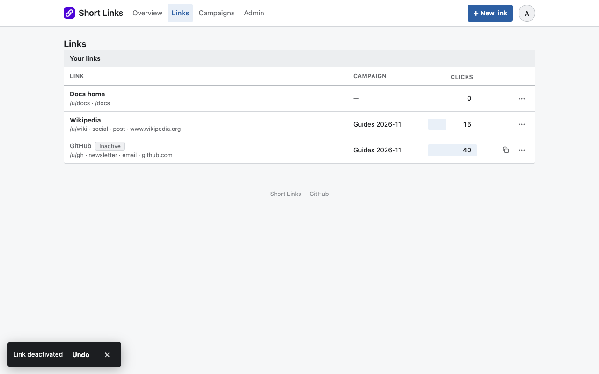
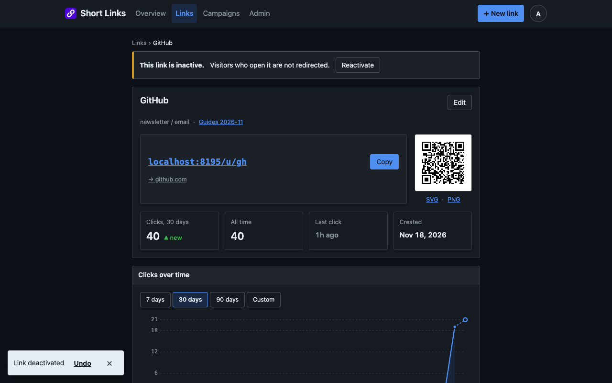
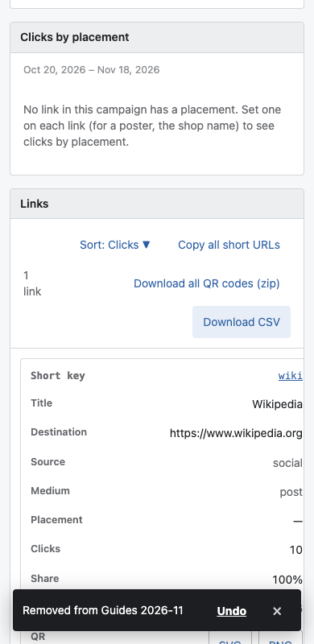

# 0165 — Deactivating a link or removing it from a campaign can't be undone

| | |
|---|---|
| **Status** | resolved |
| **Module** | web |
| **Platform** | All |
| **Phase** | 18 — Overview and campaign analytics UI |
| **First seen** | 2026-11-18 |
| **Closed** | 2026-11-18 |
| **Commit** | 147f666 |

## Description

Replace the confirmation on link deactivate and remove-from-campaign with an Undo toast, now that the API can reactivate links (#0145) and re-assign them.

## Long Description

- `lib/Toast.svelte`: a single toast region (`aria-live=polite`) with an action button. Toasts last 8 seconds, pause on hover or focus, and stack up to three.
- Deactivate → "Link deactivated · Undo" (Undo calls `PATCH {active: true}`). Remove from campaign → "Removed from Guides 2026-11 · Undo" (re-assigns). Bulk actions undo as a group.
- An inactive link's detail page shows a banner with **Reactivate**.
- Irreversible actions (revoke passkey, revoke token, delete filter rule, delete campaign, sign out everywhere) keep ConfirmDialog.

## Acceptance criteria

- Checked in the running app via `scripts/dev.sh` (:5173) and `scripts/sim.sh` (iOS Simulator), in light and dark, at desktop width and about 400px, with screenshots attached to the issue folder.
- `cd web && npm test && npm run build` passes.

## Relation

- Part of: [#0152](0152.md)
- Blocked by: [#0145](0145.md), [#0160](0160.md)

## Root cause

Deactivate and remove-from-campaign were irreversible until #0145 added `PATCH {active: true}`, so #0160 guarded them with a ConfirmDialog. Now that both can be undone, the confirm only adds friction.

## Fix

- `lib/toasts.ts` (store: 8 s lifetime, pause on hover/focus with remaining time kept, max 3, action with busy/error state) and `lib/Toast.svelte` (one `aria-live=polite` region mounted in `App.svelte`).
- `lib/linkActions.ts` holds the shared messages and the 422 `destination_denied` reactivation error text; `reactivateLink()` added to `lib/api.ts` (`active` added to `UpdateLinkInput`).
- LinksList and LinkDetail: Deactivate acts immediately, toast "Link deactivated · Undo" (PATCH `active: true`). LinkDetail's inactive banner has a **Reactivate** button.
- CampaignDetail (minimal edit): Remove acts immediately, toast "Removed from <campaign> · Undo" (re-assigns via `assignLinksToCampaign`).
- ConfirmDialog stays for the irreversible actions (revoke passkey/token, delete filter rule, etc.), untouched.
- Bulk undo: no view has a bulk action yet; a toast's `onaction` is generic, so a bulk action can pass one handler that restores the whole group.

## Verification

- `cd web && npm run check` -> 0 errors, 0 warnings; `npm test` -> 24 test files, 586 tests passed (includes the new `toasts.test.ts` and `linkActions.test.ts`); `npm run build` ok.
- Real Postgres DB (`shortlinks_0165`, migrated, seeded, session cookie in Playwright, since dropped), Go on :8195 and Vite on :5195, Chromium at 1280 and 390 px, light and dark. Scripted flows all passed in all four combinations: list deactivate -> toast -> Undo restores the row; detail deactivate -> banner + toast -> auto-dismissed after ~8 s -> Reactivate clears the banner; campaign Remove -> "Removed from Guides 2026-11" -> Undo restores the row (2 Remove buttons before and after). `scrollWidth == clientWidth` in every state (no root horizontal scroll).
- Screenshots:    plus the `*-390-*`, `*-dark` and `*-undone-*` variants in `issues/0165/`.
- `scripts/sim.sh` ran once (`0165/sim-iphone.png`, round 1); the simulator has no session cookie, so it only shows the login page and could not show the toast. Mobile layout was checked in Chromium at 390 px instead.

## Files changed

`web/src/lib/toasts.ts`, `toasts.test.ts`, `Toast.svelte`, `linkActions.ts`, `linkActions.test.ts`, `api.ts`; `web/src/App.svelte`; `web/src/views/LinksList.svelte`, `LinkDetail.svelte`, `CampaignDetail.svelte`; `issues/0165.md`, `issues/0165/*.png`.

## Review round 1

Changes requested by review, all done in new commits after `git merge main`:

- **iOS check.** Started Go in dev mode (`STORAGE=json`, auto-login) on :8195 and Vite on :5195 (temporary config, removed), then `xcrun simctl openurl booted http://localhost:5195/#/links` and `xcrun simctl io booted screenshot`: `0165/sim-iphone-links.png` shows the signed-in Links list on the iPhone 17 simulator (iOS 26.5). I cannot tap in the Simulator, so the toast and the Reactivate banner are shown with Playwright WebKit iPhone 15 emulation against a temporary Postgres DB (since dropped): `0165/webkit-iphone-list-toast.png` and `0165/webkit-iphone-detail-banner.png` (no horizontal scroll: scrollWidth 393 = clientWidth 393).
- **Focus after Undo.** `ToastInput.returnFocus` (a lazy resolver). LinksList returns to the row's ⋯ button, LinkDetail to its More actions button, CampaignDetail to the `<h1>`; fallback is the page `<h1>`, then `<main>` (now `tabindex="-1"`). Checked in Chromium: after Undo the active element is `button[Actions for GitHub]`, `button[More actions]` and `h1.detail-title` respectively.
- **Keyboard.** Alt+Z focuses the latest toast's Undo (or dismiss) button; the region's aria-label says so. Checked: Alt+Z lands on `button.act[Undo]`, Enter undoes.
- **Timer.** Mouse-leave and focus-out no longer restart the timer while an action runs (new unit test).
- **401 during Undo** now clears `currentUser` in all three views.
- **Dead code.** Removed `unassignError` and its unused CSS from CampaignDetail.
- Re-run: `npm run check` 0 errors 0 warnings, `npm test` 28 files / 610 tests passed, `npm run build` ok.

## Work log

| Date | Model | Input | Output | Cache read | Cache write | Cost |
|---|---|---|---|---|---|---|
| 2026-11-18 | claude-sonnet-5-5 | 144 | 42,915 | 6,721,674 | 120,816 | $1.40 |
| 2026-11-18 | claude-opus-5-5 | 36 | 5,959 | 1,009,658 | 57,716 | $0.61 |

**Total: $2.01**
