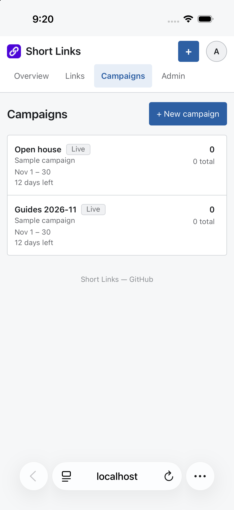
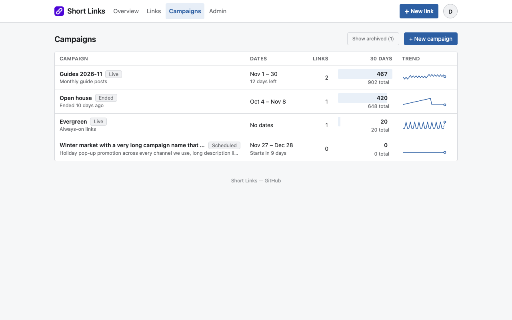
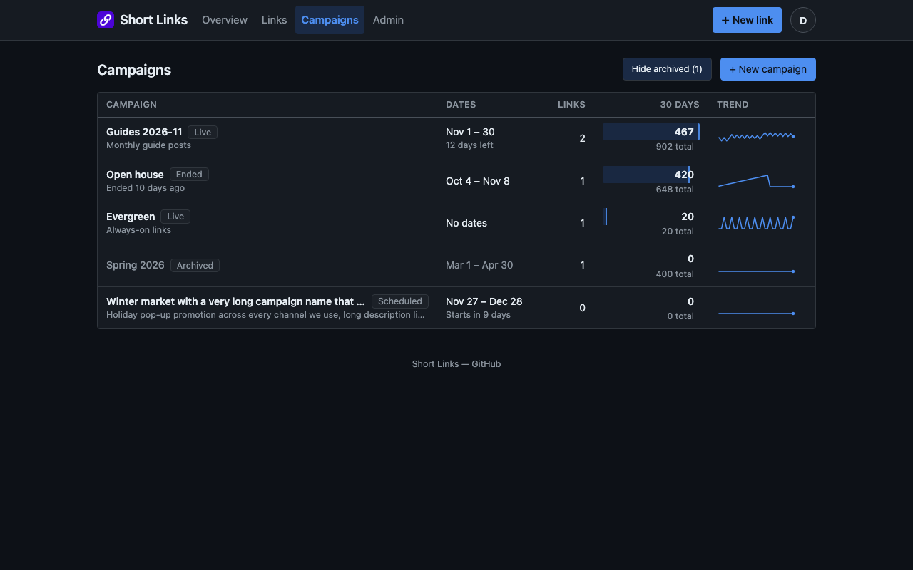
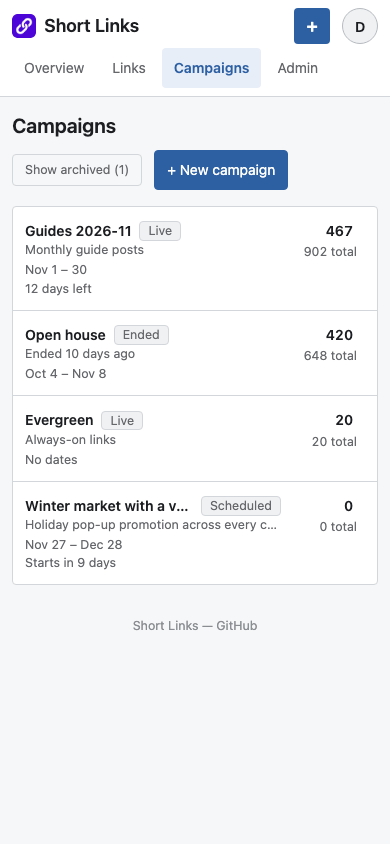
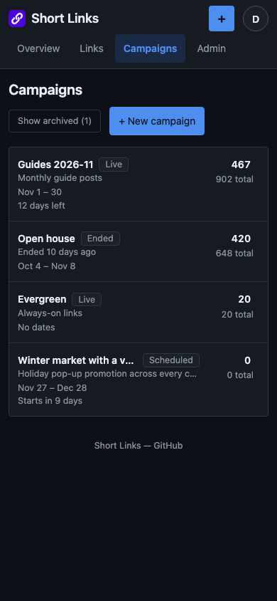
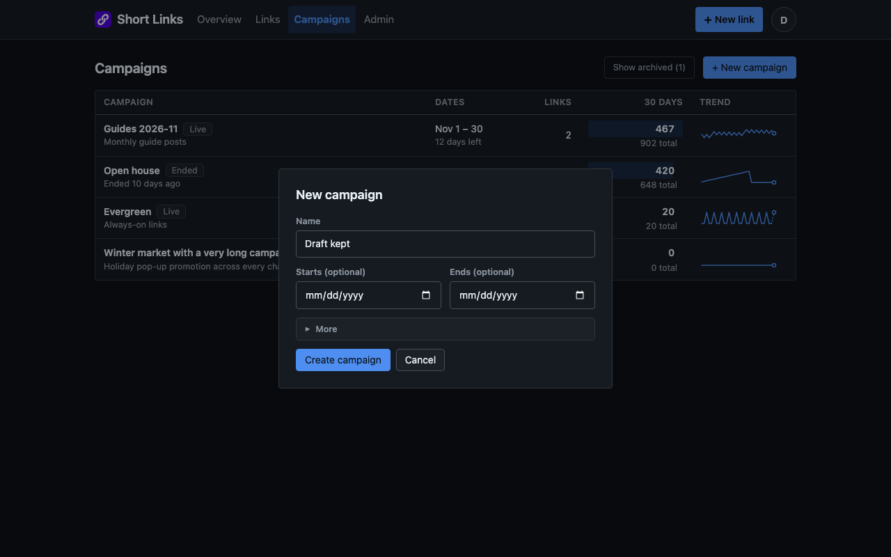
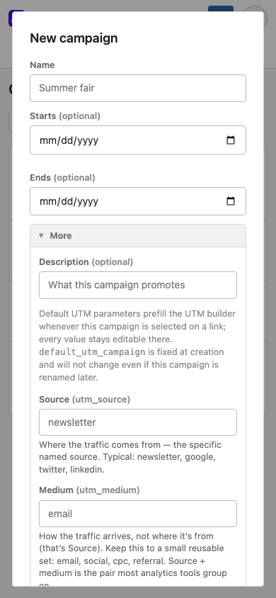

# 0166 — The campaigns list leads with a create form, ranks by all-time clicks, and its Trend column is a placeholder

| | |
|---|---|
| **Status** | resolved |
| **Module** | web |
| **Platform** | All |
| **Phase** | 18 — Overview and campaign analytics UI |
| **First seen** | 2026-11-18 |
| **Closed** | 2026-11-18 |
| **Commit** | b342e6b |

## Description

`CampaignsList.svelte:167-253` puts the create form first, clicks are all-time only (`:285`) and Trend is a permanent dash (`:301`). Make the list the page, sorted by recent activity, with 30-day clicks and real sparklines.

## Long Description

See [docs/ui-redesign.md](../docs/ui-redesign.md) §3.5.

- Columns: Campaign (two-line: name and status tag, then description or "Ended 10 days ago"), Dates, Links, 30 days (InlineBar, with all-time as a second line), Trend (Sparkline).
- Data from `GET /api/campaigns?sort=activity` with `clicks_30d`, `sparkline` and `status` (#0146).
- **+ New campaign** opens a dialog (name and dates; description and default UTMs under More). **Show archived (N)** is a toggle.
- Under 700px, rows become cards.

## Acceptance criteria

- Checked in the running app via `scripts/dev.sh` (:5173) and `scripts/sim.sh` (iOS Simulator), in light and dark, at desktop width and about 400px, with screenshots attached to the issue folder.
- `cd web && npm test && npm run build` passes.

## Relation

- Part of: [#0152](0152.md)
- Blocked by: [#0146](0146.md), [#0155](0155.md), [#0161](0161.md)

## Root cause

`CampaignsList.svelte` was built before the redesign: a create form came first, the table showed only all-time clicks (so a dead campaign outranked this month's) and Trend was a permanent dash. #0146 now supplies `clicks_30d`, `sparkline` and `status`, and #0155/#0161 supply DataTable and Sparkline.

## Fix

- The list is the page: `listCampaigns` now calls `GET /api/campaigns?sort=activity`; `CampaignWithCounts` gains `clicks_30d`, `sparkline`, `status`.
- DataTable columns: Campaign (TwoLineCell, status tag, description or "Ended 10 days ago"), Dates (compact range plus "12 days left" / "Starts in 9 days"), Links, 30 days (InlineBar with all-time total beneath), Trend (Sparkline from the 30 daily counts).
- **+ New campaign** opens a native `<dialog>` (name, dates; description and default UTMs under More). After creating, the app opens the new campaign, since it has no clicks and would sort last.
- **Show/Hide archived (N)** is a toggle button. Rows become cards under 900px (DataTable's breakpoint, not 700px).
- New pure helpers in `lib/campaigns.ts` with unit tests: `compactDateRange`, `campaignTimingLine`, `campaignSubline`, `campaignStatusLabel`, `sparklineDays`.

## Verification

- `cd web && npm run check` 0 errors; `npm test` 524 passed; `npm run build` OK.
- Real Postgres DB `shortlinks_0166` (migrated, seeded live/ended/scheduled/no-dates/archived campaigns with clicks, session cookie in Playwright, dropped afterwards). No root horizontal scroll at 1280 or 390, light or dark. Create flow: invalid dates disable submit, valid create navigates to the new campaign.
- Simulator (`scripts/sim.sh`, dev-mode data, so zero clicks): 

## Files changed

- `web/src/views/CampaignsList.svelte`
- `web/src/lib/campaigns.ts`, `campaigns.test.ts`, `api.ts`, `types.ts`
- `issues/0166.md`, `issues/0166/*.png`

## Review fixes

- Dialog backdrop bug: `padding: 0` on the `<dialog>`, padding moved to the inner `.dialog-form` (as NewLinkDialog does). In the running app (Postgres-backed, 1280 and 390, light and dark): clicking 4px inside the dialog edge kept it open with the typed draft intact, and Escape closed it.
- Escape and backdrop clicks are blocked while a create is in flight (`oncancel` calls `preventDefault` while `creating`).
- **Cards switch at 900px** (DataTable's breakpoint), which replaces the 700px in docs/ui-redesign.md section 3.5.
- Sparkline gets `partialLast` (today is partial); `listCampaigns` sends `tz=getChartTimeZone()` (request seen: `/api/campaigns?sort=activity&tz=America%2FLos_Angeles`).
- Shared InlineBar: the 2px end line cut through the number when the bar reached it, so the line is removed (fill only) and the number has 4px extra right padding.
- Archived toggle: dropped `aria-pressed`; the Show/Hide label carries the state.
- Re-verified: check 0 errors, 555 tests pass, build OK; screenshots in `issues/0166/` refreshed (no horizontal scroll).

## Work log

| Date | Model | Input | Output | Cache read | Cache write | Cost |
|---|---|---|---|---|---|---|
| 2026-11-18 | claude-sonnet-5-5 | 138 | 48,232 | 7,469,482 | 136,485 | $1.57 |
| 2026-11-18 | claude-opus-5-5 | 20 | 5,282 | 523,966 | 47,558 | $0.45 |

**Total: $2.02**
