# 0167 — The links list can't be searched, filtered or sorted by clicks, and has no bulk actions

| | |
|---|---|
| **Status** | closed |
| **Module** | web |
| **Platform** | All |
| **Phase** | 19 — UI depth and polish |
| **First seen** | 2026-11-18 |
| **Closed** | 2026-11-18 |
| **Commit** | 3c16b4d |

## Description

Add search, filters, sorting, the 30-day clicks column, group-by-content and bulk actions to `#/links`, using the query parameters from #0144.

## Long Description

See [docs/ui-redesign.md](../docs/ui-redesign.md) §3.3.

- Toolbar: search (title, key or URL; `/` focuses it), Campaign, Source, Status (default Active), Sort (Clicks 30 days, Clicks all time, Newest, Title).
- Columns: add **30 days** (InlineBar) beside All time.
- Group by: Content or None. Grouped rows match the Overview's top-content rows.
- Bulk bar: Copy URLs, Assign to campaign ▾, Deactivate (with Undo, #0165).
- All state in the hash via `viewQuery` (#0163). Pagination is kept.

## Acceptance criteria

- Checked in the running app via `scripts/dev.sh` (:5173) and `scripts/sim.sh` (iOS Simulator), in light and dark, at desktop width and about 400px, with screenshots attached to the issue folder.
- `cd web && npm test && npm run build` passes.

## Relation

- Part of: [#0152](0152.md)
- Blocked by: [#0144](0144.md), [#0156](0156.md), [#0163](0163.md)

## Root cause

`LinksList` fetched `GET /api/links?page=&per_page=` only: newest first, all-time clicks, no query parameters. There was no way to search, filter or sort across pages, no 30-day figure, and DataTable's select column was hidden because no bulk actions existed. The filter state could not live in the URL because `viewQuery` had no search, status or page.

## Fix

- `lib/api.ts`: `searchLinks` / `linkListQueryString` call the #0144 parameters (`q`, `campaign`, `source`, `medium`, `status` always sent, `sort`, `window=30d`, `tz`). `Link` gains `content_key`, `label`, `campaign_slug`, `clicks_window`.
- `lib/viewQuery.ts`: `ViewState` gains `q`, `status`, `page` (defaults omitted from the hash).
- `lib/linksList.ts` (new, pure, tested): hash state to API query, sort and status options, grouping by content key, bulk messages, previous-campaign bookkeeping, and `linksHrefFromOverview`.
- `views/LinksList.svelte`: toolbar (search with `/` to focus, Campaign, Source and Medium via FacetFilter with chips, Status default Active, Group by Content/None, Sort), 30 days column (InlineBar) beside All time, select column re-enabled, pagination kept (page in hash). Bulk bar: Copy URLs, Assign to campaign (including "No campaign"), Deactivate. Deactivate and assign/remove are reversible and use #0165 Undo toasts (Undo restores each link's previous campaign); no ConfirmDialog is needed since nothing here is irreversible. SSE-created links are prepended only where they belong (newest first, unfiltered, page 1). Phone: filters fold behind a Filters button.
- `views/Overview.svelte`: "View all links" carries campaign, Source and Medium into `#/links`.
- `lib/DataTable.svelte`: bulk bar wraps on narrow screens.

Limitations: grouping by content applies to the links on the current page (the API pages links, not content). The Overview's other UTM filters (UTM campaign, content, placement, term) have no `GET /api/links` equivalent and are not carried.

## Verification

- `cd web && npm run check`: 0 errors, 0 warnings. `npm test`: 30 files, 663 tests pass (new `linksList.test.ts`). `npm run build` succeeds. No Go changes.
- Real Postgres (`shortlinks_0167`, `scripts/dev-seed.sql`, 33 links, 2,476 clicks), Playwright flow against the running app: `/` focuses search; typing writes `q=` to the hash and queries the server; Copy URLs puts both short URLs on the clipboard; bulk Deactivate flips both links inactive server-side, Undo reactivates; bulk Assign to "Poster run" moves both from partner-outreach, Undo restores partner-outreach; Overview "View all links" href is `#/links?campaign=guides-2026-11&source=mastodon` and lands on 4 links; `page=2` and `sort=title` persist in the hash.
- No root horizontal scroll at 1280px or 390px, light or dark, and on WebKit iPhone 14 (overflow 0px).
- iOS Simulator via a `STORAGE=json` server on :8198 and `xcrun simctl openurl`.

Screenshots: 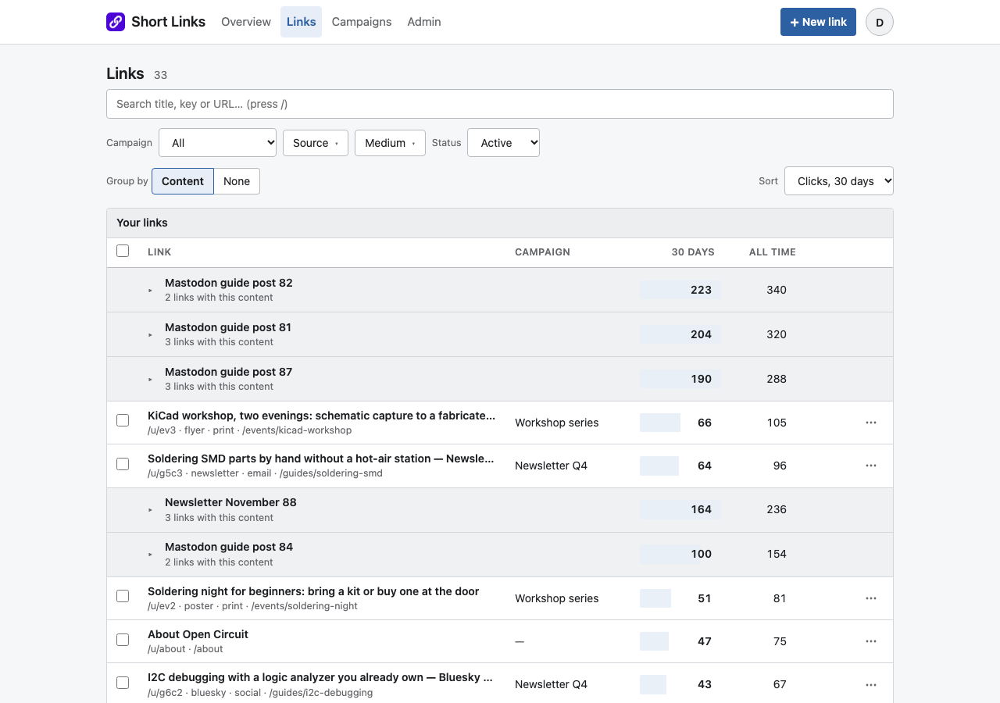 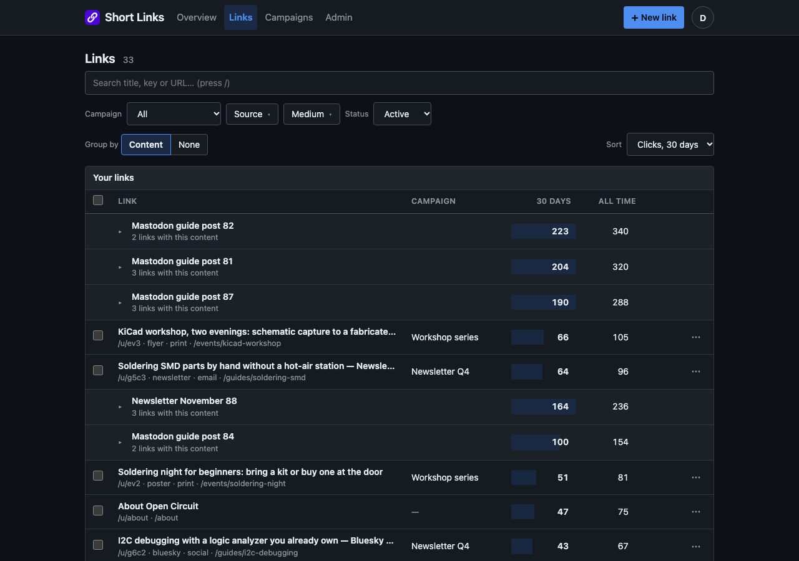 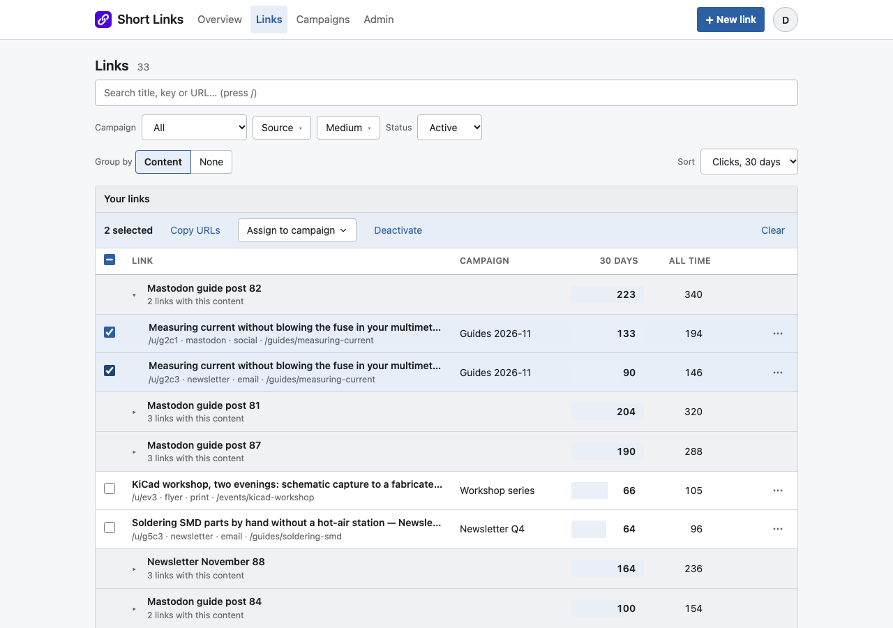 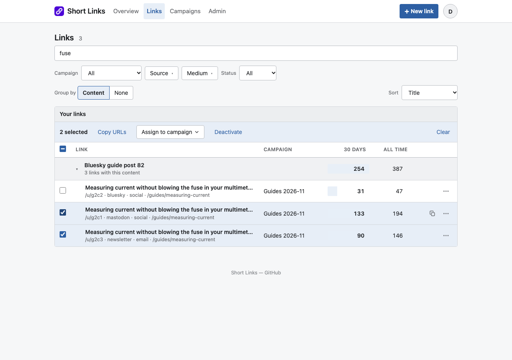 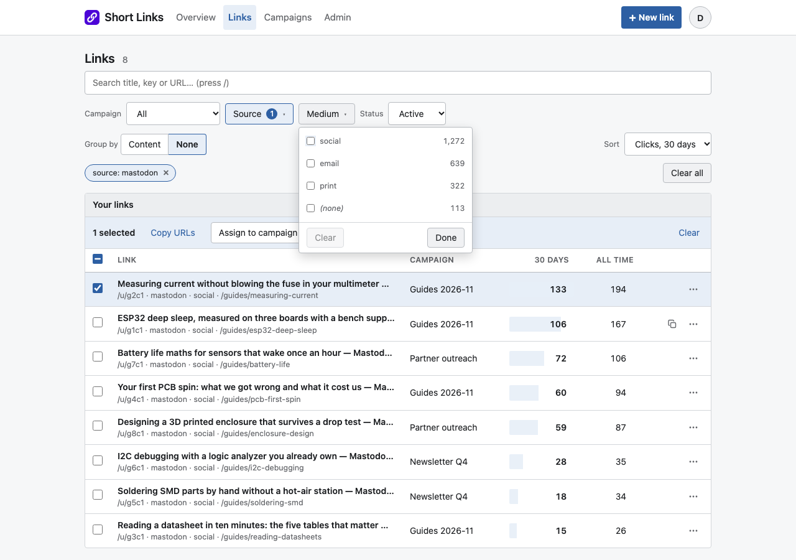 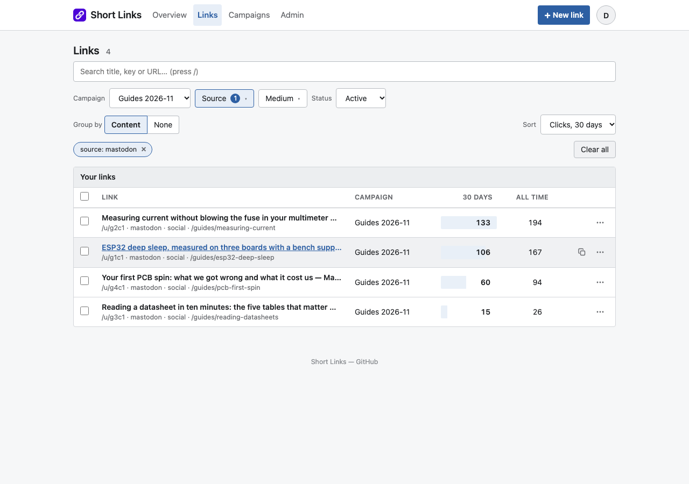 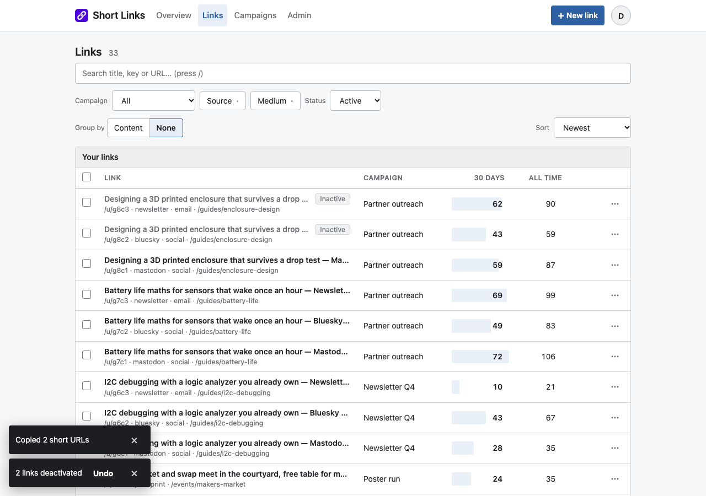 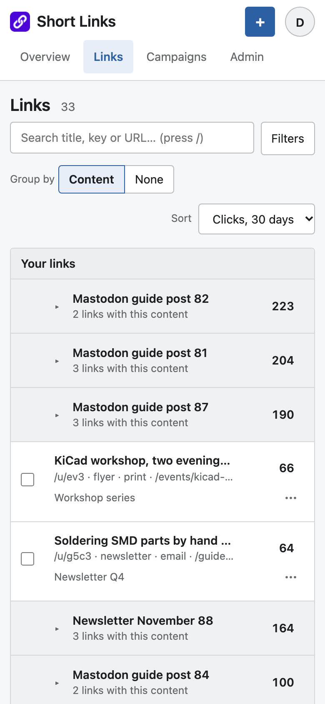 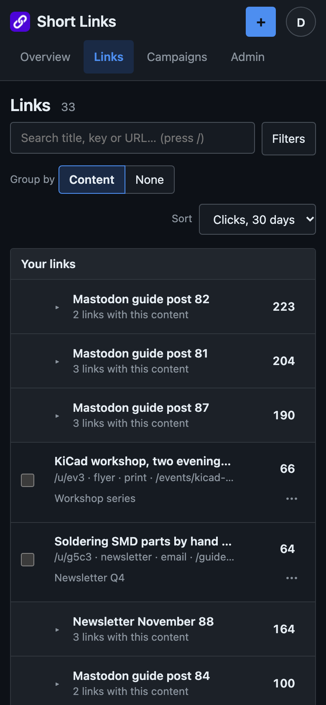 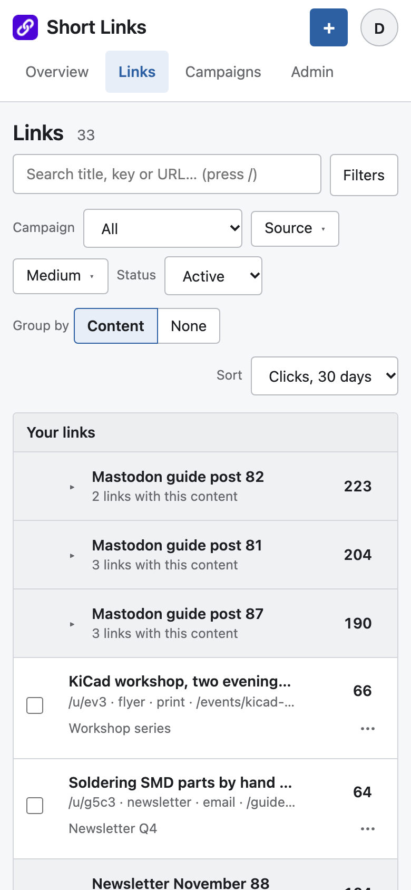 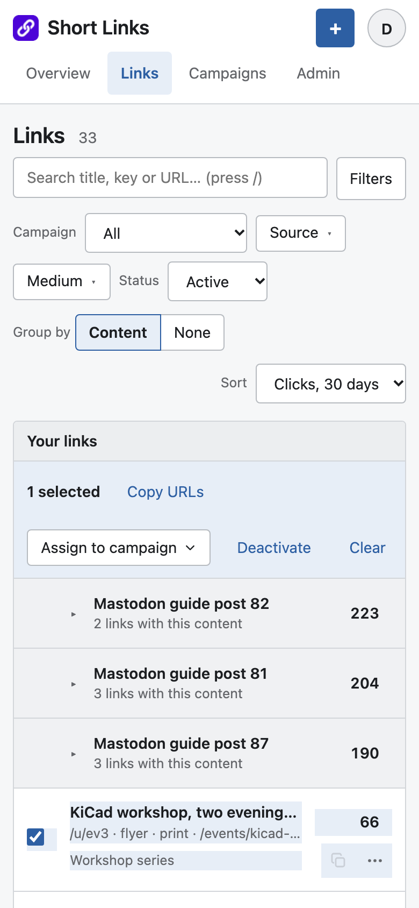 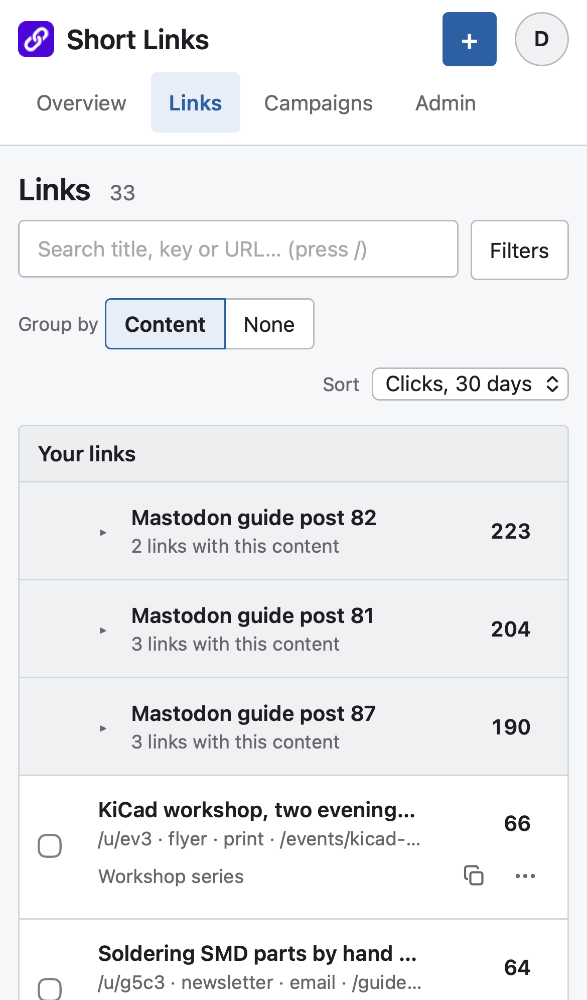 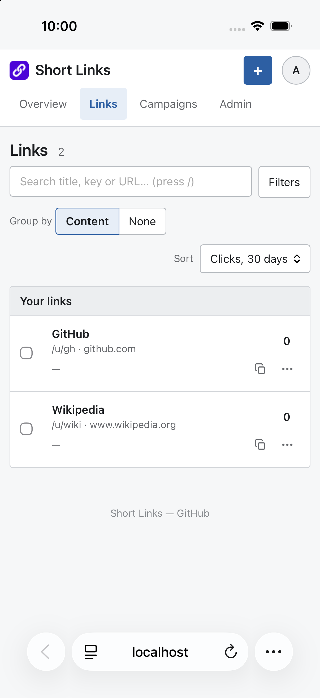

### Review round 1

- `GET /api/links` filters now go out as one parameter per value, with a lone value escaped (`appendFilterValues` in `viewQuery.ts`, shared with `reportQuery`), so a value containing a comma matches exactly (#0187). Test added.
- A pending search debounce is cleared when the hash's `q` changes (Back).
- A partly failed bulk assign now reports how many moved and offers Undo for exactly those links.
- `group` is no longer in the fetch key, so toggling it does not refetch.
- Group rows read "N links on this page".
- The 30-day bar is visible on selected rows.
- Re-verified after merging main: `npm run check`, `npm test` and `npm run build` pass.

## Files changed

- `web/src/views/LinksList.svelte`, `web/src/views/Overview.svelte`
- `web/src/lib/linksList.ts`, `web/src/lib/linksList.test.ts` (new)
- `web/src/lib/api.ts`, `web/src/lib/types.ts`, `web/src/lib/viewQuery.ts`, `web/src/lib/DataTable.svelte`
- `issues/0167.md`, `issues/0167/*.png`

## Work log

| Date | Model | Input | Output | Cache read | Cache write | Cost |
|---|---|---|---|---|---|---|
| 2026-11-18 | claude-sonnet-5-5 | 136 | 60,553 | 8,042,516 | 163,033 | $1.82 |
| 2026-11-18 | claude-opus-5-5 | 24 | 7,093 | 649,432 | 71,529 | $0.63 |

**Total: $2.45**
