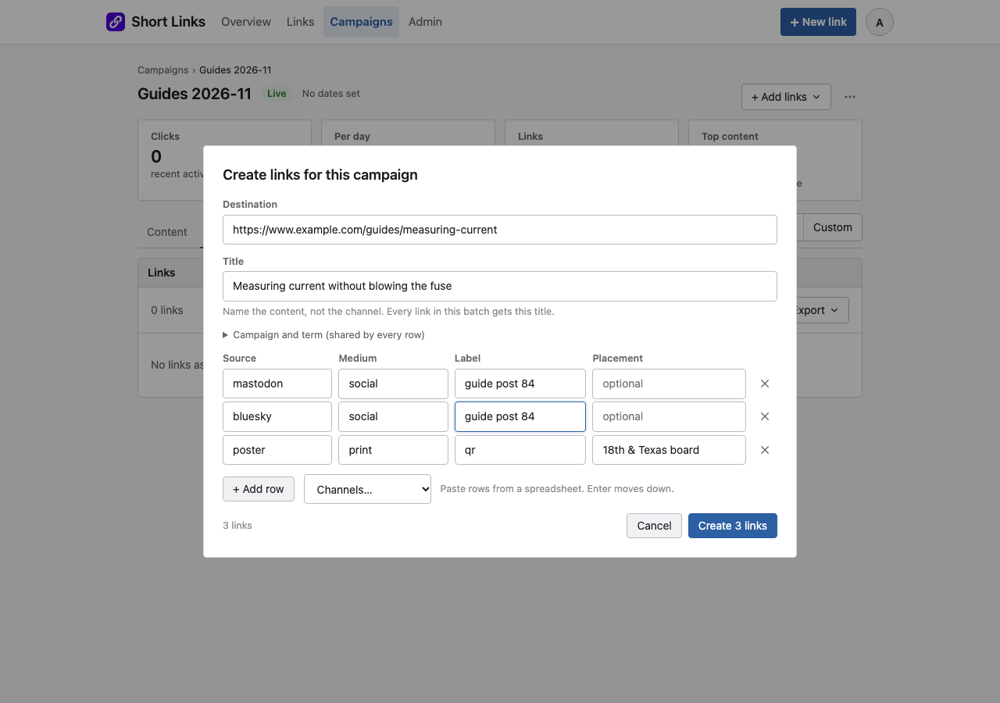
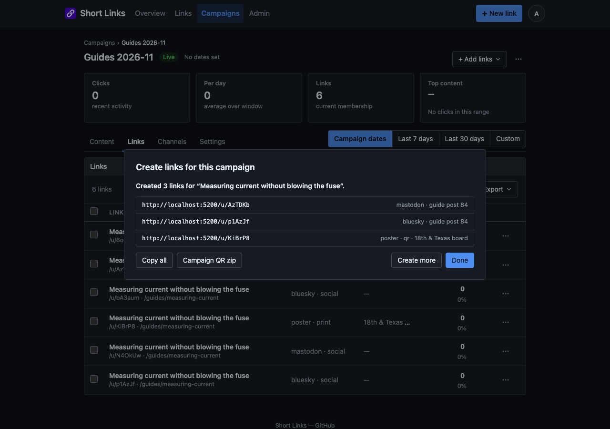
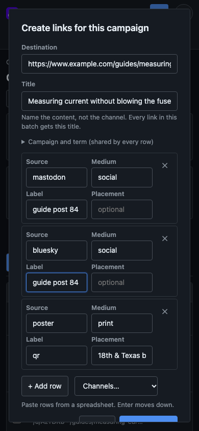
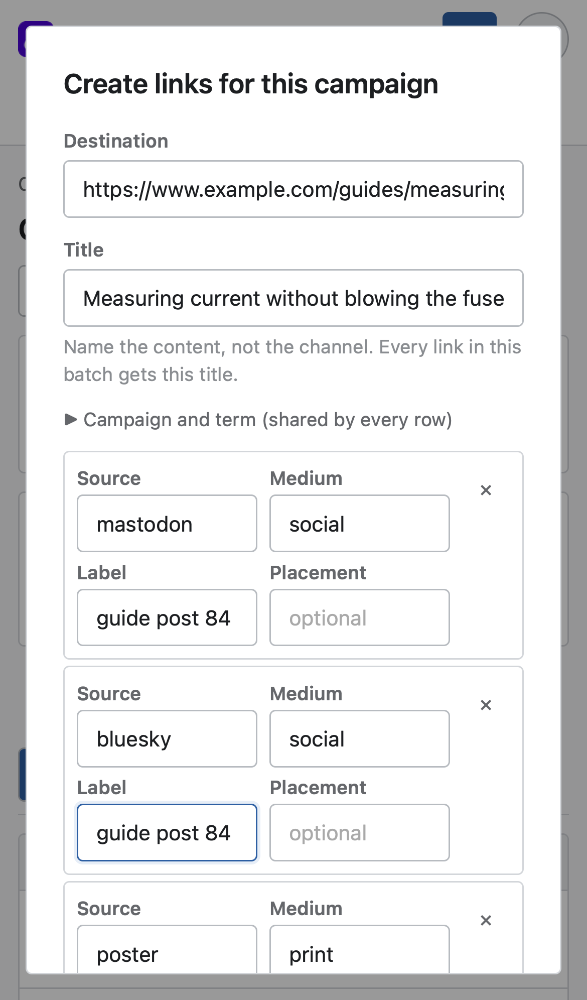
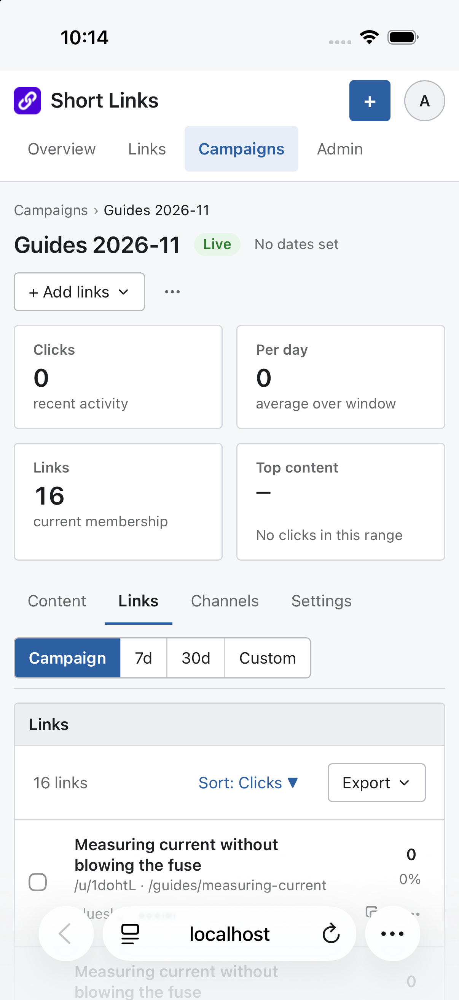

# 0168 — Batch create is a tall stack of five inputs per row, and each row gets its own title, which causes the title-suffix noise

| | |
|---|---|
| **Status** | resolved |
| **Module** | web |
| **Platform** | All |
| **Phase** | 19 — UI depth and polish |
| **First seen** | 2026-11-18 |
| **Closed** | 2026-11-18 |
| **Commit** | 2dbf001 |

## Description

Rebuild batch create as a grid: the destination and title are shared, and each row's per-channel label goes into `utm_content` instead of the title. This is the structural fix for titles like "… — Mastodon guide post 84".

## Long Description

See [docs/ui-redesign.md](../docs/ui-redesign.md) §3.7.

- Shared fields on top: Destination and Title. The grid has Source, Medium, Label (→ `utm_content`), Placement and a remove ✕.
- Tab and Enter move between cells. Pasting tab-separated text fills rows.
- Presets remember the last-used set of channels per browser (`localStorage`, wrapped in try/catch).
- The result screen lists the created short URLs with Copy all and QR zip.
- Opened from **+ Add links ▾** on CampaignDetail (#0164).
- Send an `Idempotency-Key` (#0147) so a double submit doesn't create two sets.

## Acceptance criteria

- Vitest covers TSV paste parsing.
- Checked in the running app via `scripts/dev.sh` (:5173) and `scripts/sim.sh` (iOS Simulator), in light and dark, at desktop width and about 400px, with screenshots attached to the issue folder.
- `cd web && npm test && npm run build` passes.

## Relation

- Part of: [#0152](0152.md)
- Blocked by: [#0147](0147.md), [#0164](0164.md)
- Related: guide-post publishing in the OCSF tool writes channel suffixes into titles; changing it there is outside this repo

## Root cause

Batch create (#0105) was a stack of five inputs per row, and every row carried its own Title. Channel names were typed into titles ("... - Mastodon guide post 84") because there was no per-row place for the label other than the title.

## Fix

- `web/src/lib/BatchCreateLinks.svelte` is now a grid. Shared Destination and Title sit on top, with utm_campaign/utm_term under a disclosure. Each row is Source, Medium, Label (sent as `utm_content`), Placement and a remove button. On phones each row becomes a labelled 2x2 block.
- One Title goes to every link (`buildBatchCreateRows` takes a `sharedTitle`). The per-row title field is gone.
- Enter moves to the same cell in the next row and adds a row at the end. Pasting tab-separated text (header row optional) fills rows from the focused cell.
- The last-used source+medium set is stored in `localStorage` (try/catch) and offered in a "Channels" select, together with "Campaign defaults" and "Blank". It loads on open.
- Each submit sends an `Idempotency-Key` (#0147). The key is reused for an identical retry and renewed when the payload changes (`keyForPayload`).
- The result screen lists the short URLs with Copy all, QR zip (the campaign's `qr.zip`), Create more and Done. CampaignDetail's dialog passes `onclose` and drops its own Close button.
- New `web/src/lib/batchGrid.ts` (pure helpers); `api.ts` accepts extra headers on POST.

## Verification

- `cd web && npm run check` reported 0 errors and 0 warnings.
- `npm test` reported 32 files and 716 tests passing, including the new `batchGrid.test.ts` (TSV parsing, paste application, presets, idempotency key, shared title).
- `npm run build` succeeded. No Go code changed.
- Playwright (Chromium 1280px and 390px, light and dark; WebKit iPhone 14 light) against a dev-mode Go server: pasting a 4-line TSV with headers filled 3 rows, Enter moved focus to `batch-1-utm_content`, and a double-click on "Create 3 links" sent exactly one `POST .../links/batch` carrying an `Idempotency-Key`. The preset was saved to localStorage. No root horizontal scroll at any width.
- iOS Simulator via `scripts/sim.sh`: `ios-sim-campaign-links.png` shows the campaign Links tab. The dialog could not be opened there, since the simulator can't be tapped from this environment. The phone layout of the dialog is covered by the WebKit iPhone shots.
- The dev store does not replay idempotent responses (that needs Postgres); replay is covered by #0147's tests.
- The desktop shots predate two cosmetic tweaks (the Channels select was full width, and the Placement placeholder read "18th & Texas board" instead of "optional").

## Review round 1

- The result-screen download is now a `.btn-link` anchor labelled "Campaign QR zip"; the local `a.btn` rule is gone.
- Cell labels use `.sr-only` above 600px (visible on phones) and carry the row number, e.g. "Source, row 2". Playwright `getByLabel('Source, row 2')` finds exactly one input at desktop and phone width.
- Shift+Enter in a cell is swallowed, so it can't submit the form.
- Removed the per-row `title` from `BatchChannelRow` (nothing else used it). `buildBatchCreateRows` now takes `sharedTitle = ''`, and the related tests were updated.
- "Create more" and "Done" sit in a no-wrap group, so Done stays on the same line at 390px.
- `npm run check` 0 errors; `npm test` 715 passing (one test removed with the title field); `npm run build` succeeded. The `issues/0168/*` desktop and phone shots were retaken, including `desktop-light-3-result.png`.

## Files changed

- `web/src/lib/BatchCreateLinks.svelte`
- `web/src/lib/batchGrid.ts`, `web/src/lib/batchGrid.test.ts` (new)
- `web/src/lib/api.ts`, `web/src/lib/campaigns.ts`
- `web/src/views/CampaignDetail.svelte` (dialog wiring only)
- `issues/0168.md`, `issues/0168/*.png`

## Work log

| Date | Model | Input | Output | Cache read | Cache write | Cost |
|---|---|---|---|---|---|---|
| 2026-11-18 | claude-sonnet-5-5 | 114 | 45,568 | 5,842,061 | 128,614 | $1.36 |
| 2026-11-18 | claude-opus-5-5 | 20 | 5,734 | 538,823 | 53,452 | $0.49 |

**Total: $1.85**
