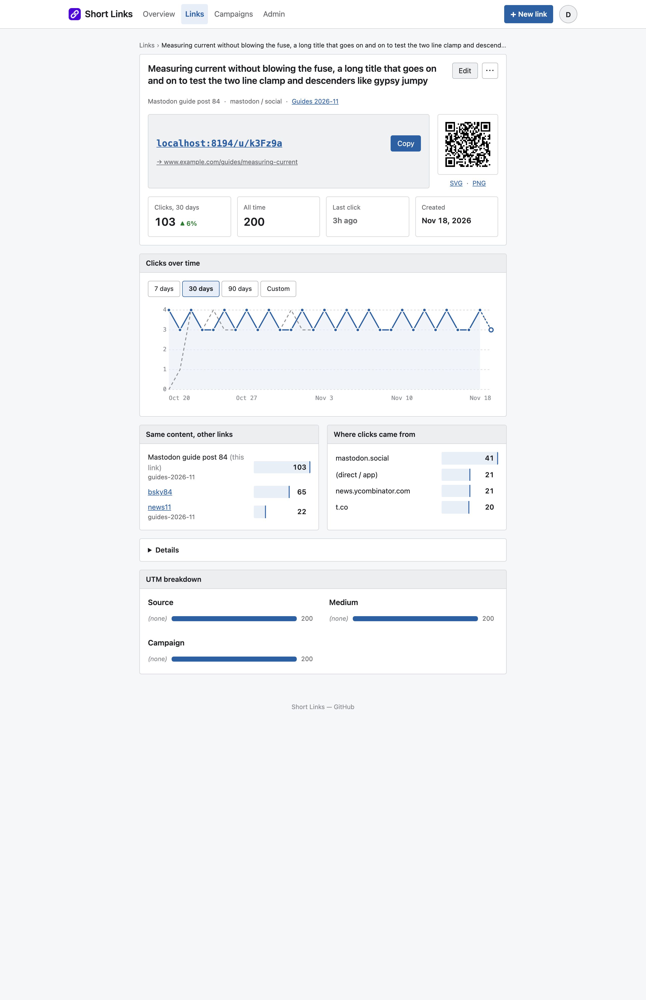
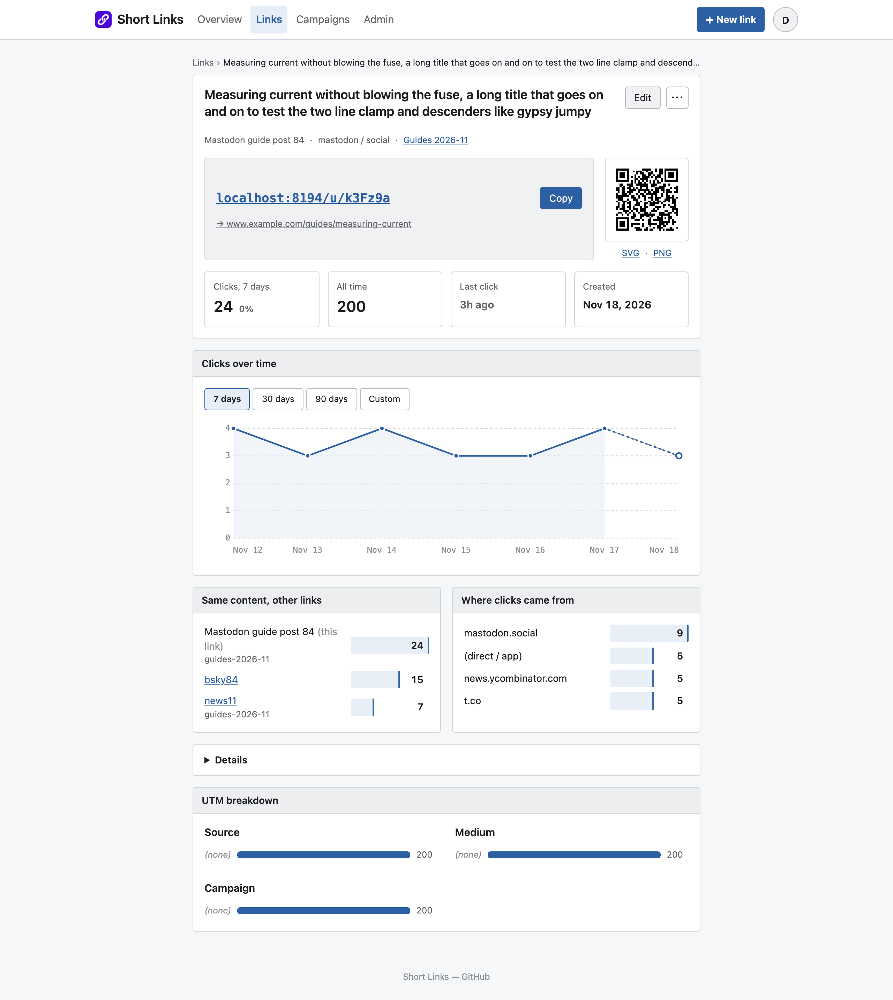
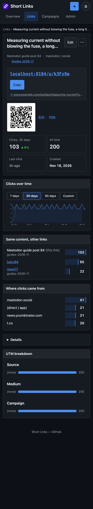

# 0169 — Link detail doesn't show the same content's other links, where clicks came from, or when the link was last clicked

| | |
|---|---|
| **Status** | closed |
| **Module** | web |
| **Platform** | All |
| **Phase** | 19 — UI depth and polish |
| **First seen** | 2026-11-18 |
| **Closed** | 2026-11-18 |
| **Commit** | 59bb54a |

## Description

Add "Same content, other links", a referrer breakdown, last click and a range control to link detail, from `link-performance` (#0143).

## Long Description

See [docs/ui-redesign.md](../docs/ui-redesign.md) §3.4. Siblings show their label, an InlineBar of clicks and "(this link)". Referrers show hostnames with `(direct / app)`. Add a Last click tile, and a range control (7d, 30d, 90d, custom) stored in the hash.

## Acceptance criteria

- Checked in the running app via `scripts/dev.sh` (:5173) and `scripts/sim.sh` (iOS Simulator), in light and dark, at desktop width and about 400px, with screenshots attached to the issue folder.
- `cd web && npm test && npm run build` passes.

## Relation

- Part of: [#0152](0152.md)
- Blocked by: [#0143](0143.md), [#0159](0159.md)

## Root cause

Link detail showed only the link's own 30-day series. Nothing used the `link-performance` report (#0143), so there were no sibling links, referrers, last click or previous-period comparison, and the range was fixed.

## Fix

- `web/src/lib/linkReport.ts` (+ tests): range state in the hash (`?range=7d|90d` or `?range=custom&from=&to=`, 30d omitted), report query, `percentChange`, `siblingRows`, `referrerLabel` ("(direct / app)"), scheme stripping and slash-only line breaks.
- `api.ts`: `getLinkPerformance`.
- `LinkDetail.svelte`: range control (7/30/90/Custom) above the chart; chart uses the report series with the previous-period line and "today so far" tail; tiles gain Last click and a ▲/▼ % change; new "Same content, other links" (this link + siblings, InlineBar, "(this link)") and "Where clicks came from" panels. If the report is unavailable (in-memory dev server) the view falls back to the old 30-day chart and hides the new pieces.
- #0159 review nits: (1) the ⋯ button is a plain disclosure (`aria-expanded` + `aria-controls`, no menu roles); Escape closes it and refocuses the trigger. (2) Save/Cancel on Edit focus the `<h1>` (`tabindex=-1`). (3) `.detail-title` gets `line-height: 1.35` and bottom padding. (4) Short URL shown without scheme and breaks only after `/` (`<wbr>`); phone QR row gap tightened. (5) Last click tile and % change added.

## Verification

- `cd web && npm ci && npm run check && npm test && npm run build`: 0 errors, 532 tests pass, build OK.
- Real Postgres `shortlinks_0169` (migrated, seeded 4 links, 1 campaign, ~300 clicks, a session row; dropped afterwards). Go on :8194, Vite on :5194. Playwright (Chromium) at 1280 and 390, light and dark; root horizontal overflow 0 in all four.
- Range: clicking 7 days sets `#/links/k3Fz9a?range=7d` and the tile reads "Clicks, 7 days 21 ▼ 12%"; Custom writes `range=custom&from=…&to=…`; reload keeps Custom active.
- Focus: Escape closes the disclosure and focus is on the trigger; after Cancel and after Save, `document.activeElement` is H1.
- iOS Simulator: `scripts/sim.sh` loaded the app but showed the sign-in page (Safari has no session cookie for the Postgres-backed server), so the simulator did not show this view. Phone layout was checked with Playwright at 390px only.

Also in `issues/0169/`: `detail-dark-1280.png`, `detail-light-390.png`, `range7-light-390.png`, `custom-light-1280.png`, `custom-light-390.png`.

## Files changed

- `web/src/lib/linkReport.ts`, `web/src/lib/linkReport.test.ts` (new)
- `web/src/lib/api.ts`
- `web/src/views/LinkDetail.svelte`
- `issues/0169.md`, `issues/0169/*.png`

## Review round 1

Merged `main` (no conflicts), then:

- `reportQuery` now sends `tz=getChartTimeZone()` (lib/preferences.ts); test added.
- The custom-range `max` date is today in the chart time zone (`Intl.DateTimeFormat('en-CA', { timeZone })`), not the UTC date.
- `InlineBar` has an `alwaysShowBar` prop (default false, so #0156's phone cards still hide the bar). The sibling and referrer panels set it; at 390px all 7 bars are visible.
- Without a report the tile and chart are labelled "30 days".
- The range control stays visible once a report has loaded, even if a later range fetch fails (an error line says the 30-day series is shown).
- "(this link)" uses the link's placement (the human channel label), falling back to the report label. The report gives siblings only its derived `label`, so siblings are unchanged.
- Re-verified: `npm run check` 0 errors, `npm test` 561 pass, `npm run build` OK. Screenshots retaken on the merged UI at 1280px and 390px, light and dark, in `issues/0169/` (no root horizontal overflow, no console errors).

## Work log

| Date | Model | Input | Output | Cache read | Cache write | Cost |
|---|---|---|---|---|---|---|
| 2026-11-18 | claude-sonnet-5-5 | 128 | 48,978 | 6,861,013 | 151,509 | $1.55 |
| 2026-11-18 | claude-opus-5-5 | 28 | 5,089 | 781,916 | 69,511 | $0.61 |

**Total: $2.16**
