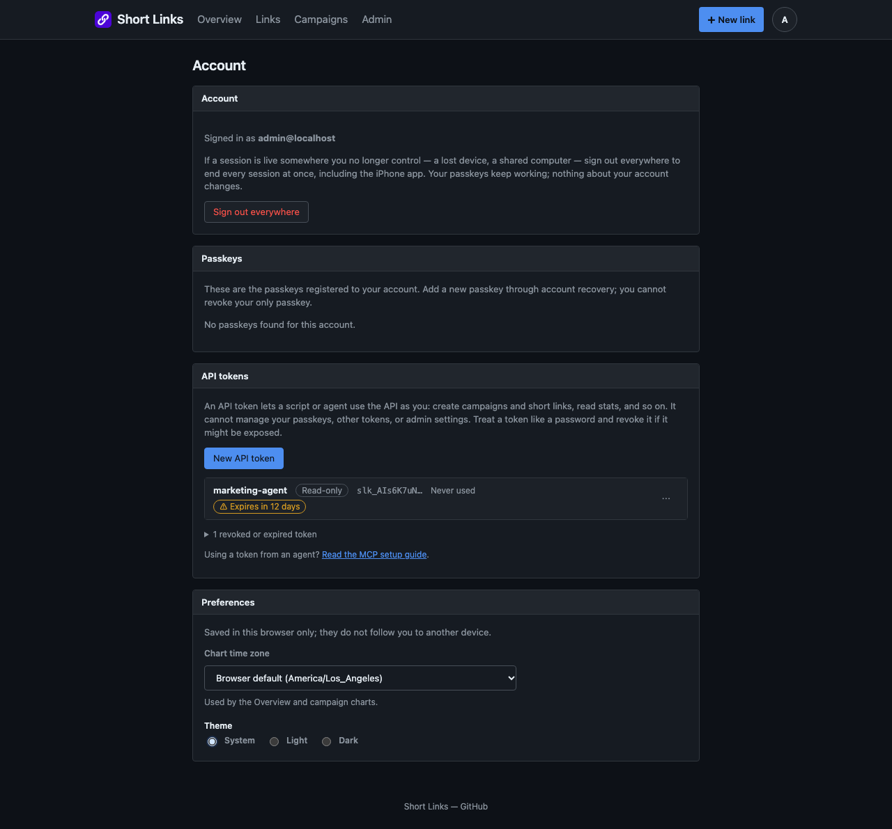
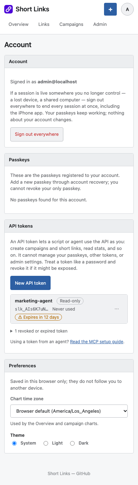
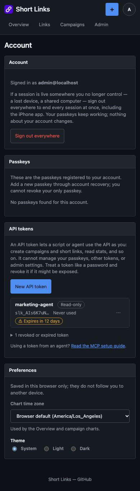
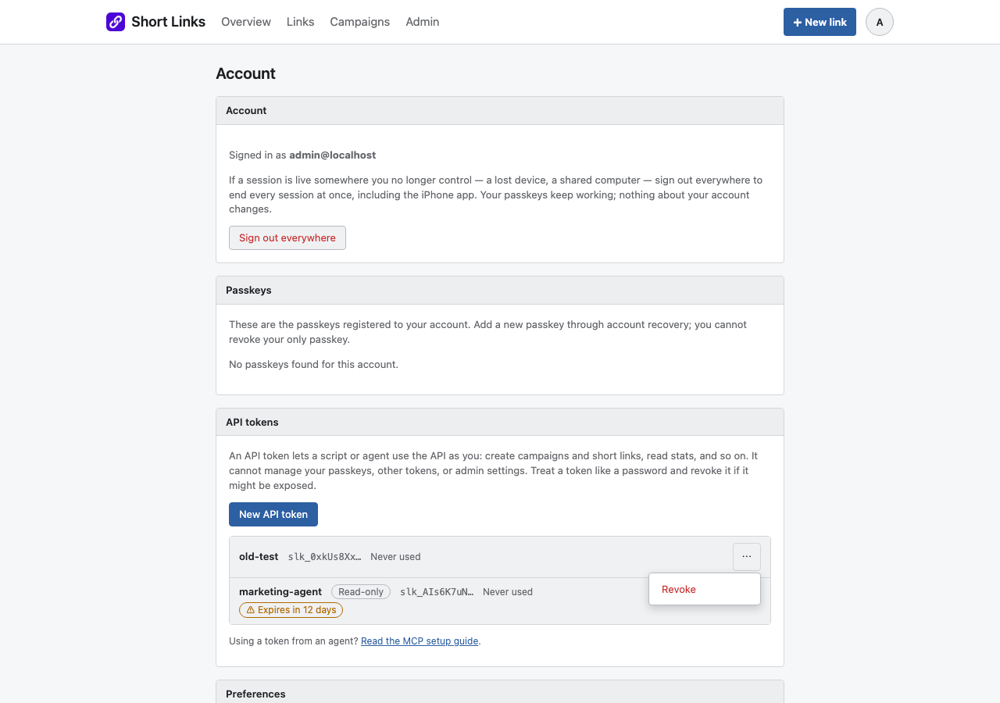
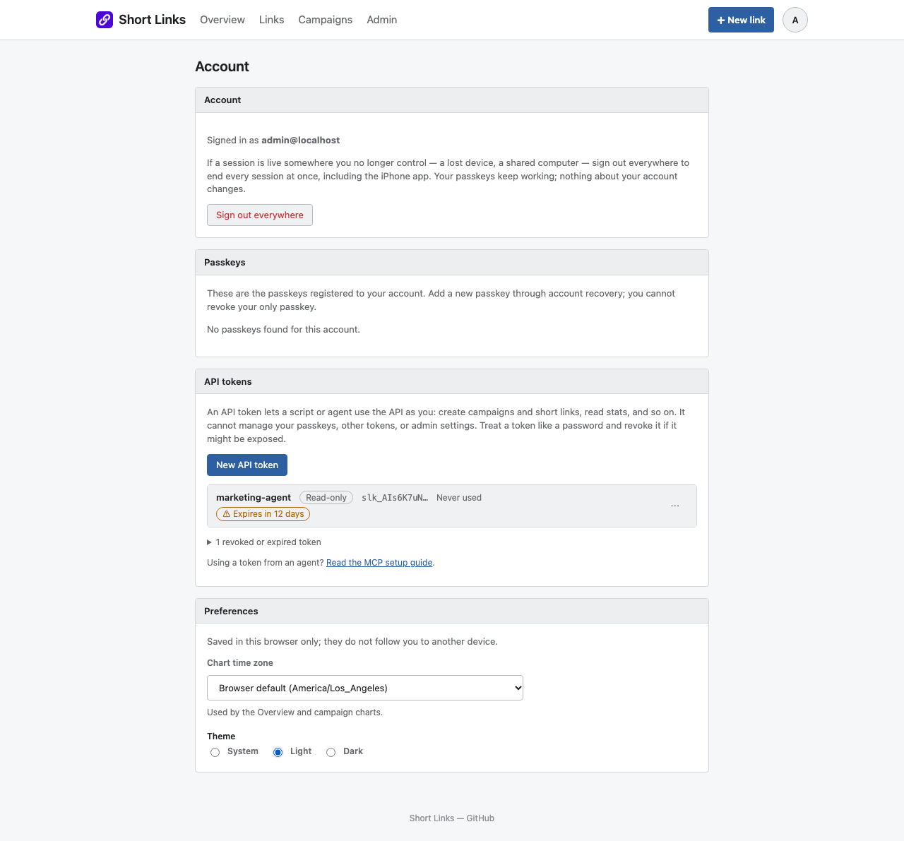
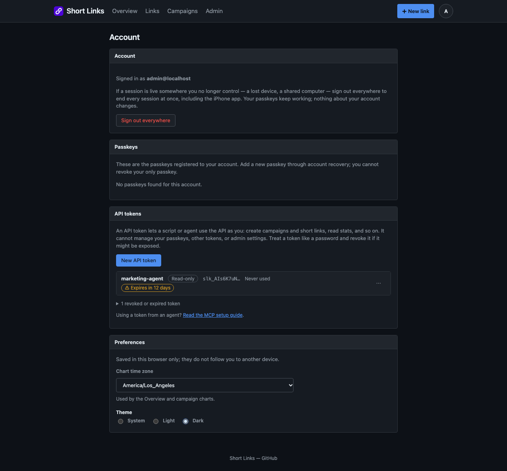
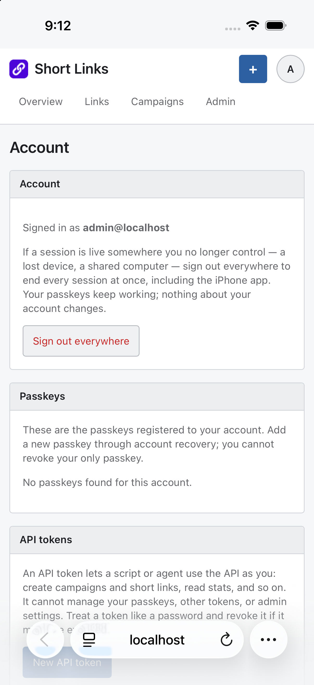

# 0170 — Account mixes three equal-weight panels, shows passkey sign counts, and has no preferences for chart time zone or theme

| | |
|---|---|
| **Status** | closed |
| **Module** | web / auth |
| **Platform** | All |
| **Phase** | 19 — UI depth and polish |
| **First seen** | 2026-11-18 |
| **Closed** | 2026-11-18 |
| **Commit** | bd6475c |

## Description

Restyle Account: one line per passkey and token with a ⋯ menu, and a Preferences block for time zone and theme.

## Long Description

See [docs/ui-redesign.md](../docs/ui-redesign.md) §3.8.

- Passkeys: name, "This device" for the passkey used in this session, synced/backed-up in words, last used and added dates. Drop "Sign count". Revoking the last passkey is blocked with an explanation.
- API tokens: name, read-only tag, prefix, last used, and a warning tag when expiry is within 14 days. Revoked and expired tokens collapse into a disclosure. Link to `docs/mcp.md` (#0151) under the token list.
- Preferences: chart time zone (default: browser) and theme (system, light, dark). Store them per browser for now. The theme overrides `prefers-color-scheme` by setting `data-theme` on the root element, and `app.css:454` gains the matching `[data-theme]` blocks.
- **Portiko:** #0133 replaces the passkey screens. If it has landed, apply this only to what remains; otherwise do the token and preference parts and note the passkey part on #0133.

## Acceptance criteria

- Checked in the running app via `scripts/dev.sh` (:5173) and `scripts/sim.sh` (iOS Simulator), in light and dark, at desktop width and about 400px, with screenshots attached to the issue folder.
- `cd web && npm test && npm run build` passes.

## Relation

- Part of: [#0152](0152.md)
- Related: [#0133](0133.md), [#0137](0137.md)

## Root cause

Account showed three equal-weight panels with tall card rows and a red Revoke button per token, no warning for tokens about to expire, revoked/expired tokens mixed into the live list, and no way to choose a chart time zone or theme. The theme followed only `prefers-color-scheme`, so there was nothing for a preference to override.

## Fix

- **API tokens** (`web/src/lib/ApiTokens.svelte`): one line per token (name, Read-only tag, prefix, last used with IP), a `⋯` menu (`AccountRowMenu.svelte`) holding Revoke, a warning tag ("Expires in N days") when expiry is within 14 days, revoked/expired tokens collapsed in a `<details>` disclosure, and a link to `docs/mcp.md` under the list. Helpers `expiryWarning`, `daysUntilExpiry`, `splitTokens` live in `apiTokens.ts`.
- **Preferences** (`Preferences.svelte`, `preferences.ts`): chart time zone (browser default or any IANA zone) and theme (system/light/dark), stored per browser in localStorage (`shortlinks.chartTimeZone`, `shortlinks.theme`). `getChartTimeZone()` is the accessor for the chart issues. No server change or migration.
- **Theme**: `app.css` dark tokens now apply under `:root:not([data-theme="light"])` in the media query and under `:root[data-theme="dark"]`; `main.ts` applies the saved theme before mount to avoid a flash.
- **Passkeys deliberately untouched**: #0133 is still open, and the API has no backup flag or current-credential info. A note was added to #0133. Revoke still uses `confirm()` (no shared dialog exists yet).

## Verification

```
cd web && npm ci && npm run check && npm test && npm run build
svelte-check: 215 FILES 0 ERRORS 0 WARNINGS
Test Files 15 passed (15), Tests 465 passed (465)
built in 903ms
go build ./... && go vet ./...   -> clean (no Go changes)
```

App served on :8187 (built SPA, STORAGE=json); `dev.sh` was not used because it kills :5173, which belongs to other implementers. Playwright checks: no horizontal scroll at 1280 or 390 in light and dark; revoking via the menu moved the token into the disclosure; choosing Light on an OS-dark browser set `data-theme=light` and persisted across reload; choosing Dark on OS-light worked; time zone saved `America/Los_Angeles`.

Desktop 1280, light and dark:




Phone 390, light and dark:




Menu open, and theme overrides:





iOS Simulator (`scripts/sim.sh`, top of page):



Not verified: the passkey list (dev store has none, and it was not changed).

## Files changed

- `web/src/app.css`, `web/src/main.ts`
- `web/src/lib/ApiTokens.svelte`, `apiTokens.ts`, `apiTokens.test.ts`
- `web/src/lib/AccountRowMenu.svelte`, `Preferences.svelte`, `preferences.ts`, `preferences.test.ts` (new)
- `web/src/views/Account.svelte`
- `issues/0133.md` (note), `issues/0170.md`, `issues/0170/*.png`

## Review round 1

- Chart time zone now has the hint "Used by the Overview and campaign charts." `getChartTimeZone()` already falls back to `Intl.DateTimeFormat().resolvedOptions().timeZone` when nothing is saved, so callers can use it unconditionally. The chart issues (#0162 onward) are expected to read it.
- `AccountRowMenu.svelte` is now a plain disclosure: `aria-expanded` plus `aria-controls`, no `role="menu"` or `menuitem`. Escape closes it and returns focus to the trigger.
- "Sign count" removed from the passkey list.
- Re-verified: `npm run check` 0 errors, `npm test` 465 passed, `npm run build` ok. Screenshots re-taken (Preferences with hint: `0170/account-390-dark.png`, `0170/account-1280-light.png`).


## Work log

| Date | Model | Input | Output | Cache read | Cache write | Cost |
|---|---|---|---|---|---|---|
| 2026-11-18 | claude-sonnet-5-5 | 98 | 33,911 | 4,111,626 | 100,432 | $1.00 |
| 2026-11-18 | claude-opus-5-5 | 28 | 6,110 | 691,335 | 48,021 | $0.50 |

**Total: $1.50**
