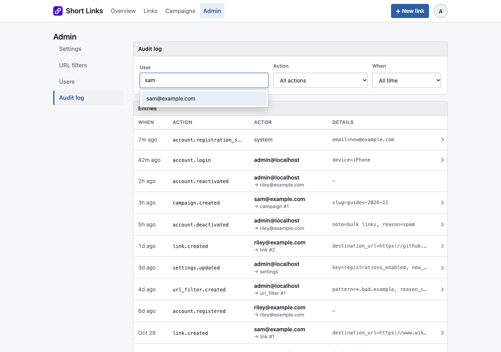
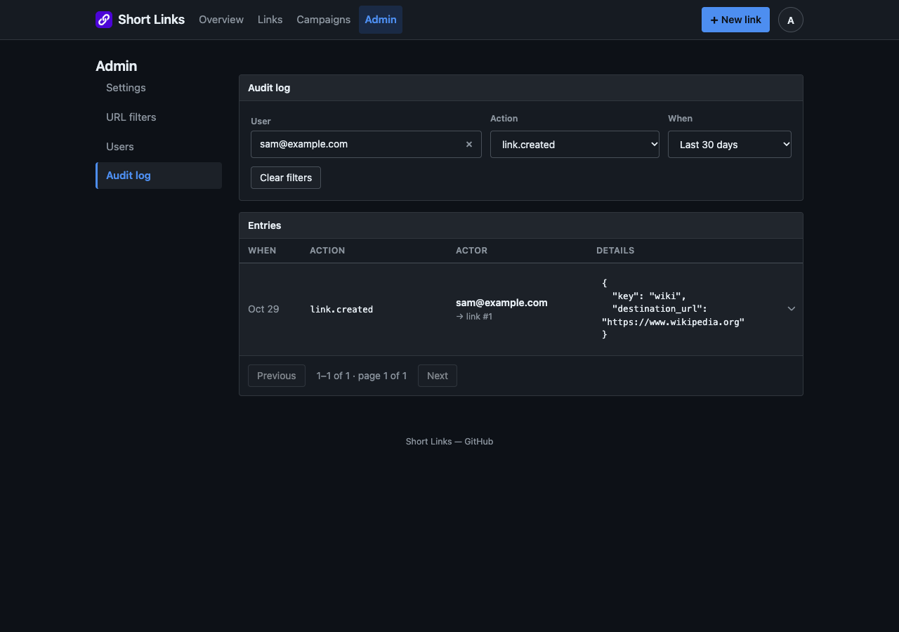
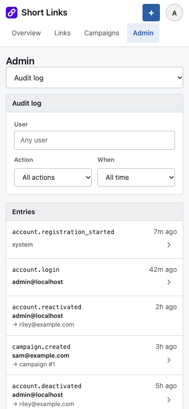
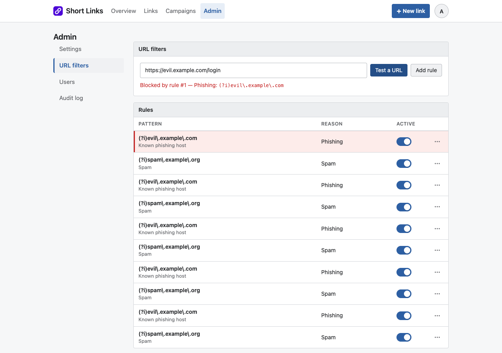
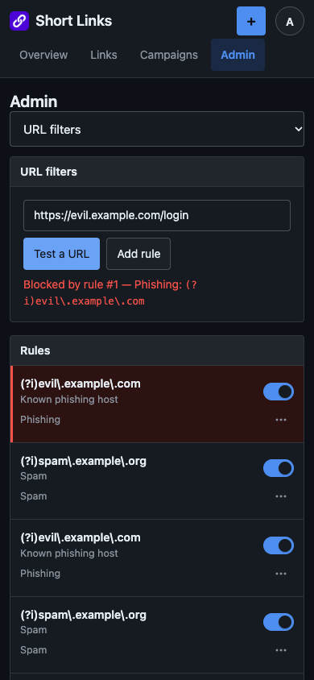
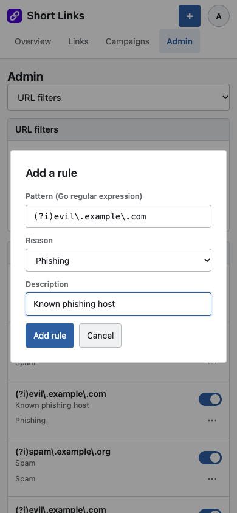
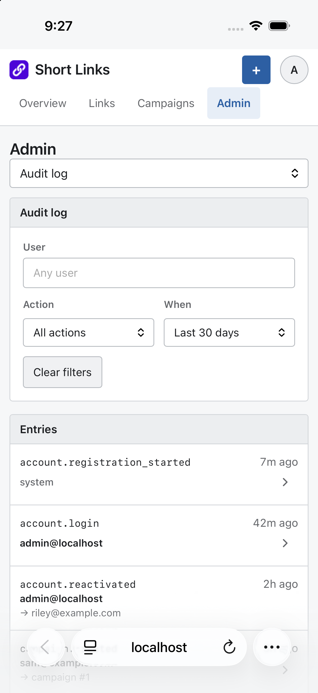

# 0171 — The audit log can only be filtered by numeric user id, and the URL filter tester is separate from the rules it tests

| | |
|---|---|
| **Status** | closed |
| **Module** | web / audit / handlers |
| **Platform** | All |
| **Phase** | 19 — UI depth and polish |
| **First seen** | 2026-11-18 |
| **Closed** | 2026-11-18 |
| **Commit** | 7977b3c |

## Description

`Admin.svelte:867-872` filters the audit log by typed user id. Add filters by user email, action type and date range (adding server parameters to `GET /admin/audit` as needed), and put "Test a URL" above the URL filter rules, highlighting the rule that matches.

## Long Description

See [docs/ui-redesign.md](../docs/ui-redesign.md) §3.9.

- `GET /admin/audit` gains `email`, `action` (comma-separated) and `from`/`to`, if it doesn't already have them. Handler tests for each.
- Audit rows: relative time with the absolute time on hover, actor email, action, target, and metadata collapsed to one line that expands. Filters live in the hash.
- URL filters: the tester sits inline above the rule table, and a hit highlights the matching row. Add and edit rules in a dialog; Active is a toggle in the row.

## Acceptance criteria

- `go test ./...` passes.
- Checked in the running app via `scripts/dev.sh` (:5173) and `scripts/sim.sh` (iOS Simulator), in light and dark, at desktop width and about 400px, with screenshots attached to the issue folder.
- `cd web && npm test && npm run build` passes.

## Relation

- Part of: [#0152](0152.md)
- Blocked by: [#0154](0154.md)

## Root cause

`GET /admin/audit` only understood `user_id`, and its rows carried bare numeric ids, so the Admin audit view could only offer a typed id. The URL filter tester was a separate panel from the rule table, and rules were edited inline in table cells.

## Fix

- **API** (`internal/audit/read.go`, `internal/handlers/audit.go`): `audit.Filter` (user id, email, actions, from/to) drives both the count and page queries. `GET /admin/audit` gains `email` (matches the actor or the affected account, case-insensitive, exact), `action` (comma-separated), and `from`/`to` (RFC 3339 instants or `YYYY-MM-DD`; a date-only `to` covers that whole day; bad values or from >= to give 400). Rows now include `actor_email` and `user_email` (LEFT JOIN users). `user_id` still works.
- **Dev mode** (`internal/devstore`): the in-memory store applies the same filters and resolves emails. It also seeds two extra users and 11 audit rows (dev mode writes no audit entries otherwise), so the filters have something to act on.
- **Audit UI** (`lib/AdminAudit.svelte`, `lib/UserPicker.svelte`): user typeahead over the users list (ARIA combobox; the popup is `position: fixed` so the panel cannot clip it), Action select (groups plus single actions), date range (24h/7d/30d/custom). Filters and page live in the hash (`#/admin/audit?email=..&action=..&range=..&page=..`) and survive reload. DataTable with relative time (absolute on hover), actor with target beneath, metadata on one line that expands in place.
- **URL filters UI** (`lib/AdminFilters.svelte`, `lib/Dialog.svelte`): "Test a URL" inline above the rules; a hit tints and scrolls to the matching row and names its pattern. Add/edit in a dialog, Active is a switch in the row, Edit/Delete in the row menu.
- Pure helpers and tests in `lib/admin.ts` and `lib/adminAudit.test.ts`; `parseUserIdFilter` removed.

## Verification

```
go build ./... && go vet ./...                       # clean
TEST_DATABASE_URL=<scratch db> go test ./internal/audit ./internal/devstore ./internal/handlers ./cmd/...
ok  internal/audit  ok  internal/devstore  ok  internal/handlers  ok  cmd/shortlinks
--- PASS: TestAdminAudit_EmailActionDateFilters   (Postgres: email/action/date/combined, emails on rows)
--- PASS: TestAdminAudit_ParsesFilters / _NoFiltersIsZeroValue / _BadTimeIs400
--- PASS: TestListAuditLog_Filters                (dev store)
cd web && npm run check   -> 0 errors, 0 warnings
npm test                  -> 18 files, 527 tests passed
npm run build             -> built
```

Driven in a real browser (Playwright against dev mode on :8193 via Vite): picking `sam@example.com` in the picker gave `#/admin/audit?email=sam%40example.com`; adding action and range extended the hash; a reload restored the picker, the selects and the one matching row. Adding two rules through the dialog, then testing `https://evil.example.com/login`, highlighted rule #1; a non-matching URL showed "No matching rule". No root horizontal scroll in any of the 1280px and 390px, light and dark runs (scrollWidth equals clientWidth). `scripts/sim.sh` screenshot below.

Not exercised in the browser: the Edit dialog, the Active switch and Delete (same API calls the old inline UI used).

Screenshots are in `0171/` (audit-, audit-picker-, audit-filtered-, filters-dialog-, filters-hit-, filters-miss- in desktop/phone x light/dark, plus `sim-audit.png`).









## Files changed

- `internal/audit/read.go`, `internal/handlers/audit.go`, `internal/devstore/devstore.go`
- Tests: `internal/handlers/audit_filter_test.go`, `audit_db_filter_test.go`, `audit_test.go`, `internal/devstore/audit_filter_test.go`, `web/src/lib/adminAudit.test.ts`, `admin.test.ts`
- `web/src/lib/AdminAudit.svelte`, `AdminFilters.svelte`, `UserPicker.svelte`, `Dialog.svelte`, `admin.ts`, `api.ts`, `types.ts`, `web/src/views/Admin.svelte`
- `issues/0171.md`, `issues/0171/*.png`

## Review round 1

- Merged `main` (conflict in `Admin.svelte` resolved by keeping the rules code in `AdminFilters.svelte`). Delete there now opens `ConfirmDialog` ("Delete filter rule?", busy label "Deleting…", a failure throws so the dialog shows it); no `confirm(` calls remain in `web/src`. `Dialog.svelte` reuses `restoreFocus` from `confirmDialog.ts`; it is a form dialog, so it keeps its own title/body markup.
- Presets now pin the window: choosing "Last 7 days" writes `since=<instant>` into the hash, so paging and reload do not drift. Seen: `#/admin/audit?range=7d&since=2026-11-12T05%3A36%3A33.874Z`. Covered by a unit test.
- The email filter in `internal/audit/read.go` uses `actor_id IN (SELECT id FROM users WHERE lower(email)=lower($N))` (and the same for `user_id`); the count query no longer joins `users`.
- The dev seed only references entities that exist (users 1-3, links 1-2); the campaign and URL-filter rows are gone.

Exercised in the running app (dev mode :8193 behind Vite :5193, Playwright, 1280px):

```
EDIT valid:     PATCH /admin/url-filters/1 {"pattern":"(?i)evil\\.example\\.com","reason_code":2,"description":"Phishing host (edited)","active":true} -> 200; row shows the new description
EDIT bad regex: PATCH /admin/url-filters/1 {"pattern":"(unclosed[", ...} -> 400; dialog stayed open, error inside it: "pattern must be a valid Go regular expression"
SWITCH:         PATCH /admin/url-filters/2 {"active":false} -> 200 (body is {active} only); after reload the switch is off and GET /admin/url-filters reports active=false
DELETE:         ConfirmDialog -> DELETE /admin/url-filters/2 -> 200; rules 2 -> 1; native confirm() dialogs: 0
```

Screenshots: `0171/review-edit-dialog.png`, `review-edit-badregex.png`, `review-switch-off-reloaded.png`, `review-delete-confirm.png`, `review-after-delete.png`.

Re-verified: `go build ./... && go vet ./...` clean; `go test ./internal/audit ./internal/devstore ./internal/handlers ./cmd/...` ok against a scratch DB (dropped); `npm run check` 0 errors; `npm test` 583 passed; `npm run build` ok.

## Work log

| Date | Model | Input | Output | Cache read | Cache write | Cost |
|---|---|---|---|---|---|---|
| 2026-11-18 | claude-sonnet-5-5 | 204 | 97,497 | 16,080,032 | 237,131 | $3.18 |
| 2026-11-18 | claude-opus-5-5 | 56 | 9,412 | 2,262,048 | 81,881 | $1.05 |

**Total: $4.23**
