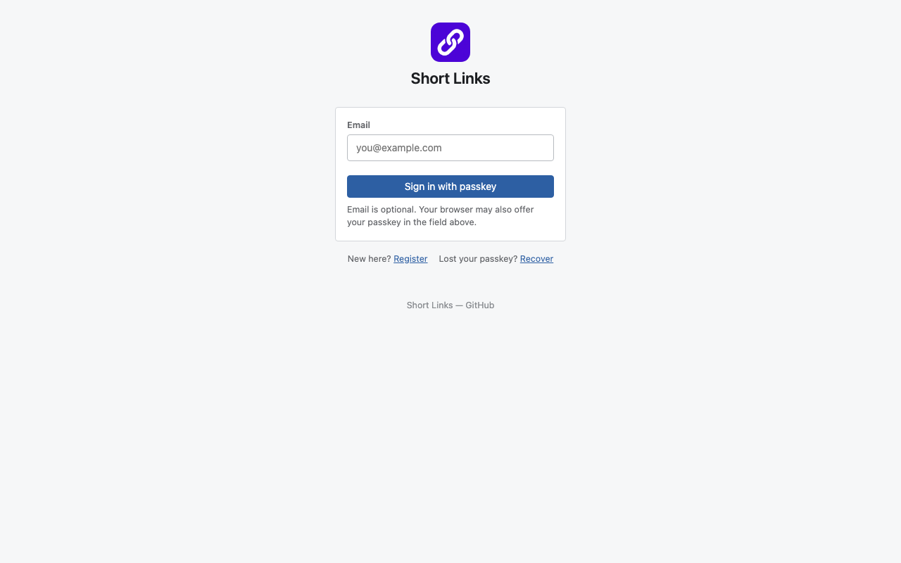
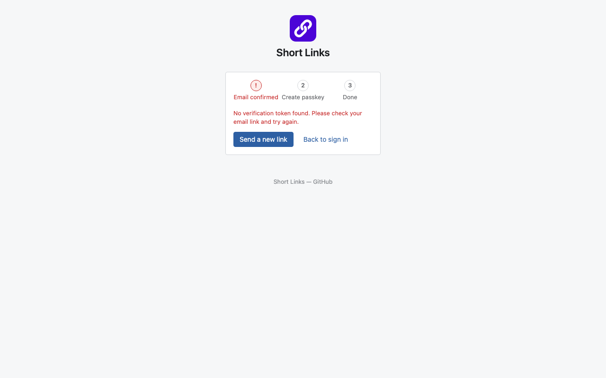
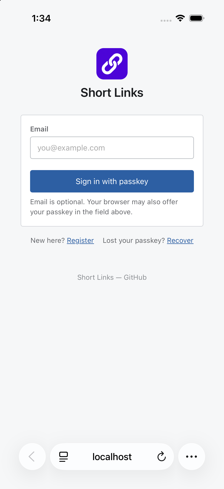

# 0172 — The sign-in screens lack the app icon, passkey autofill and clear next steps on errors

| | |
|---|---|
| **Status** | in-progress |
| **Module** | web / auth |
| **Platform** | All |
| **Phase** | 19 — UI depth and polish |
| **First seen** | 2026-11-18 |

## Description

Polish the signed-out screens: add the app icon, offer passkey autofill, make Register and Recover text links, add a step indicator to the verify screens, and give errors an inline next action.

## Long Description

See [docs/ui-redesign.md](../docs/ui-redesign.md) §3.10.

**Ordering:** [#0133](0133.md) moves sign-in to Portiko's redirect flow and drops ShortLinks' passkey screens. Work this **after** #0133 and apply it to whatever signed-out screens remain (the #0125 signed-out home page, the hand-off to Portiko). If #0133 removes them all, record that in the notes and leave the issue open for Brennan to decide; don't close it.

## Acceptance criteria

- Checked in the running app via `scripts/dev.sh` (:5173) and `scripts/sim.sh` (iOS Simulator), in light and dark, at desktop width and about 400px, with screenshots attached to the issue folder.
- `cd web && npm test && npm run build` passes.

## Relation

- Part of: [#0152](0152.md)
- Blocked by: [#0133](0133.md)

## Decision

#0133 (Portiko) has not started, and Brennan asked for the full redesign to be completed. §3.10 is implemented on the current signed-out screens (Login, RegisterVerify, RecoverVerify, the #0125 signed-out Home). When #0133 lands, whichever of these it removes drops this work with it; keep AuthBrand for what remains.

## Root cause

The signed-out screens had no icon, two full-width Register/Recover buttons, no progress indication on the verify screens, and errors that only said what failed. Passkey autofill (conditional mediation, `autocomplete="username webauthn"`, `isConditionalMediationAvailable` feature detection) and the usernameless challenge in `LoginService.StartLogin` already existed, so no Go behaviour change was needed.

## Fix

- `AuthBrand.svelte`: app icon above the title on Login, both verify screens and Home.
- Login: primary "Sign in with passkey" (email optional); Register and Recover are text links under the card and switch the card via `/login?mode=register|recover`. The conditional-mediation ceremony starts when the sign-in card shows and aborts when it leaves.
- Verify screens: `StepIndicator.svelte` (Email confirmed, Create passkey, Done; failed step marked) and a plain-language line about the system prompt.
- Errors carry an inline action: Try again (re-runs the ceremony), Send a new link (opens the matching Login form), Back to sign in.
- `lib/authScreens.ts` holds the pure logic (tests in `authScreens.test.ts`). Go: `TestStartLogin_UsernamelessChallengeForPasskeyAutofill` pins the usernameless challenge.

## Verification

- `cd web && npm run check`: 0 errors. `npm test`: 34 files, 732 tests pass.
- `TEST_DATABASE_URL=... go test ./internal/auth/`: ok; the new test and its three subtests pass.
- Real Postgres mode (no session cookie) on :8202 with Vite on :5202. Playwright with `navigator.credentials` stubbed recorded `[{"mediation":"conditional","hasAllow":false}]` on load, and the field has `autocomplete="username webauthn"`. Real ceremonies were not run.
- No root horizontal scroll at 1280px and 390px, light and dark, on any state.
- Screenshots in `issues/0172/`: `login-*`, `login-error-*`, `login-register-*`, `login-recover-*`, `verify-register-error-*`, `verify-recover-error-*`, `verify-register-creating-*`, `verify-recover-cancelled-*`, `home-*` (each `-desktop|phone-light|dark`), and `sim-login.png` from scripts/sim.sh.

## Files changed

- web/src/views/Login.svelte, RegisterVerify.svelte, RecoverVerify.svelte, Home.svelte
- web/src/App.svelte (ongotologin takes an optional path)
- web/src/lib/AuthBrand.svelte, StepIndicator.svelte, authScreens.ts, authScreens.test.ts
- internal/auth/login_test.go
- issues/0172.md, issues/0172/*.png

## Review round 1

- **Retry broke sign-up.** Each Try again re-ran verify, saving another challenge row for the token, and finish's `DELETE ... RETURNING` could pick a stale one. Client: RegisterVerify/RecoverVerify keep the verify options and retry only the create and finish steps (checked in the browser: 3 retries, 1 verify call, 4 create calls). Server: `Save{Registration,Recovery}Challenge` now delete earlier challenges for the token and insert in one transaction (`replaceTokenChallenge`). New `challenge_retry_test.go` saves twice and checks one row remains and finish consumes the latest, for both flows.
- **Abort race.** `lib/conditionalLogin.ts` creates the AbortController before the availability await and bails if aborted afterwards. `conditionalLogin.test.ts` aborts during the await and checks `credentials.get` is never called.
- **Closed registration.** `/login?mode=register` shows "Registration is closed." with Back to sign in once home info says enrollment is off (a failed fetch still shows the form; the server gate enforces). "Send a new link" from the register verify screen lands there too. Screenshots: `login-register-closed-*`, `verify-new-link-closed-*`.
- **Nits.** Removed `verifyExpired` and the unused `recover`/`register` actions. A failed step 1 reads "Link not confirmed". After Try again, focus moves to the card. Register, Recover and Back to sign in links keep `?redirect=` (`loginModePath`).
- **Re-verified.** `go test ./internal/auth/` on a fresh DB passes; `npm run check` 0 errors; `npm test` 745 pass; `npm run build` ok.

## Review round 2

- **Retry re-runs verify.** `retry()` in RegisterVerify and RecoverVerify now just calls `run()`; the stored-options path is gone. Verify checks the token first, so an expired link fails fast with "Send a new link" before any passkey is created. Browser check: initial load plus 3 Try again clicks gave 4 verify calls and 4 create calls. Removed the duplicate `status = 'creating'`.
- **Concurrent verify.** `replaceTokenChallenge` first locks the token's `pending_registrations` row (`SELECT ... FOR UPDATE`), then deletes and inserts. New `TestSaveChallenge_ConcurrentVerifyLeavesOne` runs 12 simultaneous saves and checks one challenge row remains.
- **Re-verified.** `go test ./internal/auth/` on a fresh DB passes; `npm run check` 0 errors; `npm test` 745 pass.
