# 0173 — Below 900px the tables don't turn into cards, and filters take up the whole screen

| | |
|---|---|
| **Status** | closed |
| **Module** | web |
| **Platform** | All |
| **Phase** | 19 — UI depth and polish |
| **First seen** | 2026-11-18 |
| **Closed** | 2026-11-18 |
| **Commit** | 3179d75 |

## Description

Finish the phone layouts across every list view: card rows, a filter sheet, and chip rows that scroll.

## Long Description

See [docs/ui-redesign.md](../docs/ui-redesign.md) §2 principle 14.

- Overview, Links, Campaigns, Campaign detail (both tabs) and the audit log render rows as cards under 900px: title, meta line, metric on the right, ⋯.
- Filter bars collapse to a **Filters (N)** button that opens a bottom sheet. (#0163's Overview `FilterBar` currently just wraps below 900px and each `FacetFilter` panel opens as its own bottom sheet on phones; collapsing the whole bar into one sheet needs those panels to become inline sections, so it is left to this issue.)
- Chip rows scroll horizontally on one line. Tap targets are at least 40px.
- The page never scrolls sideways, at any width.

## Acceptance criteria

- Checked in the iOS Simulator (`scripts/sim.sh`) on every listed view, with screenshots attached.
- Checked in the running app via `scripts/dev.sh` (:5173) and `scripts/sim.sh` (iOS Simulator), in light and dark, at desktop width and about 400px, with screenshots attached to the issue folder.
- `cd web && npm test && npm run build` passes.

## Relation

- Part of: [#0152](0152.md)
- Blocked by: [#0162](0162.md), [#0164](0164.md), [#0166](0166.md), [#0167](0167.md)

## Root cause

DataTable already became cards under 900px (#0155) and Links had a Filters toggle (#0167), but the rest was unfinished: the Overview `FilterBar` just wrapped (five dropdown buttons filling the screen, each opening its own sheet), the Links toggle expanded an inline block instead of a sheet, active-filter chips wrapped, many controls were 26-36px tall, and the campaign Links tab had a misaligned toolbar and group rows.

## Fix

- `lib/phone.svelte.ts` (new): `createPhone()`, a reactive `(max-width: 899px)` flag (false where `matchMedia` is missing).
- `lib/FilterSheet.svelte` (new): native `<dialog>` bottom sheet, header `Filters (N)` with Clear all, scrolling body, full-width Done; Escape/backdrop/Done close, focus returns to the opener.
- `FacetFilter.svelte`: `inline` mode renders the heading, per-section Clear and the checkbox list with no trigger or popover.
- `FilterBar.svelte` (Overview): below 900px one `Filters (N)` button plus the sheet; active chips are a single scrolling row with 40px chips.
- `LinksList.svelte`: the same sheet (Campaign, Source, Medium, Status) replaces the inline expander; chips scroll on one line.
- `CampaignDetail.svelte` Links tab: toolbar stacks (count, then toggle/sort/export), group channel line aligns under the title, 40px twisty.
- Tap targets of at least 40px below 900px: selects and inputs (`app.css`), shell brand, `+`, avatar, Overview range/group segments, campaign chips, campaign range segments, matrix chips and cells, row menu icon buttons, TopContent expander, breadcrumb links, audit chevron, admin toggles, link detail menu and range buttons, New link "More custom", stat-tile help (hit area).
- Tests: `lib/filterSheet.test.ts` (phone shows one button with count, sheet opens, change and Clear all reported, desktop unchanged).

## Verification

```
cd web && npm run check  -> 300 FILES 0 ERRORS 0 WARNINGS
cd web && npm test       -> Test Files 33 passed, Tests 719 passed
cd web && npm run build  -> built (placeholder web/dist/index.html restored, not committed)
```

Seeded Postgres `shortlinks_0173` (migrated, `scripts/dev-seed.sql`, a few audit rows and users added, dropped afterwards), Go on :8201, Vite on :5201 (`SHORTLINKS_API`), Playwright WebKit with iPhone 13 emulation, light and dark. Every view: Overview (plain and filtered), Links, Campaigns, Campaign detail (Content and Links tabs), Link detail, Account, Admin (Settings, Filters, Users, Audit log), New link.

- Root horizontal scroll (`scrollWidth - clientWidth`) is 0 on all 13 views, light and dark, at 390px and at 360px (52 of 52 checks print `overflow 0` after the last change).
- Tap targets: every button, link, select and text input below 900px has an effective vertical hit area of at least 40px. The check scans `elementFromPoint` through each control's centre, so `::after` overlays count; the final run reported no small target on any view at 390px. (Hit-area-only overlays: the title link covers its whole two-line cell, other inline links get 12px of overlay or padding, nothing moves.)
- Overview at 390px: `Filters` opens the sheet; ticking mastodon and newsletter gave `#/?source=mastodon,newsletter`, the button read `Filters (2)`, and the chips stayed on one line (`scrollWidth 544` in a `340` wide row). Links gave `#/links?source=mastodon&status=inactive`.
- Campaign Content tab: each content card shows one scrolling line of channel chips (and a scrolling "All content" line); the real table cells stay in the DOM for desktop.
- Admin Users is a `DataTable`: table at desktop width, cards (email, last login, status, actions) below 900px.
- Desktop 1280px light and dark (Overview, Links, Campaign links, Audit log): no Filters button, overflow 0.

Screenshots are JPEGs (phone shots 780px wide, 2.6 MB for all 20 in `issues/0173/`). Phone: 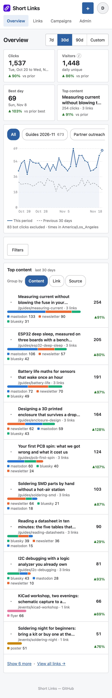 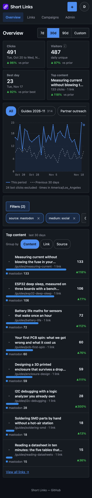 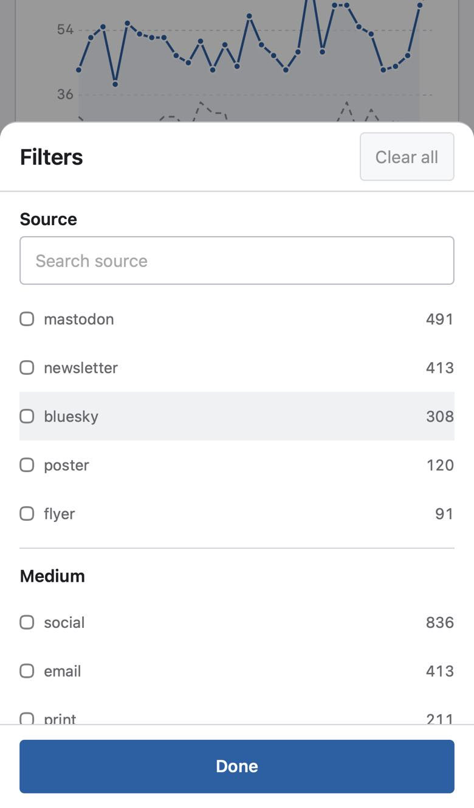 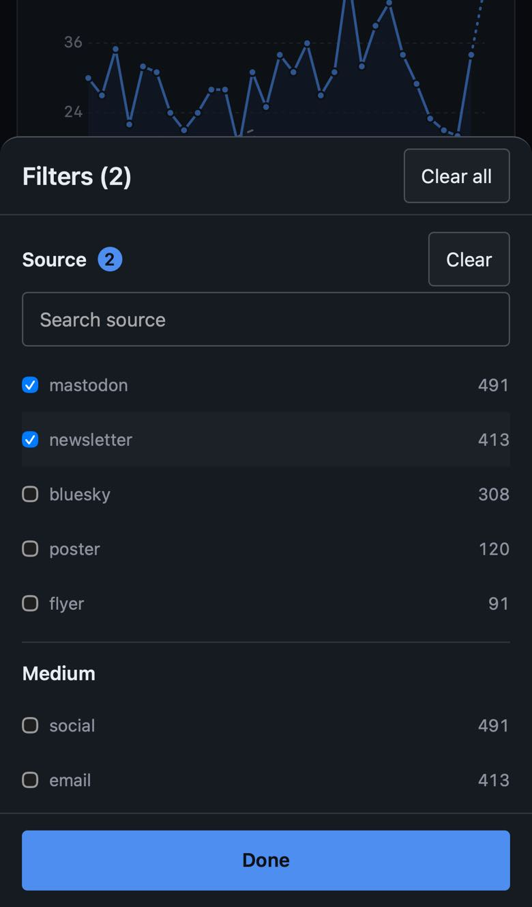 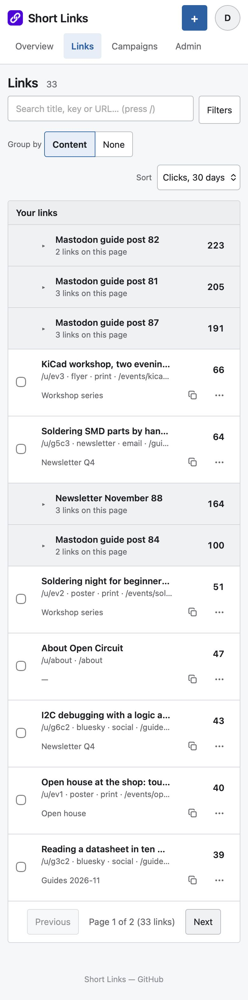 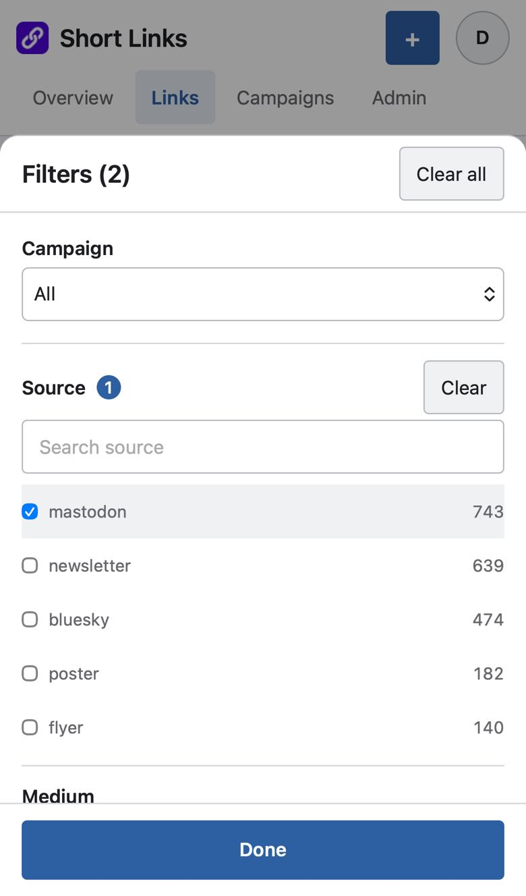 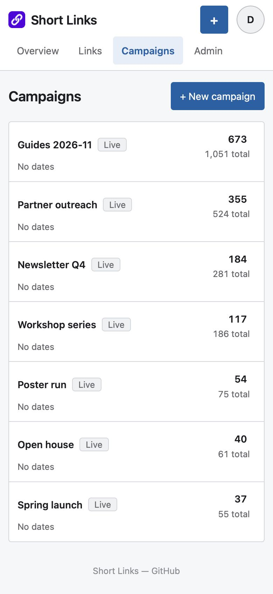 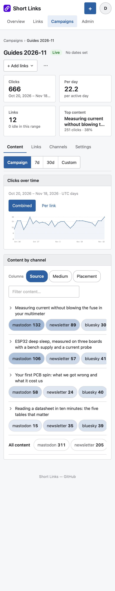 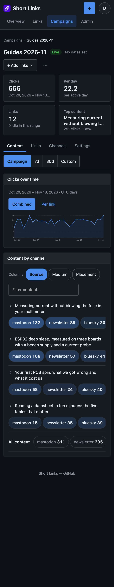 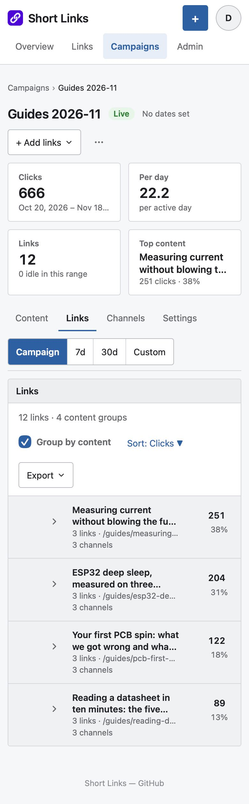 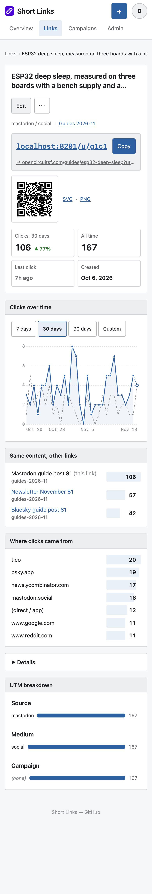 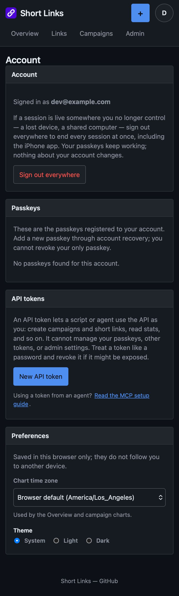 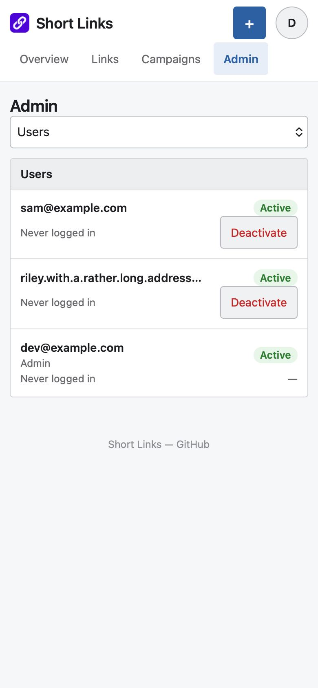 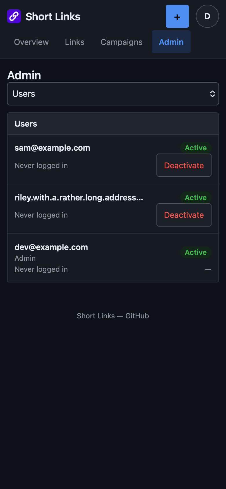 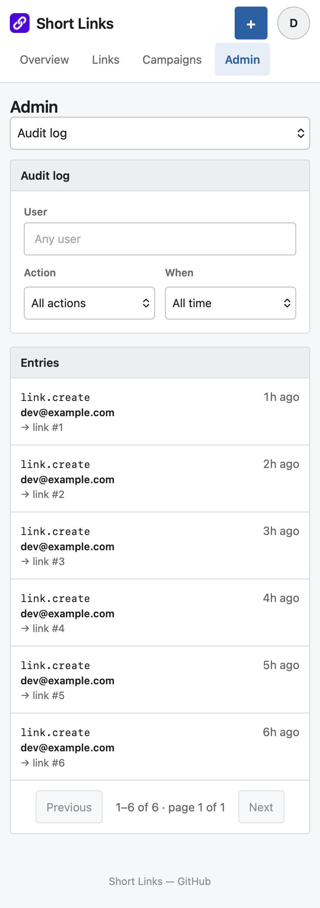 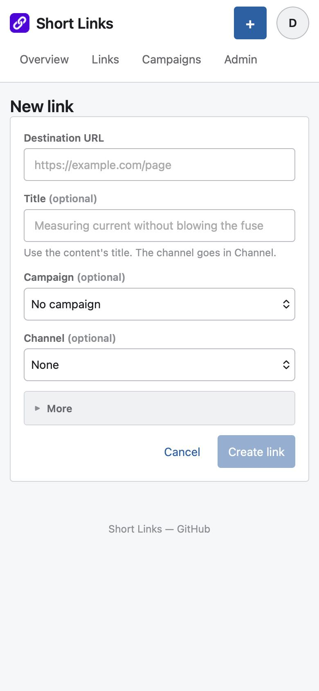. Desktop: 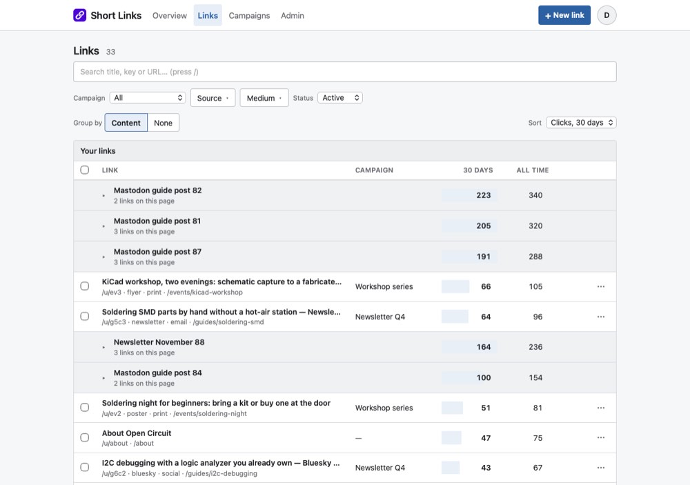 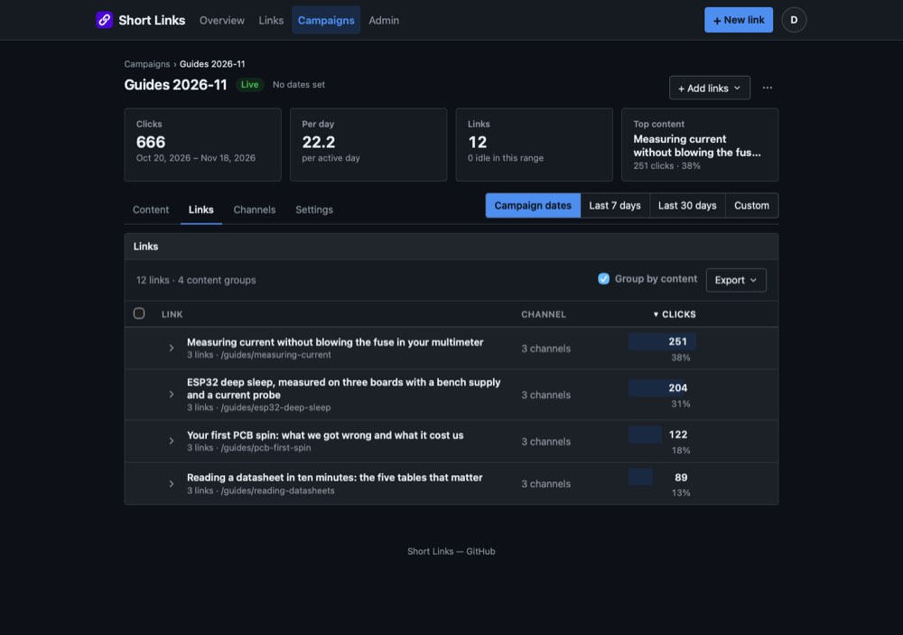.

Real iOS Simulator (iPhone 17, `scripts/sim.sh` then `xcrun simctl openurl`), dev-mode Go server (`STORAGE=json`, auto-login) behind Vite: 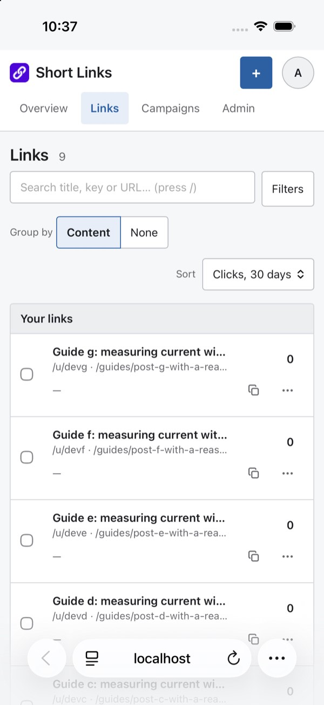 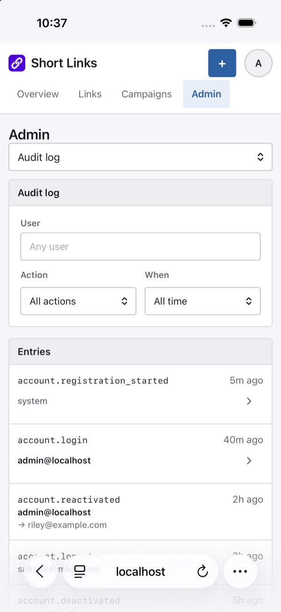. Dev mode has no `/api/reports`, so Overview and Campaign detail are covered by the Playwright shots on the seeded DB.

## Review round 1

- Inline text links (row title links, "Read the MCP", link detail short URL, QR and destination links, breadcrumb/text links, footer) now have a 40px hit area without changing their look.
- Channel chips on the Content tab cards scroll on one line.
- Admin Users uses `DataTable` (cards below 900px).
- Screenshots reduced from 13 MB (54 PNGs) to 2.6 MB (20 JPEGs).
- `git merge main` done first (picked up #0168).

## Files changed

- `web/src/lib/phone.svelte.ts`, `FilterSheet.svelte`, `filterSheet.test.ts` (new)
- `web/src/lib/FacetFilter.svelte`, `FilterBar.svelte`, `AppShell.svelte`, `Breadcrumb.svelte`, `CampaignChips.svelte`, `CampaignMatrix.svelte`, `CampaignRange.svelte`, `NewLinkForm.svelte`, `RowMenu.svelte`, `StatTile.svelte`, `TopContent.svelte`, `TwoLineCell.svelte`, `Footer.svelte`, `ApiTokens.svelte`, `AdminAudit.svelte`
- `web/src/views/LinksList.svelte`, `CampaignDetail.svelte`, `Overview.svelte`, `LinkDetail.svelte`, `Admin.svelte`
- `web/src/app.css`, `docs/frontend.md`, `issues/0173.md`, `issues/0173/*.jpg`

## Review round 2

- `FilterSheet` locks page scroll while open (`overflow: hidden` on `<html>`, restored on close; unit test added). Checked in WebKit: `hidden` while open, `""` after Done.
- "Open campaign →": below 600px it is `align-self: flex-start` with a `--space-3` top margin, so its 40px overlay no longer reaches the chip row. With the link present, a probe at a chip's bottom edge (2px up) hit the chip at 390px and 360px, and a real touch tap there navigated by the chip.
- `sheetOpen` / `filtersOpen` reset when the width crosses 900px (checked by resizing 390 -> 1100 -> 390: no open dialog either time).
- Dead code removed: FacetFilter's 600px fixed-panel rules, CampaignMatrix's `.cell.empty` and `.total-col` background rules, `id="links-filters"`.
- FacetFilter inline mode: Clear is a sibling of the `<h3>`, not inside it.
- Admin Users on desktop no longer says "Admin" twice: the Admin column is gone and the role shows as the second line under the email (desktop and phone).
- The campaign matrix switches to cards at 900px (was 640px), matching principle 14.
- LinksList select duplication left as is.
- Re-verified: `npm run check` 0 errors, `npm test` 720 passed, `npm run build` ok. Overview and Campaign detail (both tabs) have root overflow 0 at 390px and 360px; the full 13-view sweep gave 52 of 52 `overflow 0` and no control under 40px.

## Work log

| Date | Model | Input | Output | Cache read | Cache write | Cost |
|---|---|---|---|---|---|---|
| 2026-11-18 | claude-sonnet-5-5 | 378 | 95,311 | 36,424,155 | 313,499 | $5.38 |
| 2026-11-18 | claude-opus-5-5 | 44 | 13,663 | 1,282,781 | 82,953 | $0.94 |

**Total: $6.32**
