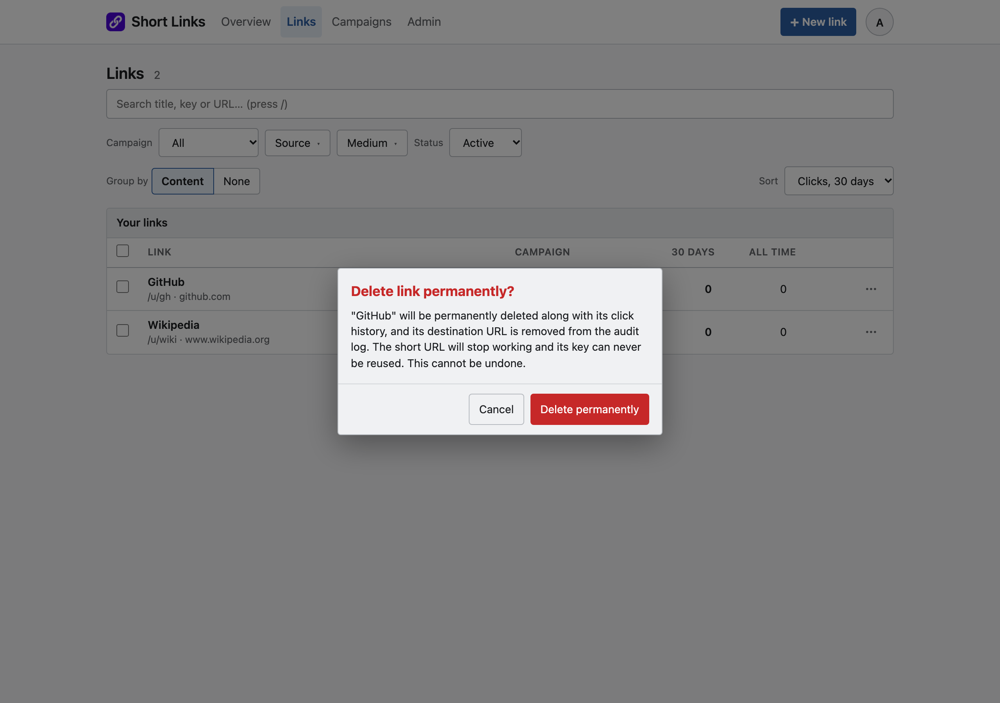
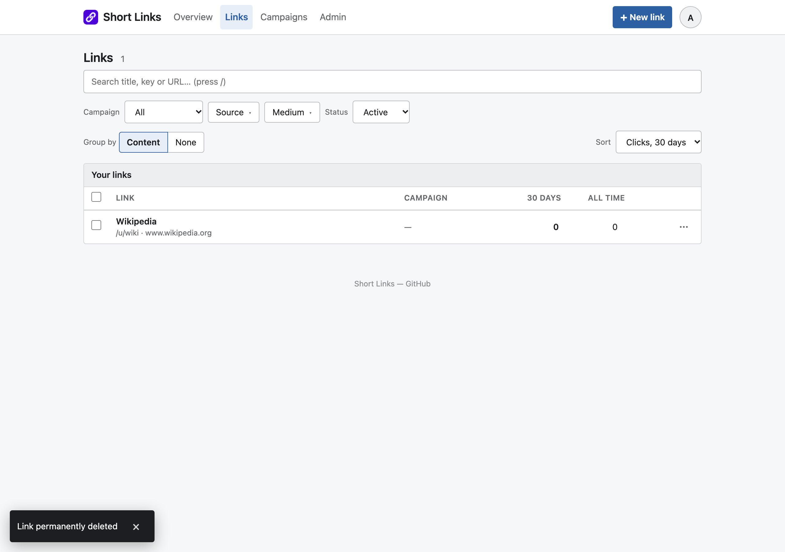
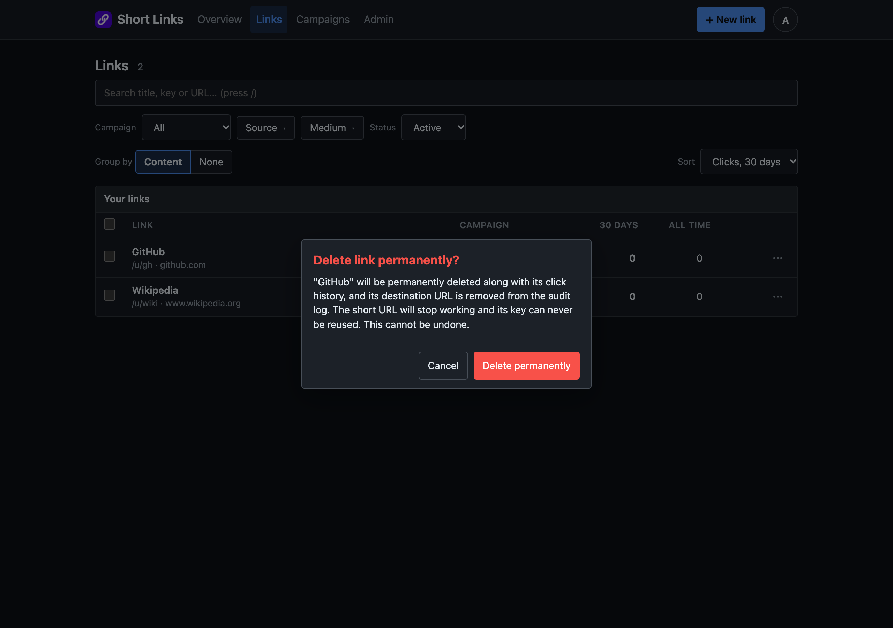
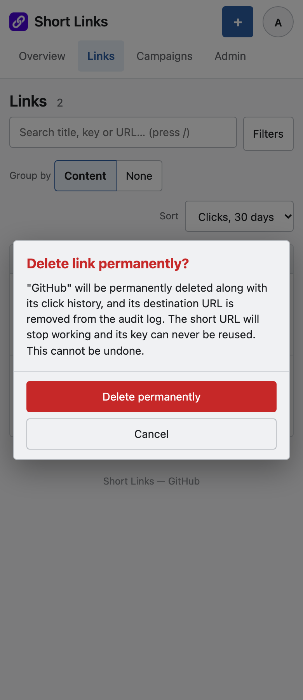
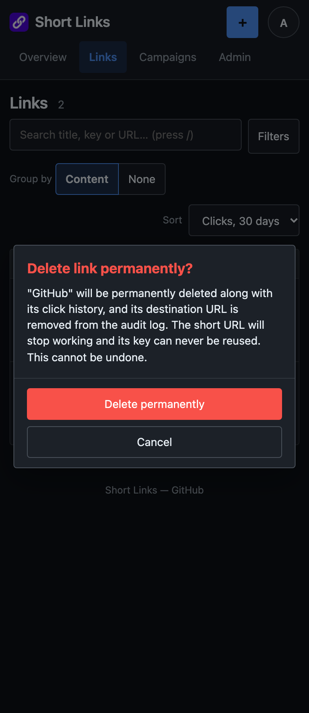
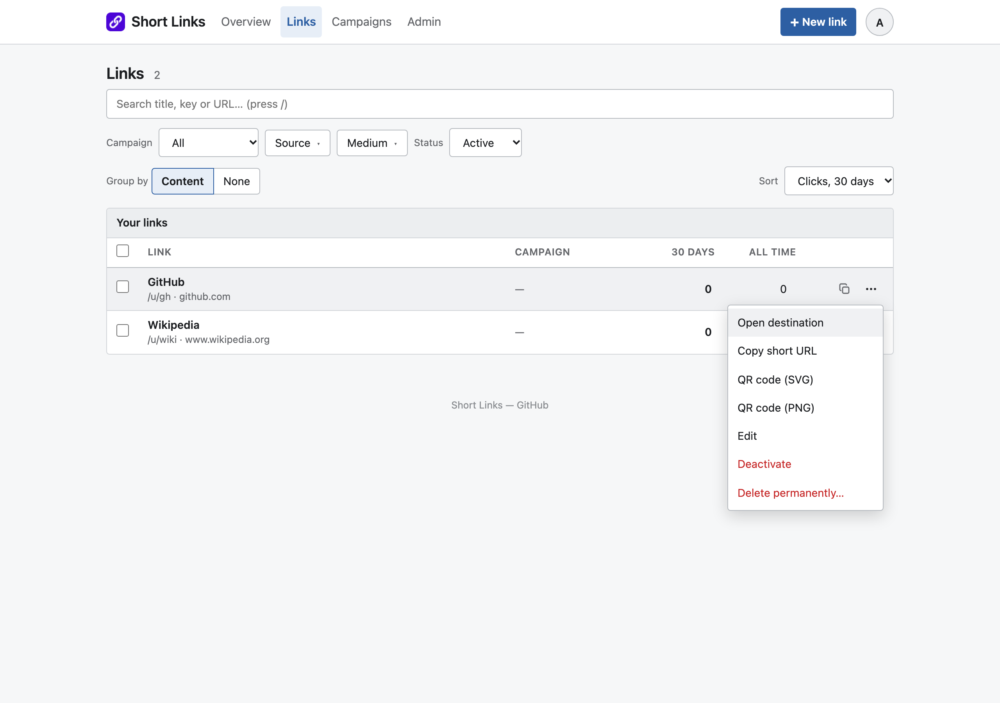
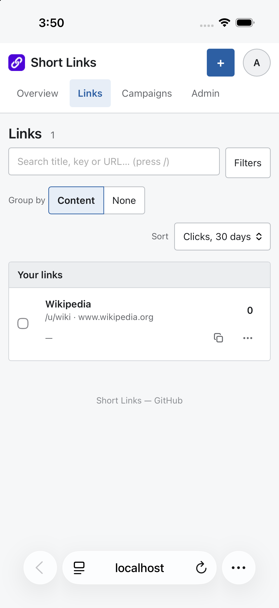

# 0183 — A link can only be deactivated, never deleted, so secret-bearing destination URLs stay in the database forever

| | |
|---|---|
| **Status** | resolved |
| **Module** | links / clicks / handlers / audit / db |
| **Platform** | All |
| **Phase** | 21 — Invitation links (CoupleDozen) |
| **First seen** | 2026-11-18 |
| **Closed** | 2026-11-18 |
| **Commit** | 6ed06d7 |

## Description

`DELETE /api/links/{key}` only deactivates. Invitation destinations contain a secret token, so once an invitation is used or withdrawn, its URL should be removable. Add a real purge.

## Long Description

Requested by the CommunityPlatform session on 2026-11-18, for CoupleDozen invitation links on the new go.coupledozen.com instance. Their plan is in CommunityPlatform `docs/Plans/2026-11-ShortInviteLinks.md`, with issues GroupsWeb #0274/#0275 and CommunityBackend #0108. Each invitation link carries a secret token that grants entry to a family group, so these links need more protection than marketing links.

**Wanted:**
- **Purge request.** `DELETE /api/links/{key}?purge=true`, which also needs a confirming header such as `X-Confirm-Purge: <key>` so it can't be triggered by accident. It deletes the link row and its clicks, and frees the key for reuse only if the key was generated, not custom (decide and document). Read-only tokens get 403.
- **Audit:** write a `link.purged` entry with key, title and campaign. **Never the destination URL**, which is the secret being removed. Check what existing audit entries for this link hold. If earlier entries (`link.created`, `link.updated`) store the destination, decide whether purge also redacts them, and document it. CommunityPlatform's concern is exactly that tokens stay readable somewhere.
- **Purge after expiry:** optional `purge_after_expiry_days` on the link or campaign. The retention sweeper purges expired links that many days after `expires_at`. Off by default.
- **Cache:** evict the redirect cache entry, so `/u/{key}` returns 404 immediately.
- **Reports:** purged links disappear from reports. Campaign totals drop accordingly; document it.
- **MCP:** add a `purge_link` tool, marked destructive.

## Acceptance criteria

- Tests: purge removes the link and its clicks; it requires the confirming header; read-only gets 403; the audit entry has no destination; any earlier audit entries are redacted (if chosen); the cache is evicted; auto-purge after expiry works through the sweeper; reports no longer count the link.
- Docs, including the redaction behaviour.
- `go test ./...` passes.

## Relation

- Related: [#0145](0145.md), [#0121](0121.md) (click retention)
- Requested for: CoupleDozen invitations (phase 21)

## Root cause

`DELETE /api/links/{key}` only set `active = false`. The row, its clicks, the `destination_url` copied into `link.created` / `link.reactivated` / `link.deactivated` / `link.denied` audit entries, and the full create response stored in `idempotency_keys.response_body` (24 hours) all kept the secret destination. There was no way to remove it.

## Fix

Migration `000027_link_purge` (000024 to 000026 are reserved for #0131, #0182 and #0180): `links.purge_after_expiry_days`, a `purged_keys` tombstone table and a trigger that rejects inserting a tombstoned key.

**Decisions (also in the OpenAPI description of `DELETE /api/links/{key}`):**

- **Request:** `DELETE /api/links/{key}?purge=true` with header `X-Confirm-Purge: <key>`. A missing or different header is `400`. Owner only, scoped in SQL (someone else's key is `404`). Read-only API tokens get `403` from the existing write guard. Without `purge` the call still only deactivates.
- **Clicks:** deleted with the link (`clicks.link_id` has no cascade, so the purge deletes them explicitly in the same transaction). Reports and campaign totals therefore drop by the purged link's clicks.
- **Audit:** earlier entries for the link (`target_type = 'link'`, `target_id = id`) keep their action, time, actor and other fields, but `destination_url` is removed and `destination_redacted: true` is added. This is a deliberate exception to "audit rows are never updated". A new `link.purged` entry holds key, title, campaign id and slug, and never the destination. Limit: batch-create *rejections* for denied URLs have no `target_id`, but they never created a link row, so they cannot be matched to a purge and are left alone.
- **Idempotency rows:** the owner's rows whose stored response contains `"key":"<key>"` are deleted (they hold the destination). Replaying that Idempotency-Key afterwards simply runs the request again.
- **Key reuse:** a purged key is **never freed**, for generated and custom keys alike. The links table cannot tell the two apart, and reusing a key would send every printed or shared copy of the old short URL to a different destination. The key is kept in `purged_keys` (key and timestamp only). Creating a link with it is `409`, and generated keys check the tombstone before they are issued.
- **Cache:** the handler evicts the redirect cache, so `/u/{key}` answers 404 immediately.
- **Purge after expiry:** optional `purge_after_expiry_days` (1 to 3650) on a link, set on `POST /api/links`, `PATCH`, and the MCP create/update tools; it needs an expiry. Off by default. It is link-level only; no campaign-level default. The hourly retention sweeper runs `Store.PurgeExpired`, which purges links whose `expires_at + days` has passed through the same code path (audit entry has no actor and `via: retention`) and evicts their cache keys. Batch create does not accept the field.
- **MCP:** `purge_link` (`key`, `confirm_key`), `Destructive`, description starts with DESTRUCTIVE. It covers `DELETE /api/links/{key}`, so the parity exclusion was removed.
- **UI:** the Links table row menu has "Delete permanently…", which opens #0160 ConfirmDialog (destructive, busy state, error text). Not added: a field for `purge_after_expiry_days` in the web forms (API/MCP only).
- **Dev store:** `devstore.PurgeLink` mirrors it (no clicks, tombstones or idempotency in dev mode).

## Verification

```
$ createdb shortlinks_0183 && migrate -path migrations -database .../shortlinks_0183 up   # 27/u link_purge
$ migrate ... down 1 && migrate ... up                                                      # 27/d, 27/u both apply
$ TEST_DATABASE_URL=.../shortlinks_0183 go test ./...    # every package ok
$ go build ./... && go vet ./...                         # clean
$ cd web && npm run check && npm test && npm run build   # 0 errors; 793 tests passed (38 files); built
```

New Go tests: `TestPurgeLink` (header required, read-only 403, other user 404, link and clicks gone, other link's clicks kept, cache evicted once, no `SECRET-TOKEN` anywhere in `audit_log`, earlier entry redacted, `link.purged` has no destination, idempotency row of owner deleted and other user's kept, key reuse 409, second purge 404, plain DELETE still deactivates), `TestPurgeAfterExpiry_ValidationAndSweeper`, and purge_link steps in the MCP round trip (destructive annotation, wrong `confirm_key` fails, link really gone). The OpenAPI drift and MCP parity tests pass. Vitest: `linkPurge.test.ts`.

End to end in dev mode (Go on :8221, Vite on :5221): `DELETE ...?purge=true` without header `400`; with header `{"key":"wiki","message":"Link purged","purged":true}`, then `/u/wiki` `404`.

Screenshots (menu, dialog; the "after" shot shows the toast and one row left), no root horizontal scroll in any (overflow 0):









## Review round 1

- **Sweeper race fixed.** `purgeTx` takes the sweeper's `now`. The locked `SELECT ... FOR UPDATE` re-checks `purge_after_expiry_days IS NOT NULL AND expires_at + days <= now`, so a link whose owner extended `expires_at` or cleared the setting after the sweeper listed it returns no row (`ErrLinkNotFound`) and is skipped. Test `TestPurgeTx_SweeperRechecksDue` (links package) extends the expiry between selection and purge, then clears the setting, then confirms a still-due link is purged.
- **Docs:** `docs/audit.md` (new "Purging a link" section and the append-only wording) and `docs/architecture.md` (the `links`, `purged_keys` and `audit_log` rows) cover the redaction exception, the purge endpoint, tombstones, `purge_after_expiry_days`, and that backups and WAL keep destinations until they rotate.
- **Nits:** `PurgeExpired` has `ORDER BY expires_at LIMIT 500`. MCP `update_link` accepts `purge_after_expiry_days: null` to clear it (schema `integer|null`; tested set then clear). `HomeHandler.InvalidateActivity()` drops the #0175 activity cache, called from a `LinksHandler.OnPurge` hook on REST purge and from the sweeper (the home handler is now built before the sweeper in `main.go`); tested.
- **Re-verified** on a fresh DB (`shortlinks_0183r`, all migrations applied): `go test -p 1 ./...` all packages ok; `go build ./... && go vet` clean. DB dropped afterwards.

## Merge of main (#0182, #0180)

`git merge main` (no rebase). Conflicts were adjacent additions in `links/store.go`, `links/list.go`, `handlers/links.go`, `mcpserver/tools_links.go`, the MCP and list tests, and `openapi.yaml`. All columns and fields are kept. Column order is now the same everywhere: `linkColumns` ends `placement, external_id, fallback_url, purge_after_expiry_days`, and every Scan site (`scanLink`, `scanLinkWithCampaign`, `ListLinksFiltered`) reads `&externalID, &fallbackURL, &l.PurgeAfterExpiryDays, &l.ClickCount`; the two inserts take `$13` external_id, `$14` fallback_url, `$15` purge_after_expiry_days. Migration stays 000027 (after 000025 and 000026).

- **Redaction extended:** the audit redaction removes `fallback_url` and `default_fallback_url` as well as `destination_url` from earlier entries for the link (the dev store does too). No current code writes them into link audit entries; the test inserts entries that carry them and checks they are redacted while other fields stay. A campaign's own audit entries are not touched by a link purge.
- **`external_id` decision:** it is freed when the link is purged and can be reused, unlike the key, because a key is printed on short URLs outside the database while an external id is only the client's own reference. Tested (`TestPurgeLink_RedactsFallbackURLsAndFreesExternalID`) and documented in `docs/audit.md`.
- **Verified:** fresh DB with migrations 1 to 27, `go test -p 1 ./...` all ok, `go build` and `go vet` clean.

## Files changed

- `migrations/000027_link_purge.{up,down}.sql`
- `internal/links/purge.go` (new), `store.go`, `list.go`; `internal/audit/actions.go`
- `internal/handlers/links.go`, `internal/devstore/devstore.go`, `cmd/shortlinks/main.go`, `cmd/shortlinks/seed.go`
- `internal/mcpserver/tools_links.go`, `parity.go`; `internal/openapi/openapi.yaml`
- Tests: `internal/handlers/links_purge_test.go`, `links_list_test.go`, `credentials_test.go`, `internal/mcpserver/mcpserver_test.go`
- Web: `web/src/lib/api.ts`, `types.ts`, `linkActions.ts`, `linkPurge.test.ts`, `views/LinksList.svelte`

## Work log

| Date | Model | Input | Output | Cache read | Cache write | Cost |
|---|---|---|---|---|---|---|
| 2026-11-18 | claude-sonnet-5-5 | 278 | 93,473 | 24,229,264 | 271,465 | $4.04 |
| 2026-11-18 | claude-opus-5-5 | 58 | 12,874 | 2,109,609 | 74,448 | $1.05 |

**Total: $5.09**
