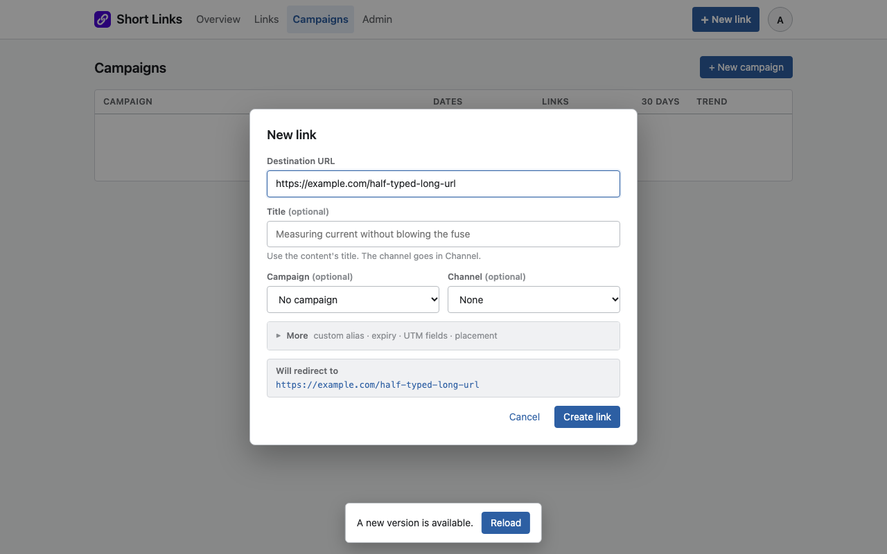
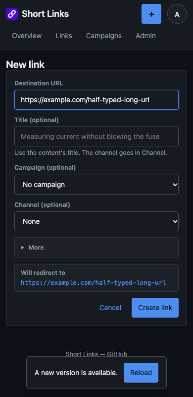
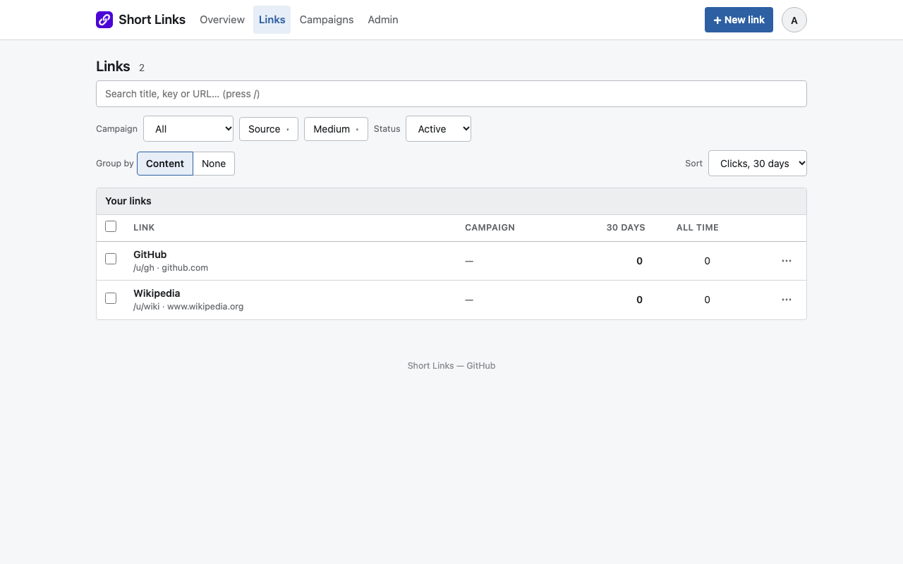
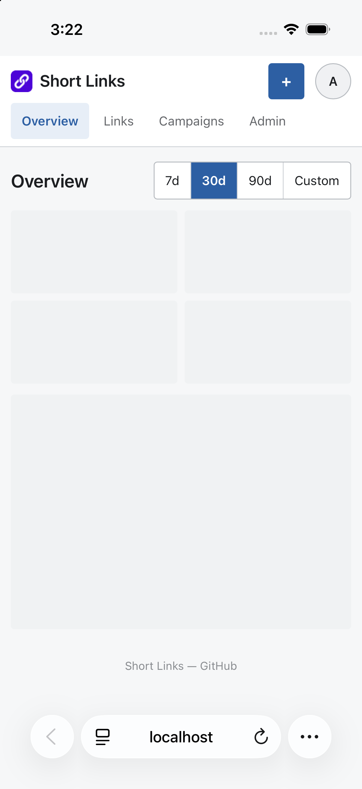

# 0185 — An open tab keeps running an old release after a deploy until someone reloads it by hand

| | |
|---|---|
| **Status** | resolved |
| **Module** | handlers / web |
| **Platform** | All |
| **Phase** | 22 — Web performance and stale tabs |
| **First seen** | 2026-11-18 |
| **Closed** | 2026-11-18 |
| **Commit** | e8d3556 |

## Description

After a deploy, a ShortLinks tab that stayed open keeps the old bundle. It can then fail against changed APIs, or miss fixes. opencircuitsf.com now checks the build id when a tab comes back to the foreground and reloads to the same URL.

## Long Description

Requested by the Open Circuit SF website session on 2026-11-18, on Brennan's behalf: port fixes that shipped in opencircuitsf.com v0.17.0. The reference implementation and its plan and review notes are in `/Users/brennan/Developer/OpenCircuitSF/Website` (issues and commits below). Adapt them to ShortLinks rather than copying, because the router, the views and the size of the win all differ. Measure before and after.

**Reference:** Website #0715 (`/Users/brennan/Developer/OpenCircuitSF/Website/issues/0715.md`, commits `49310178` and `59ac0073`) and #0718 (`/Users/brennan/Developer/OpenCircuitSF/Website/issues/0718.md`, commits `4394af74` and `840e48d0`).

**Wanted:**
- **Server:**
  - `GET /api/version` returns `{"build": "<id>"}` with `no-store`. The id is the git commit or the bundle hash, set at build time.
  - The same id is stamped into the HTML shell as `<meta name="sl-build" content="…">`.
- **`web/src/lib/versionCheck.ts`:**
  - Checks on `visibilitychange` (when the tab becomes visible) and on bfcache `pageshow`, **at most once an hour**, and **never on load**, so it can't loop.
  - Stays silent when offline.
- **Reload:** `reloadToSameURL()` uses `location.reload()`, which keeps the hash route and restores scroll.
- **Unsaved work:** if a form is dirty or a text field has focus (the create-link form, batch create, admin settings), show a small notice, "A new version is available. Reload", instead of reloading.
- **Several stale tabs (#0718):** keep a shared seen-build record in `localStorage` (wrapped in try/catch), so a second stale tab reloads when it gets focus instead of waiting an hour.

## Acceptance criteria

- Vitest covers: no check on load, the throttle, a reload only when the build differs, the notice instead of a reload when the user has unsaved work, the shared seen-build record, and offline being silent.
- A Go test covers `/api/version` headers and the meta tag.
- Checked in the running app: open a tab, rebuild with a new id, refocus the tab, and see it reload to the same hash route.
- `go test ./...` and `cd web && npm test && npm run build` pass.

## Relation

- Reference: Website #0715, #0718
- Related: [#0186](0186.md) (stale-chunk recovery shares the reload helper)

## Root cause

The SPA is one bundle and the server never announced its build, so a tab opened before a deploy ran the old code indefinitely. Nothing in the page said which build it was, and nothing in the client asked.

## Fix

- **Server** (`internal/handlers/version.go`, `cmd/shortlinks/main.go`, `internal/openapi/openapi.yaml`, `internal/mcpserver/parity.go`): `GET /api/version` returns `{"build":"<id>"}` with `Cache-Control: no-store`, unauthenticated. The id is `-ldflags "-X main.buildID=…"` (the Makefile passes the short commit), else a 12-char hash of the embedded `index.html`, which names the hashed bundles and so changes with every SPA build. `web/index.html` carries `<meta name="sl-build" content="%%SL_BUILD%%">`; `StampBuild` wraps the embedded dist FS and substitutes the id into `index.html` once. `SPAHandler` is untouched (#0184 is changing its caching). The route is in the OpenAPI spec and the MCP parity exclusion list, which their tests require.
- **Client** (`web/src/lib/versionCheck.ts`, ported from Website #0715/#0718): checks on `visibilitychange` to visible and on bfcache `pageshow`, at most once an hour (throttle in `localStorage` with an in-memory fallback), never on load, silent offline (a failed check retries in 5 minutes). A shared seen-build record in `localStorage` lets a second stale tab reload on focus without waiting out the hour. `reloadToSameURL()` calls `location.reload()`, so the hash route is kept, and scroll is restored.
- **Unsaved work** (`web/src/lib/unsavedWork.ts`): rather than make every form register, the check scans the page: an open `<dialog>` (New link, batch grid, rule editor), any text field whose value differs from its default, a focused text field, or a registered flag (used for the magic-link verify ceremony). If any holds, a "A new version is available. Reload" notice shows instead, in the top layer so a modal cannot cover it. After a notice, the next navigation reloads once the view has swapped and nothing is unsaved.
- `App.svelte` mounts the watch and the notice.

## Verification

```
cd web && npm run check   -> 0 ERRORS 0 WARNINGS
cd web && npm test        -> Test Files 37 passed, Tests 790 passed
cd web && npm run build   -> built
go build ./... && go vet ./...  -> clean
go test ./internal/handlers ./internal/mcpserver ./cmd/shortlinks -> ok
```

Vitest covers: no check on load, the hourly throttle, reload only when the build differs, notice instead of reload with unsaved work, next-navigation reload, the shared seen-build record, offline silence, and the DOM scan. Go tests cover `/api/version` headers and body, the meta stamp (escaped, via SPAHandler), and build-id derivation.

End to end (Playwright, Chromium, real binaries): built the SPA and binary twice, with build 2 differing by a marker. Served build 1 on :8212 with two tabs open (A clean on `#/links`, B with the New link dialog open and a URL half typed), then swapped in build 2.

```
tab A before: { build: 'a160adac1f1d', marker: null, hash: '#/links' }
no check on load: tabA flag still original
server now reports: {"build":"e22169e26b1b"}
tab A after focus: { build: 'e22169e26b1b', marker: 'two', hash: '#/links' } flag reset: gone (reloaded)
tab B after focus: { build: 'a160adac1f1d', ... } typed value: https://example.com/half-typed-long-url notice: A new version is available. Reload
tab B after dialog closed + navigation: { build: 'e22169e26b1b', marker: 'two', hash: '#/links' } (reloaded)
```

The clean tab reloaded onto the new build at the same hash route. The tab with unsaved input kept its text and showed the notice, then reloaded on the next navigation. Repeated at 390px dark (`#/new` page, root scrollWidth 390 = clientWidth 390). The iOS Simulator loaded the app from the binary.







Not done: the "refocus" was simulated by dispatching `visibilitychange` (headless pages are always visible). Go DB tests were not needed, since nothing here touches the database.

## Files changed

`cmd/shortlinks/main.go`, `internal/handlers/version.go`, `internal/handlers/version_test.go`, `internal/openapi/openapi.yaml`, `internal/mcpserver/parity.go`, `Makefile`, `web/index.html`, `web/src/App.svelte`, `web/src/lib/versionCheck.ts`, `web/src/lib/versionCheck.test.ts`, `web/src/lib/unsavedWork.ts`, `web/src/lib/unsavedWork.test.ts`, `issues/0185.md`, `issues/0185/*.png`.

## Review round 1

Fixes after review (new commit on `issue/0185`, after `git merge main`):

- `hasOpenDialog` now matches `dialog[open], [aria-modal="true"]`, the selector AppShell's shortcut guard uses, so Admin's deactivate-user modal blocks the reload. Test added.
- A persistent, visually hidden `role="status"` live region is always mounted and its text changes when the update is detected. The visible bar is separate and `aria-hidden`.
- The bar is centred with `inset: auto 0 …; margin-inline: auto; width: max-content`, so it is not capped at half the viewport on phones. Code comment notes Reload is unclickable while a modal is open (the modal makes the rest of the page inert).
- Dirty-field behaviour: Svelte's `bind:value` writes the `.value` property and leaves `defaultValue` alone, so a bound field with a non-empty initial value reads as dirty. That only costs a notice instead of a reload, never lost input (comment on `hasDirtyField`).
- Fallback build id now also hashes `vcs.revision` and `vcs.modified` from `debug.ReadBuildInfo`, so a Go-only deploy changes it. Test added.
- Removed the unused `activeElement` field from `WatchOptions.doc`.
- `/api/version` moved from the Documentation tag to Account.

Re-verified: `go test ./internal/handlers ./internal/mcpserver ./cmd/shortlinks` pass, `npm run check` 0 errors, `npm test` 791 passed, and the 390px dark e2e rerun (notice on one centred line, no root horizontal scroll, clean tab reloaded, tab with unsaved input kept its text). Screenshot: `0185/notice-phone-dark.png`.

## Work log

| Date | Model | Input | Output | Cache read | Cache write | Cost |
|---|---|---|---|---|---|---|
| 2026-11-18 | claude-sonnet-5-5 | 130 | 44,271 | 6,312,573 | 123,147 | $1.38 |
| 2026-11-18 | claude-opus-5-5 | 44 | 16,046 | 1,487,971 | 69,038 | $0.96 |

**Total: $2.34**
