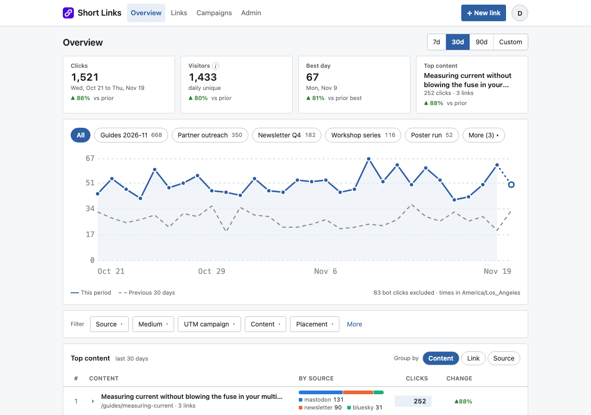
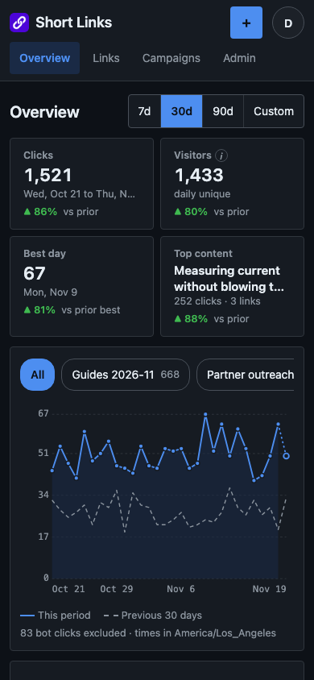
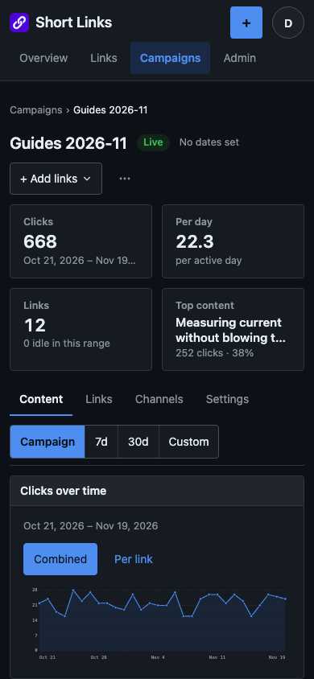
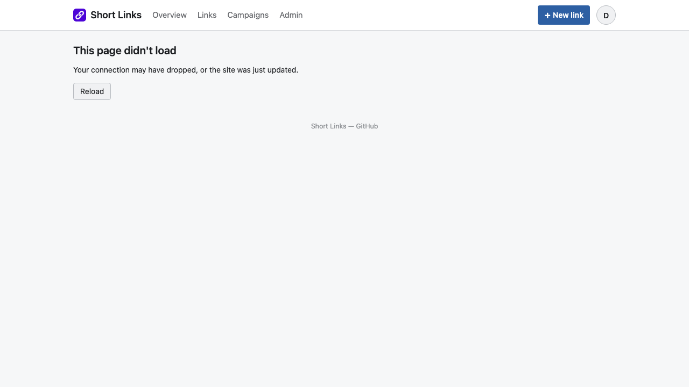
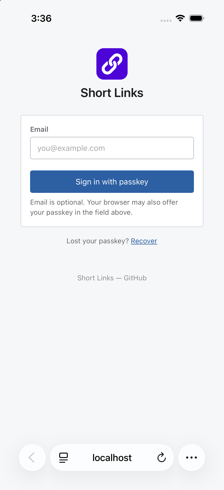

# 0186 — The whole SPA ships as one bundle, so every page loads the admin, campaign and chart code up front

| | |
|---|---|
| **Status** | in-progress |
| **Module** | web / handlers |
| **Platform** | All |
| **Phase** | 22 — Web performance and stale tabs |
| **First seen** | 2026-11-18 |

## Description

ShortLinks builds a single `index-*.js` (about 204 KB, 65 KB gzipped, in the 2026-11-18 build), so the sign-in and home routes download every view. On opencircuitsf.com, splitting by route cut the JS for the first route from 324 KB to 57 KB gzipped. The ShortLinks gain will be smaller. Measure it, and do it anyway, because the redesign (#0152) adds a lot of view code.

## Long Description

Requested by the Open Circuit SF website session on 2026-11-18, on Brennan's behalf: port fixes that shipped in opencircuitsf.com v0.17.0. The reference implementation and its plan and review notes are in `/Users/brennan/Developer/OpenCircuitSF/Website` (issues and commits below). Adapt them to ShortLinks rather than copying, because the router, the views and the size of the win all differ. Measure before and after.

**Reference:** Website #0717 (`/Users/brennan/Developer/OpenCircuitSF/Website/issues/0717.md`), commits `604f3c30` and `01de1efb`.

**Wanted:**
- **Lazy views:** `web/src/lib/routeViews.ts` maps routes to dynamic `import()`s, rendered through a `LazyView.svelte` wrapper. Sign-in and public home stay eager; the other routes are lazy (Dashboard or Overview, LinkDetail, Campaigns, CampaignDetail, Account, Admin).
- **Startup:** `main.ts` waits for the first route's chunk before mounting, so there's no flash.
- **Stale-chunk recovery:** when a chunk fails to load (usually after a deploy), reload the same URL **at most once per URL**. Clear the guard only after every load under that URL has settled. Share the reload helper with #0185.
- **Missing assets:** `/assets/*` misses return 404 with `no-cache` (#0184), never the HTML shell.
- **Measure:** record the before and after JS sizes for the first route in the resolution notes.

## Acceptance criteria

- Vitest covers: route-to-view mapping, the stale-chunk recovery guard (one reload per URL, cleared after settling), and waiting for the first chunk before mount.
- Checked in the running app via `scripts/dev.sh` and a production build. The network panel shows a lazy chunk per route. Navigating every route works. A deleted chunk triggers exactly one reload.
- `cd web && npm test && npm run build` pass.
- Bundle sizes are recorded.

## Relation

- Reference: Website #0717
- Related: [#0184](0184.md), [#0185](0185.md), [#0152](0152.md)

## Root cause

`App.svelte` statically imported every view, so Vite emitted one entry chunk holding Overview, LinkDetail, Campaigns, CampaignDetail, Account, Admin and their charts. A signed-out visitor loading the sign-in screen paid for all of it. On the 2026-11-19 main build that was one 382.96 kB (128.00 kB gzip by Vite) `index-*.js`.

## Fix

- `web/src/lib/routeViews.ts`: `VIEW_LOADERS` maps ten keys to dynamic `import()`s (overview, links, link-detail, new-link, campaigns, campaign-detail, account, admin, and the two magic-link views). It holds the view cache, `loadComponent`, and the stale-chunk guard: on a failed chunk it calls #0185's `reloadToSameURL` at most once per URL (a `sl.chunkReload:<href>` key in sessionStorage). The guard is cleared only once every load under that URL has settled with no failure. `installChunkErrorRecovery` also hooks Vite's `vite:preloadError`; it does not `preventDefault`, so the import still rejects, and the same guard makes a double fire a no-op.
- `web/src/lib/routeTable.ts`: the route table moved out of `App.svelte`. Login and NotFound stay eager (Home is still imported by App); every other route is `lazy('key')`.
- `web/src/lib/LazyView.svelte` renders a lazy view and passes props through (prop is `view`, because LinkDetail has its own `key` prop). Router renders lazy entries through it. A spent guard shows "This page didn't load" with a Reload button.
- `main.ts` awaits `preloadForLocation(routes)` before mounting. The bare root is skipped on purpose: it is Overview only when signed in, and Home or sign-in otherwise, and that is not known until `/api/me` answers. `App.enterApp` instead awaits the chunk of the route that will actually show, after auth and redirects, while `mode` is still `loading` (same text), so nothing flashes.
- Go: no handler change needed. `SPAHandler` already gzips every `.js`/`.css` under `assets/` at construction, serves them `immutable`, and 404s a missing `/assets/*` with `no-cache` (the B5 check, kept). A new test covers several chunks plus a stale chunk name.
- The build id (#0185) is a hash of `index.html`, which names the entry; the entry embeds the hashed lazy chunk names, so changing any view changes the id. Confirmed in the swap test below.

## Verification

Initial JS for `/`, Go binary serving gzip (`measure.mjs`: Playwright counts every `.js` response's Content-Length, all `Content-Encoding: gzip`), seeded Postgres:

| Case | Before | After |
|---|---|---|
| Signed in, `/` (entry + Overview and its shared chunks) | 127,562 B (124.6 KB), 1 file | 71,559 B (69.9 KB), 12 files, **-44%** |
| Signed out, `/` (sign-in) | 127,562 B | 43,138 B (42.1 KB), 1 file, **-66%** |
| Signed in, `#/account` | 127,562 B | 53,864 B (52.6 KB) |
| Signed in, `#/campaigns` | 127,562 B | 56,431 B (55.1 KB) |

Vite's own report: entry 382.96 kB to 119.44 kB raw (128.00 to 43.27 kB gzip). The gain is smaller than the website's because Overview pulls in the charts and tables, but the entry is a third of what it was.

Two-build swap (`swap.mjs`): tab loaded on build A (`81c92f8a30c6`), server binary replaced by build B (`86a68d0f13be`, Account title changed, so A's Account chunk is gone), then the tab navigated to `#/account`:

```
GET old Account chunk -> 404 cache-control: no-cache
after navigating to #/account: tab build 86a68d0f13be ; h1: Account (build B)
document loads caused by the stale chunk: 1 (expected 1)
guard keys left in sessionStorage: []
```

A chunk that is broken on the current build too (route-blocked): 2 document loads (first plus exactly one reload), then "This page didn't load" with no loop (`chunk-failed-*.png`).

Every route at 1280 and 390, light and dark (`routes.mjs`): overview, links, link detail, new link, campaigns, campaign detail, account, admin/settings, not found load their own lazy chunks, render their h1, show no "Loading…" or failure text, and have no root horizontal scroll. The only flagged item is the signed-out login page's expected 401 from `/api/me`.

`scripts/sim.sh` against the built binary: `simulator-ios.png` (signed-out sign-in screen on iPhone 17).

Commands: `cd web && npm ci && npm run check && npm test && npm run build` (0 errors, 807 tests pass, including `routeViews.test.ts` and `mainMountWait.test.ts`); `go build ./... && go vet ./internal/handlers/ && go test ./internal/handlers/ -run SPA` pass.

Not done: the Vite dev server (:5216) was not run; checks used the production build served by the Go binary.

Screenshots:     

## Review round 1

- **Home no longer loads Overview.** `enterApp` now waits for `componentToPreload(signedIn, route, homeInfo)` (lib/home.ts), which returns null when `shouldShowHome` is true. Signed-out `/` with the public home enabled (Postgres, `registrations_enabled=false`, `home_redirect_url` set), Playwright at 1280 and 390, light and dark: JS requested is the entry alone, `index-CRRQRYMm.js`, 43,235 B, and no `Overview-*` chunk (`signed-out-home-*.png`). Unit tests cover the four cases.
- **No "Loading…" flash in-app.** `Router.svelte` keeps the current view mounted until the next lazy chunk arrives (`$effect.pre`; a failed chunk still switches, so LazyView shows its failure state). Playwright with each chunk delayed 400 ms, navigating `/links`, `/campaigns`, `/account`, `/`: placeholder seen `[]`. `router.lazy.test.ts` covers both the held view and the cached case.
- **No mount during a recovery reload.** `recoverFromChunkError` sets a flag (`isRecoveryReloading`); `main.ts` skips `mount` when it is set. Tested in `mainMountWait.test.ts`.
- **Same URL for record and recover.** `recoverFromChunkError(deps, href)` takes the URL the load started under. If the URL has changed by the time the load fails, nothing is recorded or reloaded. Two new tests.
- `mainMountWait.test.ts` calls `vi.unstubAllGlobals()`.
- **Pre-existing dev-mode bug** (reproduces on main): dev mode has no `/api/reports`, so the request falls through to the SPA catch-all and "succeeds" with the HTML shell as a string. `report` became that string and `report?.window.partial_last_day` threw. Fix: `isLinkPerformance()` in lib/linkReport.ts; LinkDetail treats anything else as no report. Tests: `linkReport.test.ts` and `views/linkDetailDevMode.test.ts` (2 of its 3 cases fail without the fix). Dev-mode binary, `#/links/gh`: before, no h1 and `TypeError: Cannot read properties of undefined (reading 'partial_last_day')`; after, h1 "GitHub", no errors (`dev-link-detail-*.png`).
- Re-run: `npm run check` 0 errors, `npm test` 821 pass, `npm run build`, `go test ./internal/handlers/`. The two-build swap test was re-run on the new code: one reload, new build landed, guard cleared; a permanently broken chunk gives 2 document loads and the failure screen.

## Files changed

- `web/src/lib/routeViews.ts`, `web/src/lib/routeTable.ts`, `web/src/lib/LazyView.svelte` (new)
- `web/src/App.svelte`, `web/src/lib/Router.svelte`, `web/src/main.ts`
- `web/src/lib/routeViews.test.ts`, `web/src/lib/mainMountWait.test.ts` (new)
- `internal/handlers/static_test.go`
- `issues/0186.md`, `issues/0186/*.png`
- Review round: `web/src/lib/home.ts`, `web/src/lib/linkReport.ts`, `web/src/views/LinkDetail.svelte`, plus tests `router.lazy.test.ts`, `views/linkDetailDevMode.test.ts` and additions to `home.test.ts`, `linkReport.test.ts`, `routeViews.test.ts`, `mainMountWait.test.ts`
