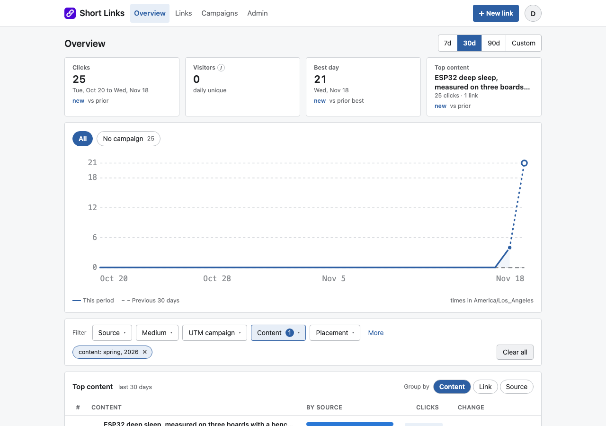
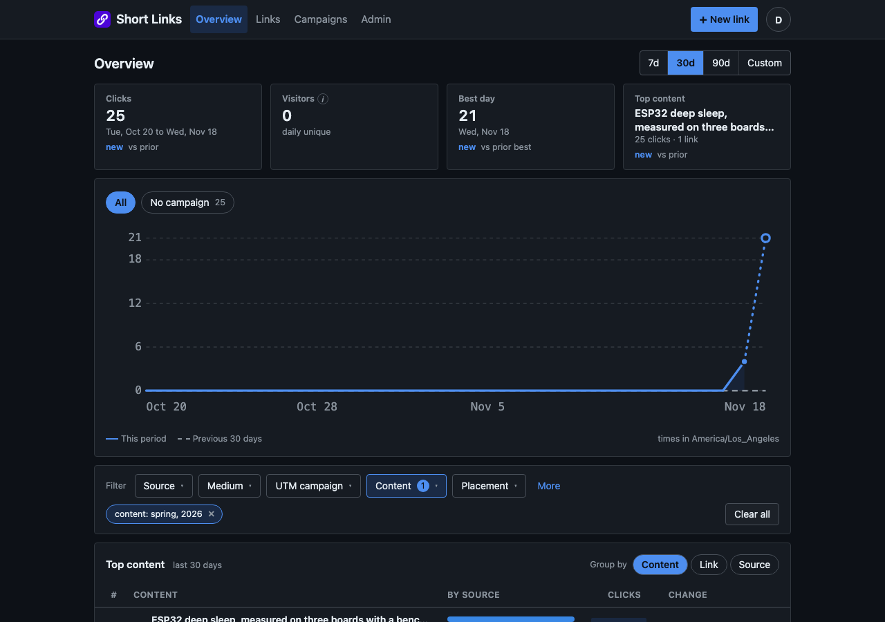
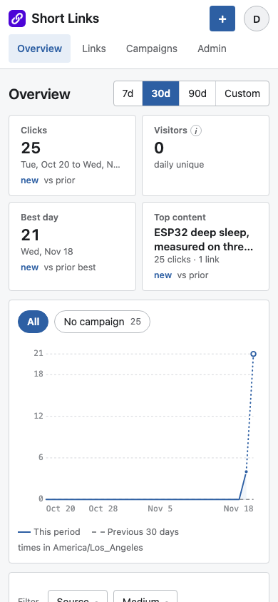
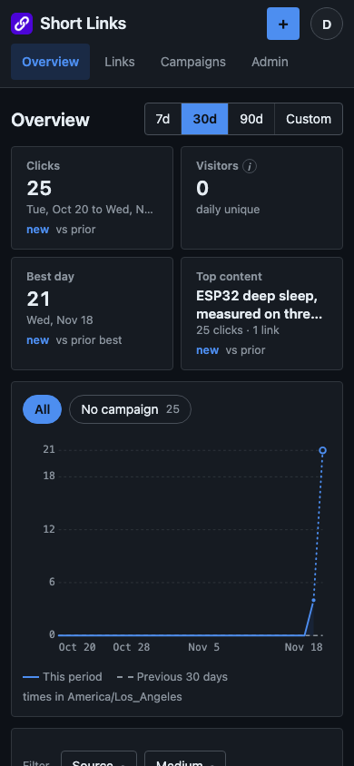
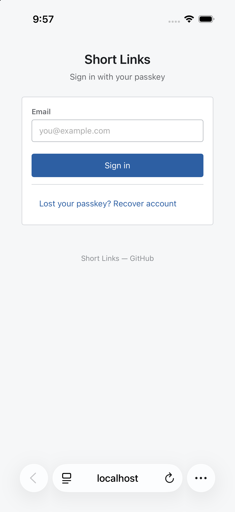

# 0187 — A UTM value that contains a comma can't be filtered on, because the reports split every filter value on commas

| | |
|---|---|
| **Status** | closed |
| **Module** | handlers / web |
| **Platform** | All |
| **Phase** | 19 — UI depth and polish |
| **First seen** | 2026-11-18 |
| **Closed** | 2026-11-18 |
| **Commit** | 332021f |

## Description

`internal/reports/params.go` (around line 202) splits each UTM filter parameter on commas, so a value such as `utm_content=spring, 2026` becomes two values and never matches exactly. The Overview filters from #0163 encode the comma correctly in the hash, but the server still splits it.

## Acceptance criteria

- The reports accept repeated parameters (`utm_content=a&utm_content=b`) as OR, without splitting on commas. Keep accepting the comma form for existing clients, or support an escape, and document the choice in `docs/mcp.md` and `internal/openapi/openapi.yaml`.
- `lib/viewQuery.ts` and `reportQuery` send values that contain commas so that they match exactly.
- A test filters on a value that contains a comma, end to end.

## Relation

- Found in review of [#0163](0163.md).

## Root cause

`splitList` in `internal/reports/params.go` split every value of a filter parameter on commas, repeated or not, so `utm_content=spring, 2026` became `spring` and `2026`. A value with a comma could never match exactly, and nothing on the wire could say otherwise.

## Fix

- `splitList`: a parameter given more than once is a list of whole values and is never split. A parameter given once is still the comma-separated form for existing clients, with `\,` for a literal comma and `\\` for a backslash. Other backslashes are kept as written.
- `reports.EscapeFilterValue` and `reports.AddFilterValues` build a query that round-trips any value. The MCP report tools (`reportCommon.values`) use `AddFilterValues`, so array elements with commas work.
- `reportQuery` in `web/src/lib/viewQuery.ts` (the only change there) sends several values repeated and escapes a lone value.
- Documented in `internal/openapi/openapi.yaml` (report filter parameters), `docs/mcp.md` and `docs/analytics.md`.
- Behaviour change: `source=a&source=b,c` used to give a, b, c; it now gives a and `b,c`. The existing params test that mixed the two forms was updated.

## Verification

Against a fresh DB `shortlinks_0187` (dropped afterwards, `TEST_DATABASE_URL` pointed at it):

```
$ go test ./internal/reports/... ./internal/handlers/... ./internal/mcpserver/... ./cmd/...
ok  internal/reports  ok  internal/handlers  ok  internal/mcpserver  ok  cmd/shortlinks (OpenAPI drift test)
$ go test ./internal/handlers -run FilterValueWithComma -v
--- PASS: TestReports_FilterValueWithComma
$ cd web && npm run check   -> 0 errors, 0 warnings
$ npm test                  -> 29 files, 648 tests passed
$ npm run build             -> built
```

`go vet ./...` is clean. End-to-end test seeds clicks for `spring, 2026`, `spring` and `2026` and filters over HTTP in five forms.

UI against a seeded Postgres (`scripts/dev-seed.sql` plus 25 clicks with `utm_content = 'spring, 2026'` and 6 with `spring`). Opening `#/?content=spring%2C%202026` sent `content=spring\,+2026` and the Overview showed 25 clicks, the chip "content: spring, 2026", and no root horizontal scroll at 1280 and 390, light and dark.






The simulator ran once, but its Safari has no session cookie, so it shows the sign-in page: 

## Files changed

- `internal/reports/params.go`, `internal/reports/params_test.go`, `internal/reports/filter_values_test.go`
- `internal/mcpserver/tools_reports.go`, `internal/mcpserver/reports_comma_test.go`
- `internal/handlers/reports_comma_test.go`
- `web/src/lib/viewQuery.ts`, `web/src/lib/viewQuery.test.ts`
- `internal/openapi/openapi.yaml`, `docs/mcp.md`, `docs/analytics.md`
- `issues/0187.md`, `issues/0187/*.png`

## Work log

| Date | Model | Input | Output | Cache read | Cache write | Cost |
|---|---|---|---|---|---|---|
| 2026-11-18 | claude-sonnet-5-5 | 112 | 24,925 | 4,005,365 | 86,234 | $0.87 |
| 2026-11-18 | claude-opus-5-5 | 32 | 5,479 | 800,392 | 40,274 | $0.47 |

**Total: $1.34**
