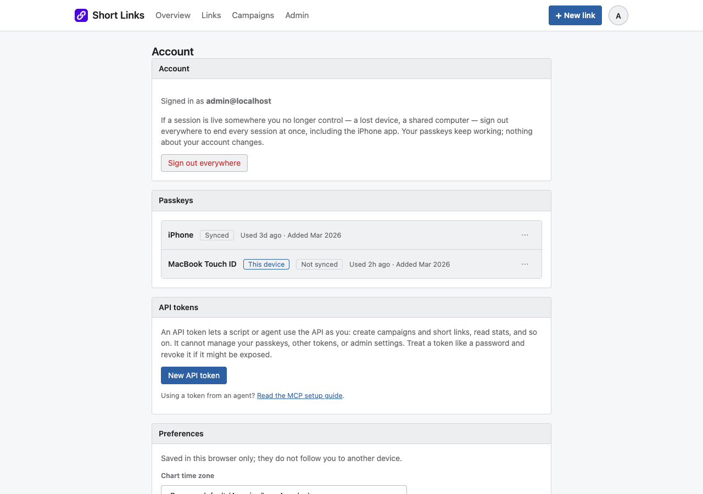
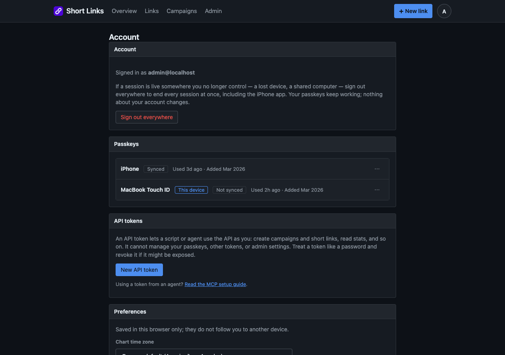
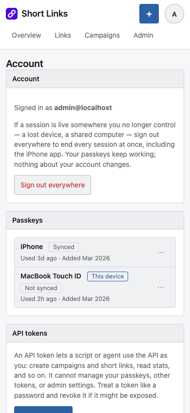
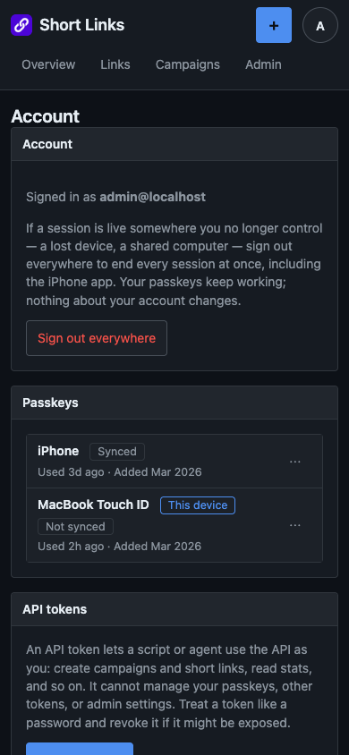
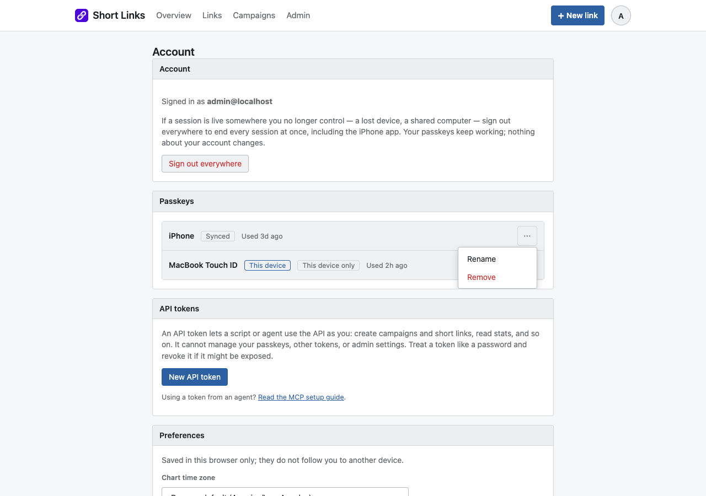
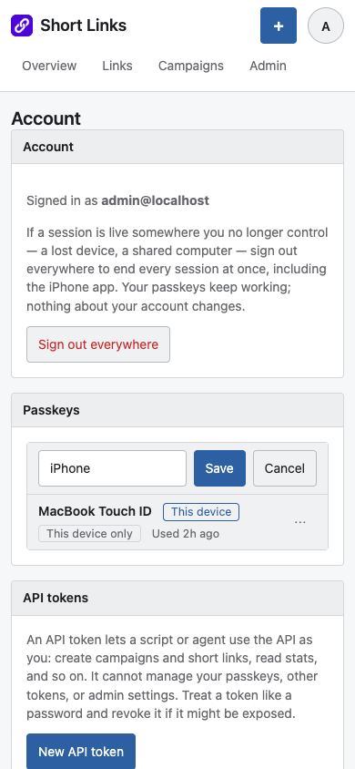
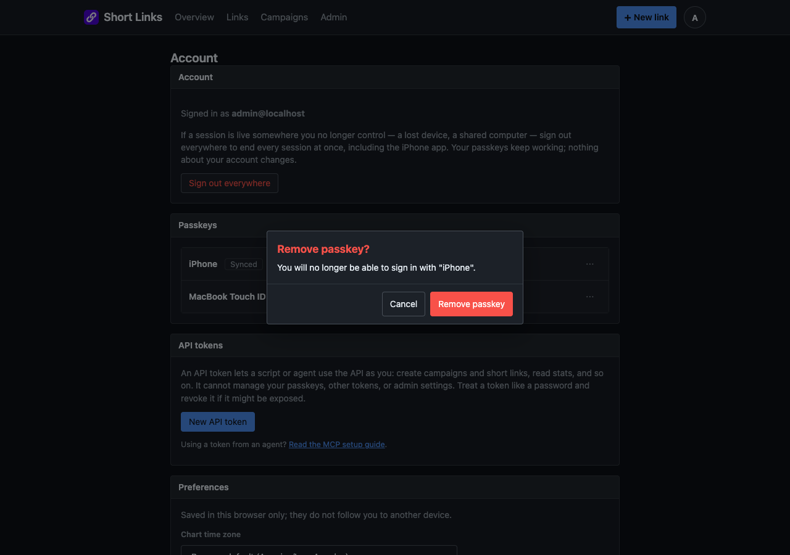
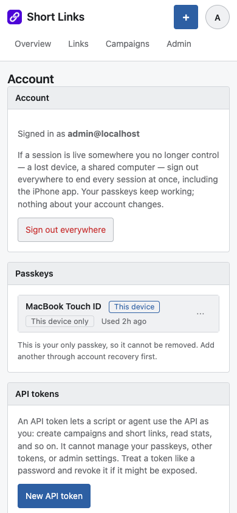
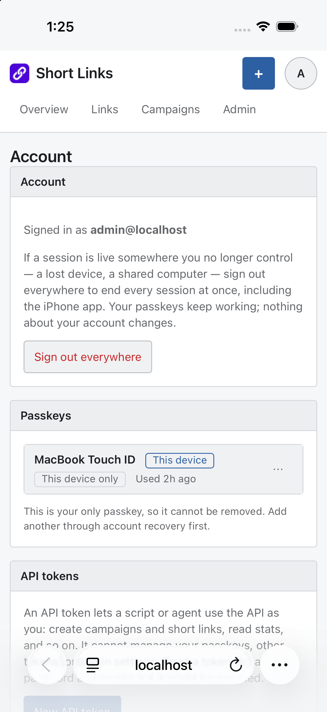

# 0188 — The Account passkey list doesn't say which passkey is on this device or whether it is synced

| | |
|---|---|
| **Status** | in-progress |
| **Module** | auth / handlers / web |
| **Platform** | All |
| **Phase** | 19 — UI depth and polish |
| **First seen** | 2026-11-19 |

## Description

#0170 left the passkey list on Account unchanged, because the credentials API doesn't return which passkey the current session used or whether a passkey is synced. Both are available server-side: sessions record the passkey they were created with (migration 000013), and credentials store `backup_eligible`/`backup_state`.

## Acceptance criteria

- `GET` on the credentials API returns `current` (true for the passkey the caller's session used) and `synced` (from `backup_state`) for each credential. The dev store returns them too. Go tests cover both.
- Account lists passkeys one line each, per docs/ui-redesign.md §3.8: name, a "This device" tag, "Synced" or "This device only", last used, and a ⋯ menu with Rename and Remove (Remove through ConfirmDialog). The current passkey can't be removed if it's the last one.
- Checked in the running app at 1280 and 390, light and dark, with screenshots in `issues/0188/`.

## Relation

- Carved out of [#0170](0170.md).

## Root cause

The issue's premise was wrong: sessions did NOT record the passkey they were created with (migration 000013 only tightens NOT NULL constraints). `sessions` had no passkey column, so the API could not say which passkey was current. `backup_state` was stored but never selected by `ListCredentialsForUser`. The dev store returned no passkeys at all.

## Fix

- Migration `000020_sessions_credential_id`: nullable `sessions.credential_id` referencing `passkey_credentials(id) ON DELETE SET NULL` (revoking a passkey leaves its sessions valid, unlinked).
- `Store.CreateSessionForCredential` records the passkey; login, registration and recovery use it (`CreateSession` is unchanged for callers with no passkey). `ResolveSession` returns `SessionUser.CredentialID`, which the session guard puts on `middleware.AuthUser`.
- `ListCredentialsForUser` selects `backup_state`; the handler returns `current` (session's passkey) and `synced` (backup state) on list and rename.
- Dev store seeds two passkeys (device-bound current one, synced one) with working list, rename, revoke and the last-passkey refusal.
- Account: one line per passkey (name, "This device" tag, "Synced"/"This device only", last used) with the shared `AccountRowMenu` (Rename, Remove). Remove goes through ConfirmDialog; with one passkey Remove is disabled and a note explains why. Existing sessions (before the migration) have no passkey, so no row shows "This device" until the next sign-in.

## Verification

- `go build ./... && go vet ./...` clean. With a fresh DB `shortlinks_0188` (migrated through 20, dropped after): `go test ./internal/auth ./internal/handlers ./internal/middleware ./internal/devstore` all `ok`. New: `TestCredentialsList_CurrentAndSynced`, `TestNewCredentialView`, `TestDevCredentials_*`, and a login test asserting `sessions.credential_id` is set. `go test ./...` fails only the known `internal/config` TestLoad_DefaultsApplied.
- `cd web && npm run check` 0 errors; `npm test` 722 passed; `npm run build` ok.
- Ran dev mode (Go :8203, Vite :5203): `GET /account/credentials` returned `current`/`synced`; DELETE of the last passkey returned `cannot_revoke_last_credential`. Playwright at 1280 and 390, light and dark: no root horizontal scroll in any. iOS Simulator checked.

## Files changed

- migrations/000020_sessions_credential_id.{up,down}.sql
- internal/auth/store.go, login.go, registration.go, recovery.go, login_test.go
- internal/middleware/auth.go
- internal/handlers/credentials.go, credentials_test.go
- internal/devstore/devstore.go, credentials_test.go
- web/src/lib/types.ts, account.ts, account.test.ts; web/src/views/Account.svelte
- issues/0188.md, issues/0188/*.png

## Review round 1

- Migration 000020 now starts with `SET lock_timeout = '5s'` and creates the partial index `sessions_credential_id_idx` (so ON DELETE SET NULL doesn't scan `sessions` during a revoke); the down migration drops the index before the column. Ran up, down 1, up on a fresh DB: all applied, index and FK present.
- §3.9 reference corrected to §3.8.
- "This device only" renamed "Not synced"; each row now shows "Added Mon YYYY".
- Dev store clears a session's credential once that passkey is removed (`TestDevCredentials_RevokedCurrentUnlinksSession`).
- Re-verified: `go build`, `go vet`, `go test ./...` all pass on a fresh DB (merged main, config test passes now); `npm run check` 0 errors, `npm test` 724 passed. The `list-*` screenshots were retaken; `menu-`, `rename-`, `confirm-`, `single-*` and `simulator.png` predate the wording change and still say "This device only" and omit "Added".
