# 0189 — Group by content on the Links list only groups the current page of links

| | |
|---|---|
| **Status** | resolved |
| **Module** | handlers / web |
| **Platform** | All |
| **Phase** | 19 — UI depth and polish |
| **First seen** | 2026-11-19 |
| **Closed** | 2026-11-18 |
| **Commit** | 1f79a97 |

## Description

#0167 groups links by content client-side, so a content item whose links fall on different pages appears split. `GET /api/links` pages links, not content.

## Acceptance criteria

- The links API (or a report) can page by content group, honouring the same search, filters and sort as the flat list. It returns each group with its links and totals. Covered by Go tests, documented in the OpenAPI spec (drift test passes) and available to MCP if the flat list is.
- Links → Group by content uses it, so each content item appears once, with all of its matching links, and paging moves by groups.
- Checked in the running app against seeded Postgres, at 1280 and 390, light and dark, with screenshots in `issues/0189/`.

## Relation

- Carved out of [#0167](0167.md).

## Root cause

`GET /api/links` pages links, and #0167 grouped the 20 links of the current page in the browser, so a content item whose links fell on different pages appeared split and paging counted links.

## Fix

- `internal/links/groups.go`: `GroupLinks` / `PageGroups` bucket already-filtered, already-sorted rows with `reports.ContentKey`, `reports.ContentTitle` and `reports.ContentPath` (the #0140 logic, not duplicated) and order the groups by the list sort (newest/oldest link, group clicks, group window clicks, title).
- `GET /api/links?group=content` (`handlers/links.go`): runs the same store query (search, campaign/source/medium, status, sort, window) without a page limit, groups, then pages by group. Returns `{groups, page, per_page, total (groups), total_links, window}`; each group has `content_key, title, path, link_count, clicks, clicks_window, links` (the enriched link items). `group=none` is the flat list; other values give `400 invalid_group`. Works against both the Postgres store and the dev store.
- OpenAPI: `group` parameter, `LinkGroup`, `GroupedLinkList`, `invalid_group`. `docs/links.md` updated. MCP `list_links` gains `group` and summarises groups.
- Web: `searchLinkGroups`, `LinkGroup` types; `LinksList` fetches with `group=content` when Group by Content is on (the group is now part of the fetch key), shows the server's content title, pages by group ("25 content items"), keeps the header count as total links, and reloads on a live link.created event instead of prepending.

## Verification

- `go build ./... && go vet ./...` clean. `go test ./...` against a private DB (`shortlinks_0189`, migrated, dropped afterwards): all pass except the known `internal/config` TestLoad_DefaultsApplied. New: `TestGroupLinks` and `TestLinksList_GroupByContent` (groups never split across pages, per_page paging, search, source filter, sort clicks/title/-created, window, bots ignored, other users' links excluded, group=none, invalid_group). The OpenAPI drift test (cmd/shortlinks) passes.
- `cd web && npm run check` 0 errors; `npm test` 33 files, 724 tests pass; `npm run build` ok.
- Real Postgres seeded with `scripts/dev-seed.sql` plus 8 extra single-link contents (41 links, 25 groups): API returns 17 groups for the seed; the UI shows 20 groups on page 1 and 5 on page 2 ("Page 2 of 2 (25 content items)"), each group holding all 3 of its links when expanded. No root horizontal scroll at 1280 or 390, light or dark (overflow 0). iOS Simulator via a `STORAGE=json` server (dev store groups too).

Screenshots: 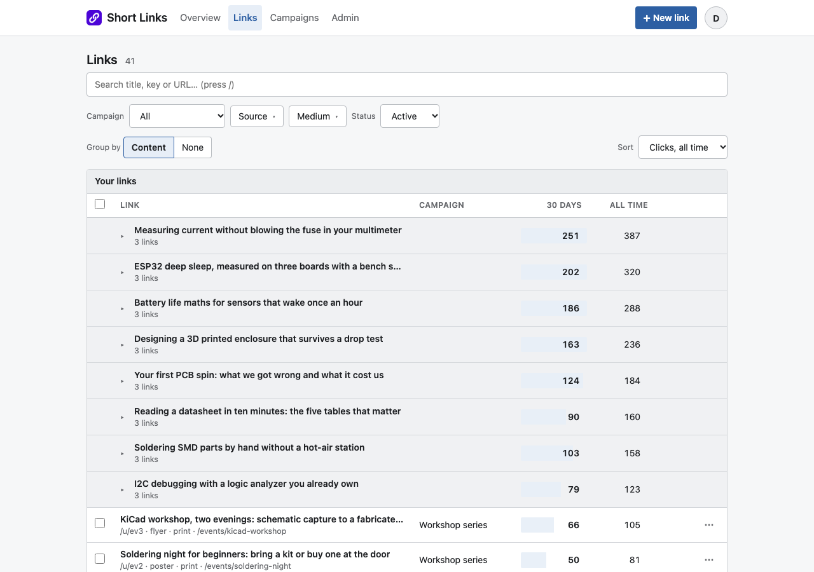 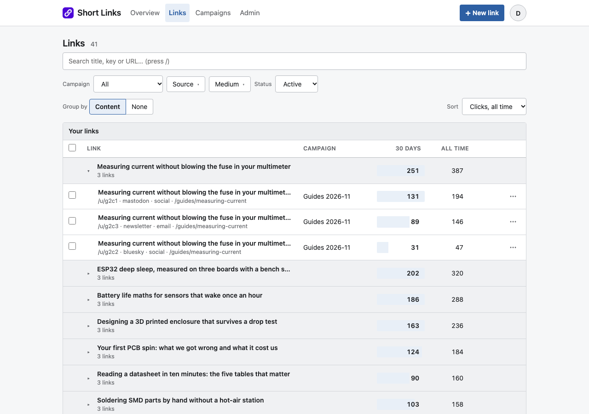 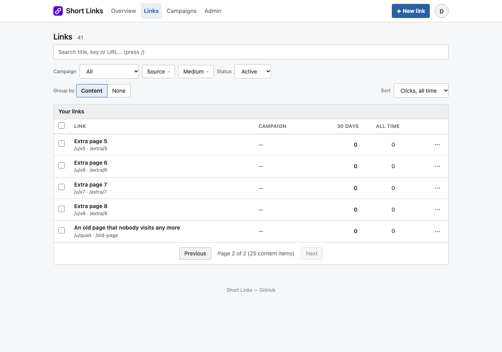 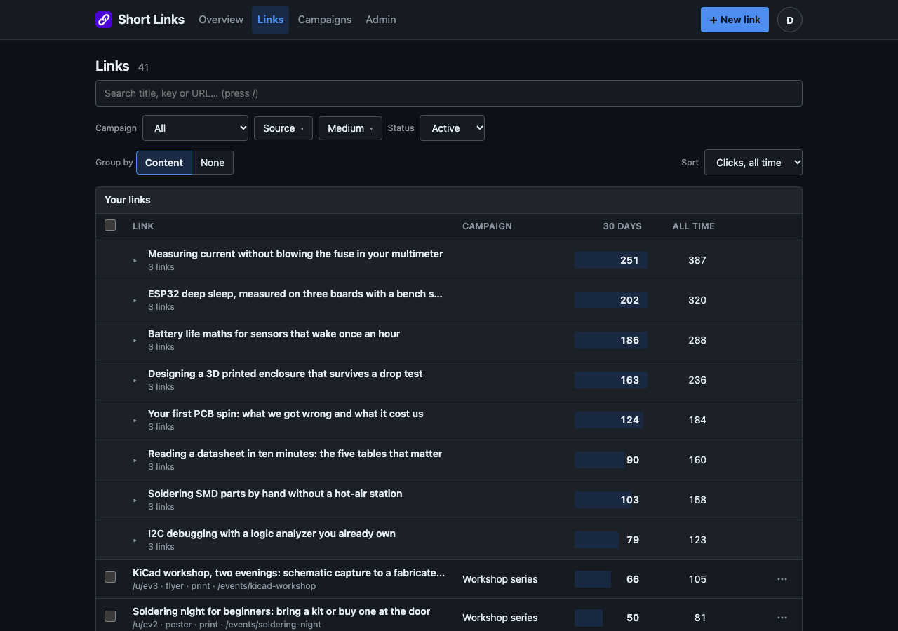 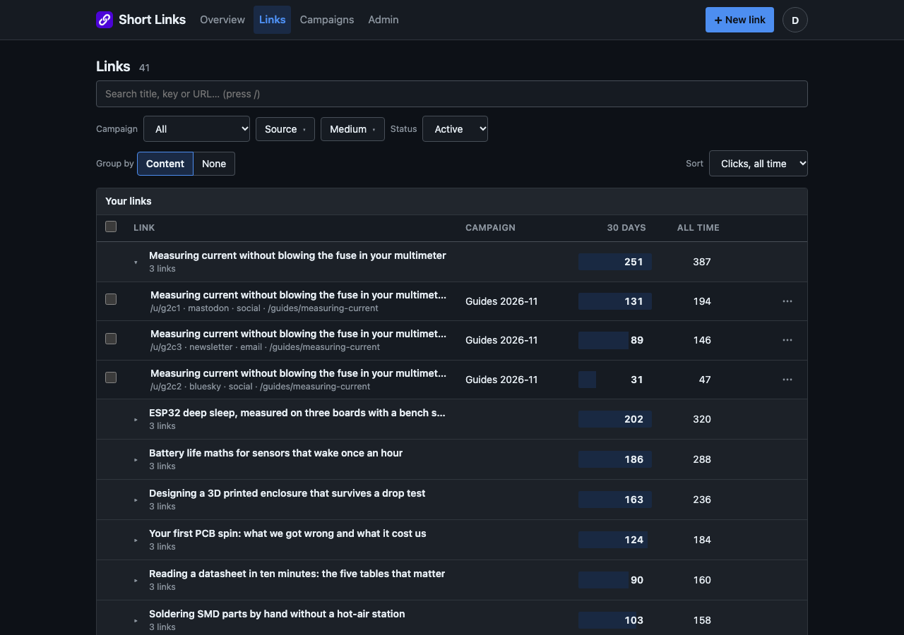 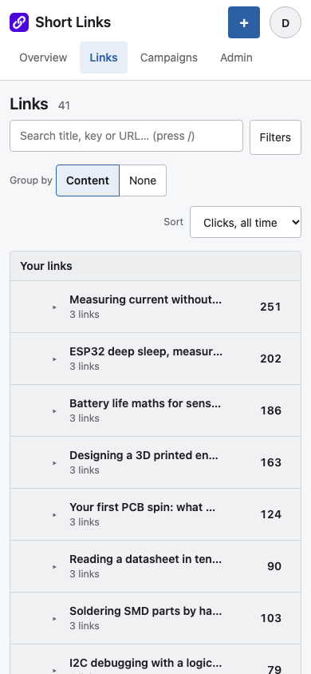 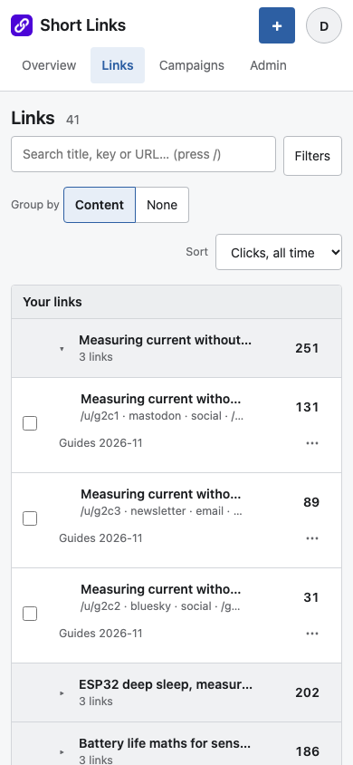 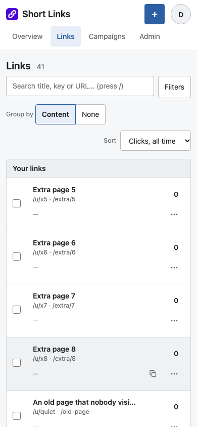 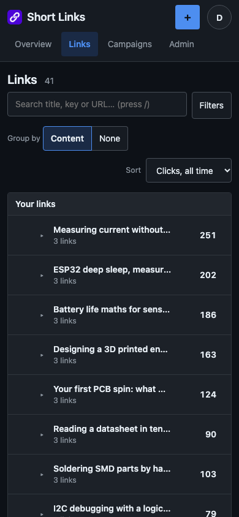 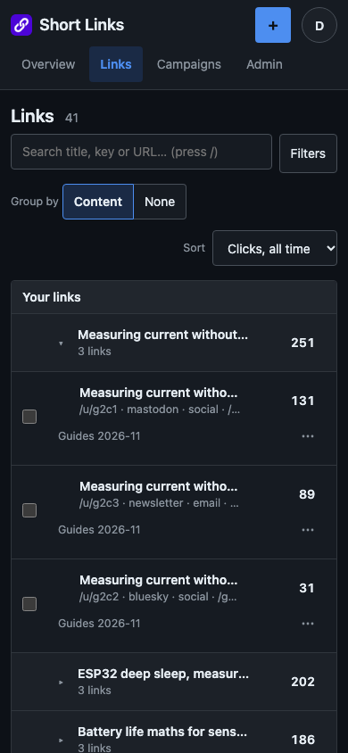 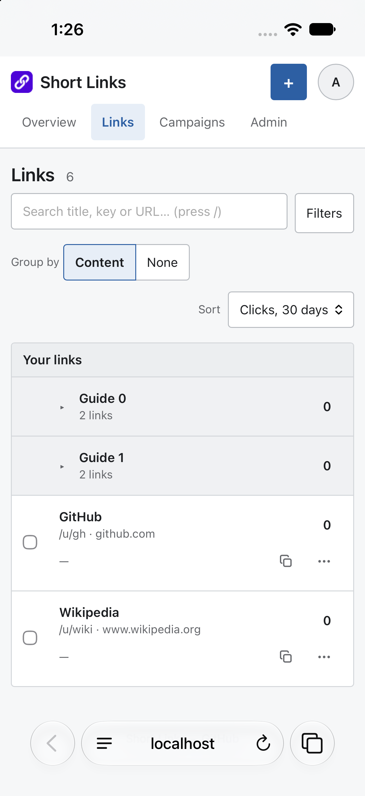

## Files changed

`internal/links/groups.go`, `internal/links/groups_test.go`, `internal/handlers/links.go`, `internal/handlers/links_group_test.go`, `internal/openapi/openapi.yaml`, `internal/mcpserver/tools_links.go`, `docs/links.md`, `web/src/lib/{api,types,linksList,linksList.test}.ts`, `web/src/views/LinksList.svelte`, `issues/0189.md`, `issues/0189/*.png`.

## Review round 1

- Grouped mode is bounded: `maxGroupedLinks = 10000` (a variable so tests can lower it). The handler fetches cap+1, truncates, and returns `"truncated": true` (`total_links` is then the links grouped). The Links list shows "Grouping covers the first 10,000 links; narrow the filters." Documented in OpenAPI and `docs/links.md`; `TestLinksList_GroupByContentTruncates` lowers the cap (truncated at 3 of 5, not truncated at exactly the cap).
- `PageSlice`/`PageGroups` are one generic `links.Page[T]`.
- Grouped mode reloads on a live link.created on any page, gated by `acceptsNewLink` (page forced to 1 for the check).
- `sort=title` puts untitled groups last (unit test).
- The web app uses the server's per-group clicks and window totals for group rows (`groupTotals`).
- Re-verified: `go build ./... && go vet ./internal/...`; `go test ./...` on a fresh migrated DB `shortlinks_0189` (all packages ok, dropped afterwards, including the OpenAPI validity and drift tests); `npm run check` 0 errors; `npm test` 725 pass; `npm run build` ok.

## Work log

| Date | Model | Input | Output | Cache read | Cache write | Cost |
|---|---|---|---|---|---|---|
| 2026-11-18 | claude-sonnet-5-5 | 148 | 48,685 | 7,916,063 | 171,071 | $1.71 |
| 2026-11-18 | claude-opus-5-5 | 22 | 4,828 | 586,638 | 51,124 | $0.47 |

**Total: $2.18**
