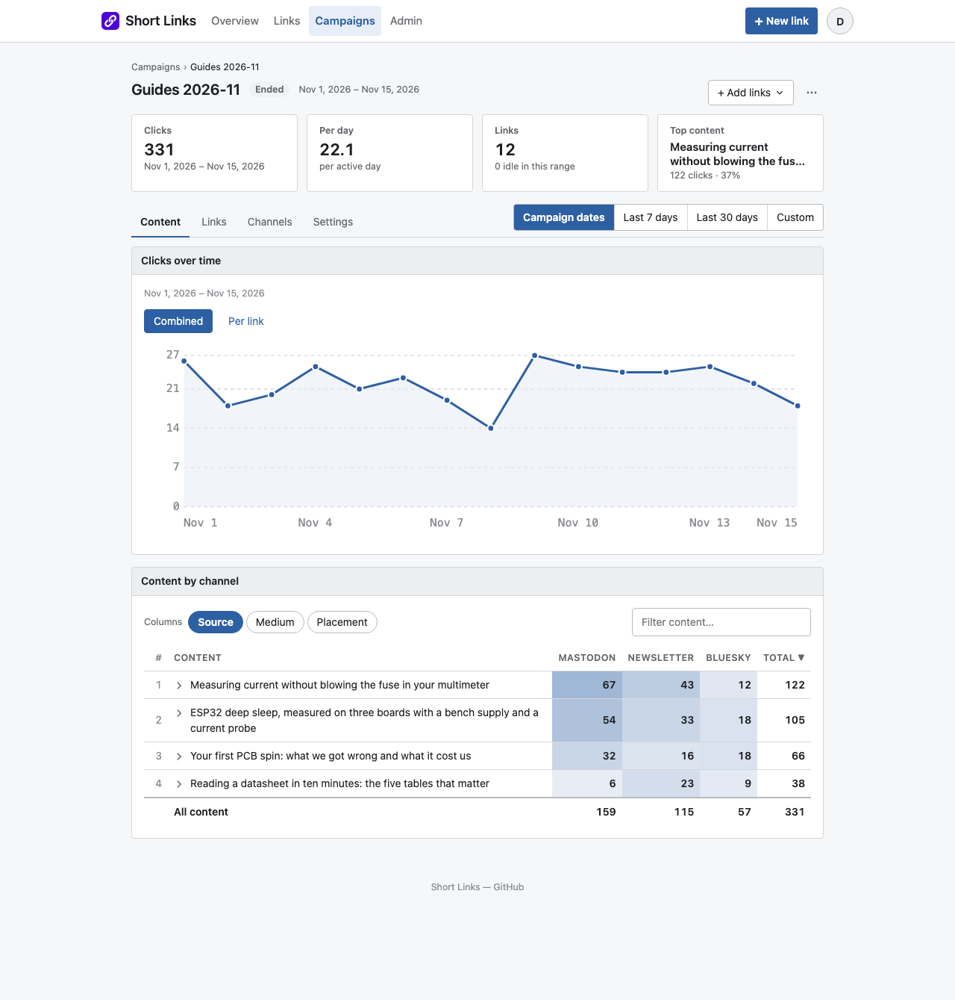
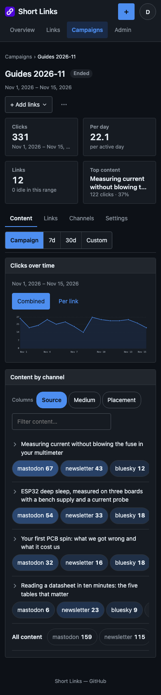
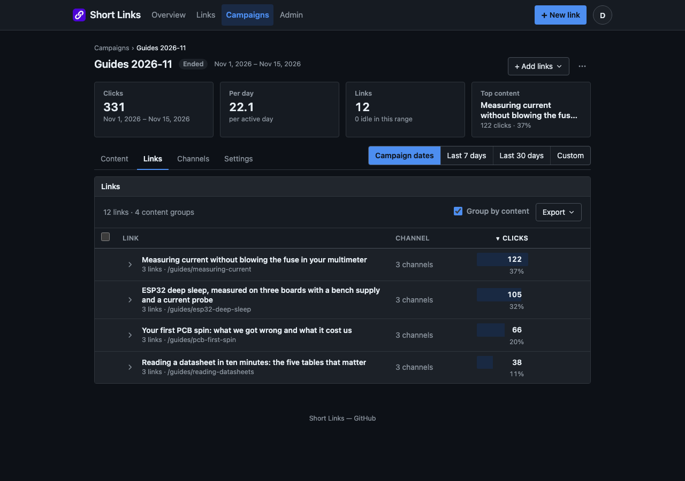
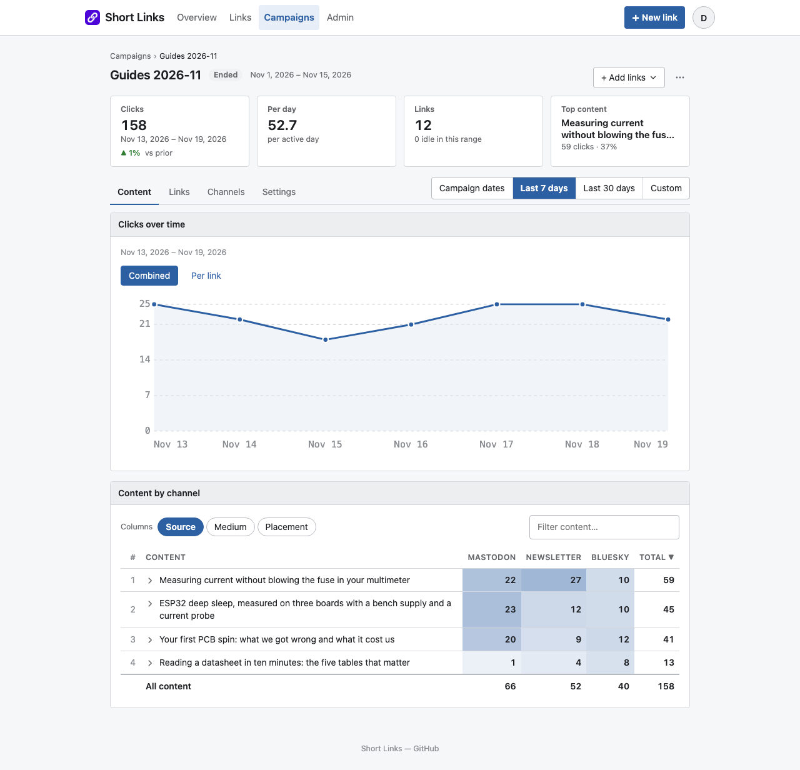

# 0190 — Campaign charts and the campaign Links table count days in UTC, not the viewer's chosen time zone

| | |
|---|---|
| **Status** | in-progress |
| **Module** | clicks / handlers / web |
| **Platform** | All |
| **Phase** | 19 — UI depth and polish |
| **First seen** | 2026-11-19 |

## Description

Campaign detail (#0164) and its Links table (#0157) send `tz=UTC`, because `GET /api/campaigns/{slug}/stats` (`CampaignClicksOverTime`, `campaignWindow` in internal/clicks/stats.go) buckets by UTC calendar day. Everywhere else uses the Account time zone preference (`getChartTimeZone()`), per design principle 11.

## Acceptance criteria

- The campaign stats endpoint, its CSV export and the campaign reports accept `tz` and bucket by local civil days in that zone, DST-safe, defaulting to `DEFAULT_TIMEZONE`. Campaign dates include the last day. Go tests cover a DST boundary and the last day.
- Campaign detail, its Links table and the Campaigns list send `getChartTimeZone()`. The "UTC days" note is removed. Remove the `tz=UTC` comments in api.ts.
- The OpenAPI spec and docs are updated, and the drift test passes.
- Checked in the running app against seeded Postgres, with screenshots in `issues/0190/`.

## Relation

- Carved out of [#0164](0164.md) and [#0157](0157.md). Related to [#0119](0119.md) (`campaignWindow` drops the last day).

## Root cause

`campaignWindow` and the three campaign day-bucket queries (`internal/clicks/stats.go`) were written in UTC: `to` was `min(ends_at, today UTC midnight)` (so the last day and today dropped out, see #0119) and the SQL used `AT TIME ZONE 'UTC'`. The SPA therefore sent `tz=UTC` everywhere on campaign pages and worked around the dropped day with an explicit `to`.

## Fix

- `clicks.StatsStore` campaign methods take a `*time.Location`. `campaignWindow` builds civil-day windows with `time.Date` (as `reports.ResolveWindows` does, so DST days of 23/25 hours still start and end at local midnight). The campaign's own `starts_at`/`ends_at` (date-only, UTC midnight) are read as civil days; `to` is the day after `min(ends_at, today)`, so the last day and today are both in. The no-dates fallback is the last 30 civil days including today. Explicit `from`/`to` are civil days in the zone (`to` stays exclusive). Day buckets use `AT TIME ZONE <tz>`; `window_from`/`window_to` are formatted in that zone.
- `GET /api/campaigns/{slug}`, `.../stats` and `.../export.csv` accept `tz` (default `DEFAULT_TIMEZONE`, invalid zone is a 400 with `field: tz`). The campaign reports already took `tz`.
- Web: CampaignDetail sends `getChartTimeZone()` to the stats, detail, CSV and the three reports; "today" is the viewer's. `statsRange` no longer sends the `min(ends, today)+1` workaround for Campaign dates; presets are N days ending today inclusive. "UTC days" notes and the `tz=UTC` comments in api.ts are gone. The Campaigns list already sent `getChartTimeZone()`.
- OpenAPI, `docs/analytics.md`, `docs/campaigns.md` updated.
- #0119: this fully covers the campaign half of #0119 (campaignWindow's dropped last day and today, for the default window and explicit `to`). It does NOT cover the per-link `ClicksOverTime`/link-detail chart, which still defaults `to` to UTC midnight today. #0119's status is unchanged.

## Verification

- `go build ./... && go vet ./...` clean. `TEST_DATABASE_URL=<fresh migrated DB> go test ./cmd/... ./internal/...` passes except the known `internal/config` `TestLoad_DefaultsApplied`; includes the OpenAPI drift tests (`cmd/shortlinks/openapi_test.go`).
- New tests: `TestCampaignWindow_TimeZoneDSTAndLastDay` (America/Los_Angeles over the 2026-03-08 spring-forward, last day, UTC comparison), `TestCampaignWindow_OneDayCampaignAndTodayDefault`, `TestCampaignsStats_TZBucketsDaysAndIncludesLastDay` (tz on stats, detail, export filename, 400).
- `cd web && npm ci && npm run check && npm test && npm run build`: 0 errors, 716 tests pass.
- Real Postgres (fresh DB, `scripts/dev-seed.sql`, campaign set to 2026-11-01..2026-11-15): `stats?tz=UTC` gives 331 clicks, window 2026-11-01 to 2026-11-16 with Nov 15 as the last bucket; `tz=America/Los_Angeles` 331; `tz=Pacific/Auckland` 329. Both match a hand-written SQL count (331 and 329). `tz=Nope` is 400.
- Requests from the page carry `tz=America%2FLos_Angeles` on `/api/campaigns/...`, `/stats`, top-content, campaign-performance, campaign-comparison and the list.
- Screenshots in `issues/0190/` (desktop 1280 and phone 390, light and dark, of detail, links tab and list, plus Last 7 days ending today): `detail-desktop-light.png`, `detail-phone-dark.png`, `links-desktop-dark.png`, `detail-7d-desktop-light.png`, and the rest of the matrix. No root horizontal scroll in any.
- `scripts/sim.sh` ran, but the Simulator has no session cookie so it only showed the sign-in page. The phone-width check is the Playwright 390px screenshots.

## Files changed

`internal/clicks/stats.go`, `internal/clicks/stats_test.go`, `internal/handlers/campaigns.go`, `internal/handlers/campaigns_export.go`, `internal/handlers/campaigns_test.go`, `internal/devstore/devstore.go`, `internal/devstore/campaigns_test.go`, `internal/openapi/openapi.yaml`, `docs/analytics.md`, `docs/campaigns.md`, `web/src/lib/api.ts`, `campaigns.ts`, `campaignView.ts`, `CampaignRange.svelte` (comment), `web/src/views/CampaignDetail.svelte`, tests `campaigns.test.ts`, `campaignView.test.ts`, `issues/0190/*`.
