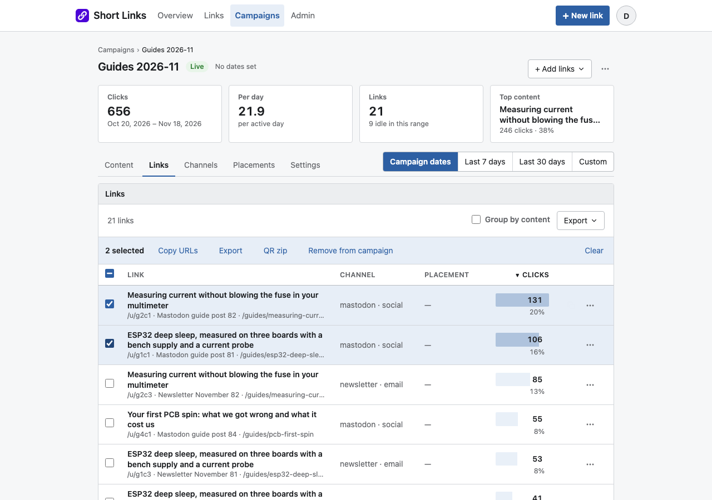
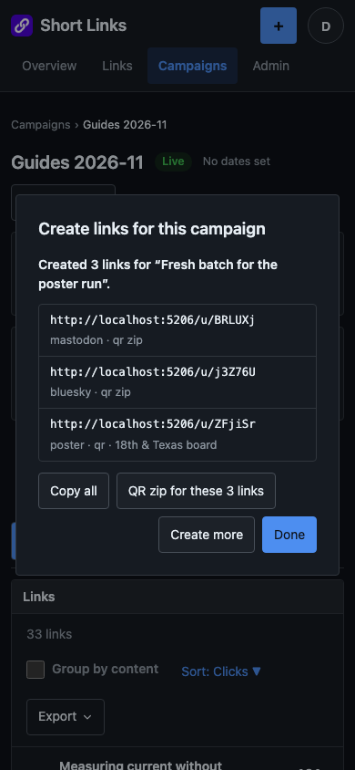

# 0191 — The QR zip after a batch create downloads every link in the campaign, not just the new ones

| | |
|---|---|
| **Status** | closed |
| **Module** | handlers / web |
| **Platform** | All |
| **Phase** | 19 — UI depth and polish |
| **First seen** | 2026-11-19 |
| **Closed** | 2026-11-18 |
| **Commit** | 858f245 |

## Description

The #0168 result screen offers "Campaign QR zip", which downloads all of the campaign's codes. After creating a batch you want the codes for that batch.

## Acceptance criteria

- `GET /api/campaigns/{slug}/qr.zip` accepts an optional `keys` filter (repeated or comma-separated, capped) and zips only those links, which must belong to the campaign. Covered by Go tests and the OpenAPI spec (drift test passes).
- The batch result screen offers "QR zip for these N links", and keeps the whole-campaign zip in the campaign Export menu. The campaign Links bulk bar gets "QR zip" for the selection.
- Checked in the running app, with screenshots in `issues/0191/`.

## Relation

- Carved out of [#0168](0168.md).

## Root cause

`QRZip` always zipped every link in the campaign and the result screen linked to it, so a batch of 3 new links produced a zip of the whole campaign.

## Fix

- `GET /api/campaigns/{slug}/qr.zip` takes an optional `keys` filter, read with the report rule from #0187 (`reports.SplitList`: a repeated param holds whole values, a single param is comma-split). More than 200 keys gives 400; a key that is not a link of this campaign gives 404. No `keys` means the whole campaign, as before. OpenAPI documents the parameter and both errors.
- `campaignQrZipUrl(slug, keys?)` builds the filtered URL.
- The batch result screen offers "QR zip for these N links" (the whole-campaign zip stays in the campaign Export menu). The campaign Links bulk bar has "QR zip" for the selection (chunks of 200).

## Verification

- `go build ./... && go vet` clean; `TEST_DATABASE_URL=<fresh shortlinks_0191> go test ./internal/handlers ./internal/reports` ok, including `TestCampaignsHandler_QRZip_KeysFilter` (comma, repeated, none, other-campaign link, unknown key, cap). `go test ./...` only fails the known `internal/config` TestLoad_DefaultsApplied.
- `cd web && npm run check` 0 errors, `npm test` 722 passed, `npm run build` ok.
- Real app (Go on :8206 with seeded Postgres, Vite on :5206, Playwright at 1280 and 390, light and dark): selecting 2 links and clicking "QR zip" requested `qr.zip?keys=g2c1&keys=g1c1`; creating a batch of 3 and clicking "QR zip for these 3 links" downloaded a zip of exactly 6 files (3 svg + 3 png). No root horizontal scroll in any of the four combinations.
- Screenshots: `0191/desktop-light-1-bulk.png`, `0191/desktop-light-2-result.png`, `0191/desktop-dark-1-bulk.png`, `0191/desktop-dark-2-result.png`, `0191/phone-light-1-bulk.png`, `0191/phone-light-2-result.png`, `0191/phone-dark-1-bulk.png`, `0191/phone-dark-2-result.png`, `0191/simulator.png` (the Simulator has no session cookie, so it shows the sign-in page only).

## Files changed

- `internal/handlers/campaigns.go` (QRZip keys filter), `internal/reports/params.go` (`SplitList`), `internal/openapi/openapi.yaml`, `internal/handlers/qr_keys_test.go`
- `web/src/lib/campaigns.ts`, `web/src/lib/campaigns.test.ts`, `web/src/lib/BatchCreateLinks.svelte`, `web/src/views/CampaignDetail.svelte`

## Review round 1

- Merged main (#0188, #0189) into the branch.
- The bulk bar "QR zip" no longer chunks: a selection of every link in the campaign downloads `qr.zip` with no keys (one download); a partial selection over 200 disables the button and shows "Select up to 200 links for a QR zip".
- `?keys=` present but empty (also `,` or blank) now returns 400; OpenAPI says so.
- Added tests for another user's key (404) and an empty `keys` param (400).
- Re-verified: handlers, reports and cmd tests pass on a fresh DB (created, migrated, dropped); `npm run check` 0 errors; `npm test` 731 passed. The over-200 button state was not exercised in the browser (the seed has 33 links), only by the code path and the Go cap test.

## Work log

| Date | Model | Input | Output | Cache read | Cache write | Cost |
|---|---|---|---|---|---|---|
| 2026-11-18 | claude-sonnet-5-5 | 122 | 32,523 | 4,669,907 | 117,749 | $1.09 |
| 2026-11-18 | claude-opus-5-5 | 52 | 12,645 | 1,484,881 | 55,470 | $0.83 |

**Total: $1.92**
